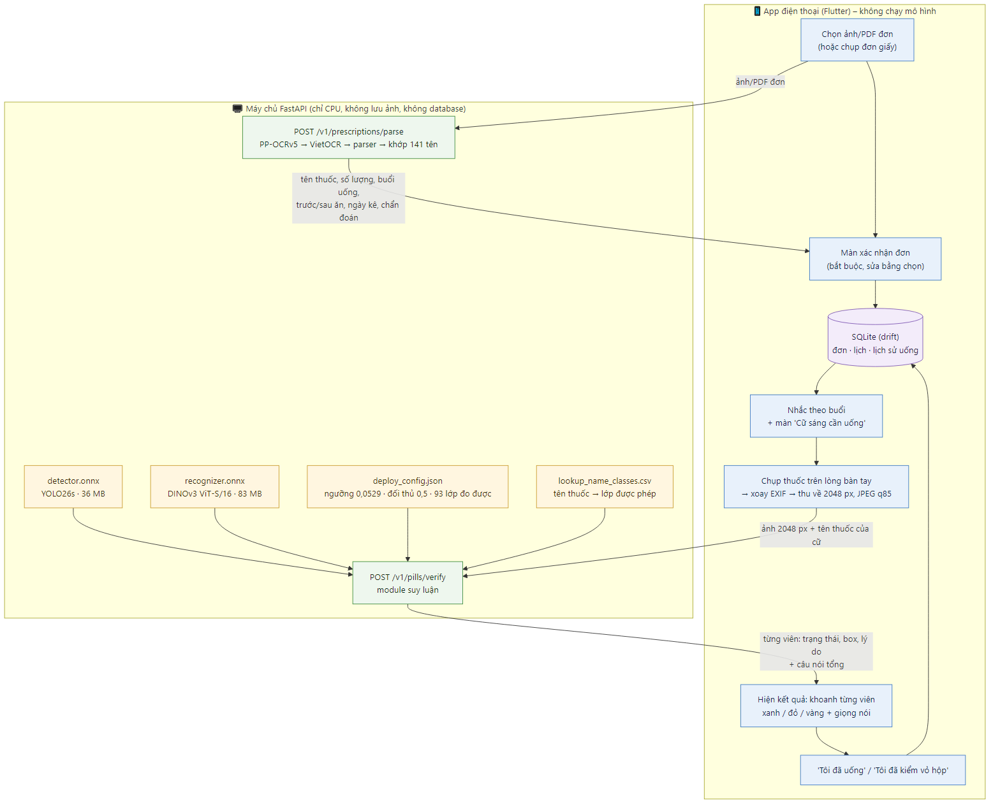
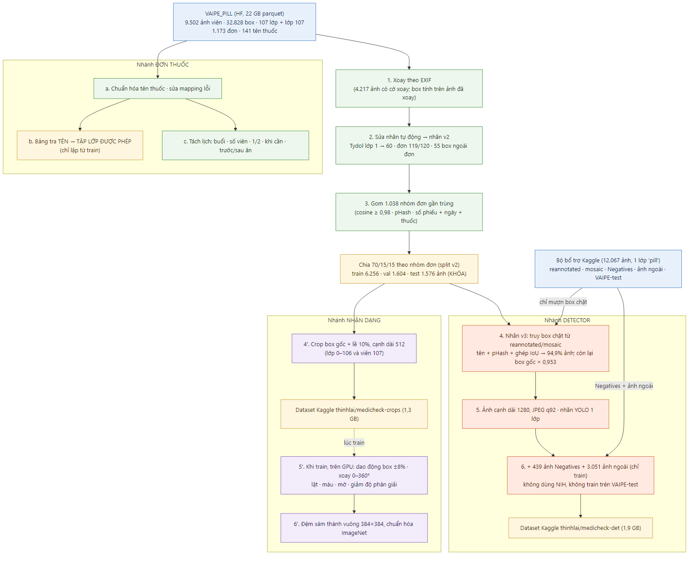
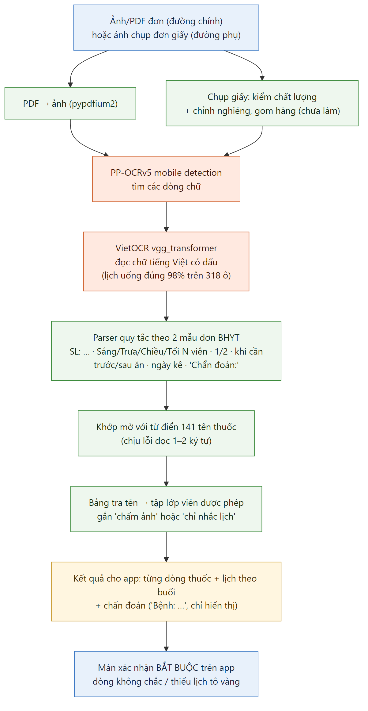
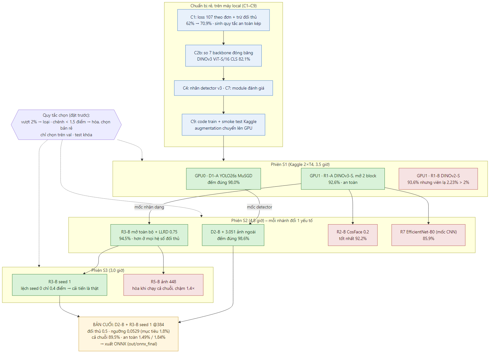
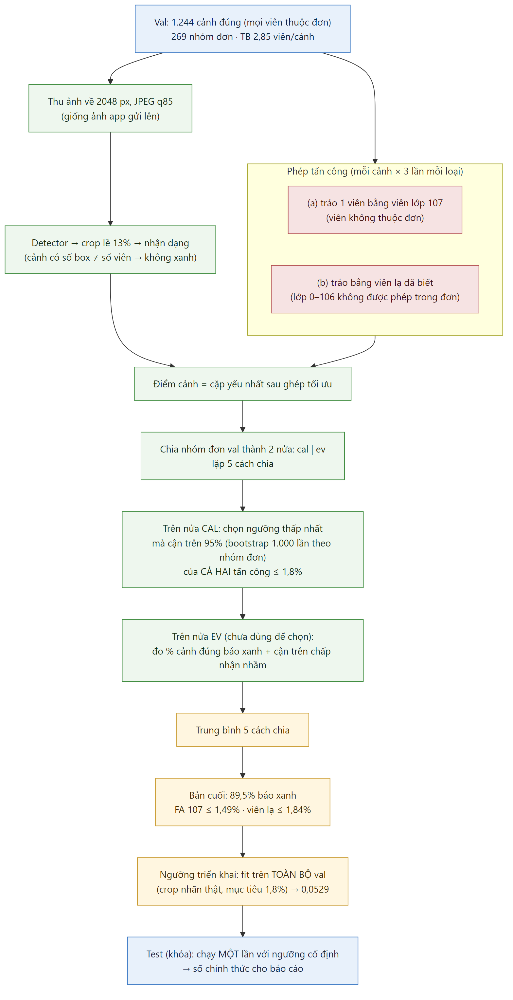
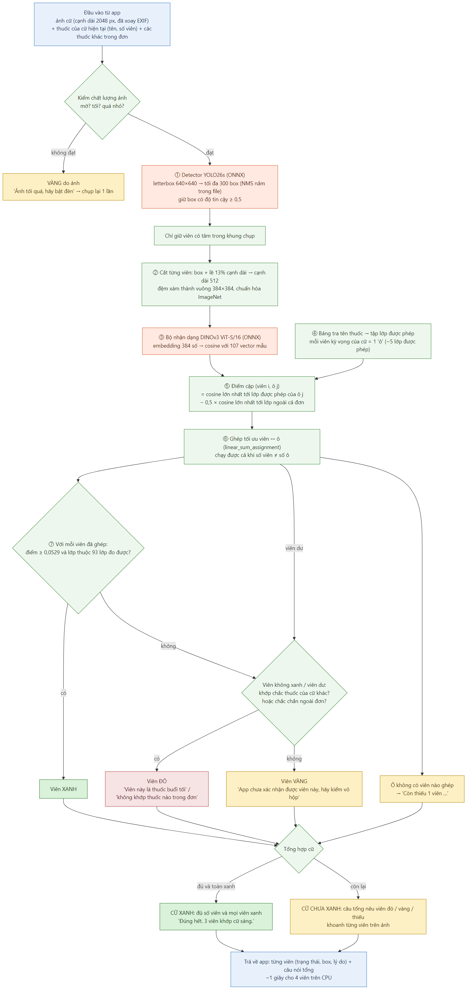

# MediCheck VN – Tổng hợp phần AI (tài liệu ôn bảo vệ)

> Mục đích: một file đủ để hiểu, giải thích và **vận dụng** toàn bộ phần AI khi bảo vệ dự án (mức 3 thang Bloom: nhớ → hiểu → vận dụng). Không đi sâu kiểu nghiên cứu.
>
> Nguồn số liệu: `MediCheck_decisions.md` (quyết định + bằng chứng), `MediCheck_AI_progress.md` (tiến độ), `vaipe_analysis.md` (dữ liệu). Khi số trong file này khác các file đó, các file đó đúng.
>
> Cập nhật: 2026-11-08, sau khi chạy test. Số **test** (chạy một lần) là số chính thức; các số khác là số val dùng để chọn mô hình.

---

## 0. Tóm tắt trong 1 phút (học thuộc đoạn này)

MediCheck giúp người cao tuổi **uống đúng thuốc theo đơn**. App có 2 luồng AI:
1. **Đơn thuốc → lịch uống:** đọc ảnh/PDF đơn bằng OCR, tách tên thuốc, số lượng, buổi uống, ngày kê và chẩn đoán ("Bệnh: …", chỉ để hiển thị); người dùng xác nhận.
2. **Kiểm viên thuốc theo cữ:** chụp các viên sắp uống, rồi:
   - **tìm từng viên** bằng YOLO26s;
   - **nhận dạng từng viên** bằng DINOv3 ViT-S/16 + đầu cosine;
   - **ghép** các viên với các thuốc của cữ đó (thuật toán gán tối ưu);
   - báo **xanh** (khớp chắc), **đỏ** (chắc chắn sai) hoặc **vàng** (chưa chắc, hãy kiểm vỏ hộp).

Nguyên tắc số 1: **báo xanh nhầm là lỗi nguy hiểm nhất.** Ngưỡng được chọn sao cho **cận trên khoảng tin cậy 95% của tỉ lệ chấp nhận nhầm ≤ 2%**, cho cả viên ngoài đơn lẫn viên lạ đã biết. Sau đó mới tối đa hóa tỉ lệ cữ đúng được báo xanh (mục tiêu ≥ 70%).

**Kết quả chính thức trên tập test (chạy một lần):** **90,2% cữ đúng được báo xanh**. Nhận nhầm ≤ 1,09% (viên ngoài đơn) và ≤ 1,31% (viên lạ), đạt chuẩn ≤ 2%. Val: 90,9%. Chạy trên CPU khoảng 0,7 giây cho 3 viên.

---

## 0.1. Trạng thái hiện tại (giải thích dễ hiểu)

**Hình dung:** đang tuyển và đào tạo một "nhân viên kiểm thuốc".

| Giai đoạn | Việc | Trạng thái |
|---|---|---|
| A. Tuyển chọn | Thử nhiều "ứng viên" (nhiều cấu hình mô hình) để tìm người giỏi nhất | ✅ Xong (phiên Kaggle S1–S3) |
| B. Chốt người | Chọn một ứng viên, khóa lại | ✅ Xong |
| C. Đóng gói | Chuyển mô hình sang file ONNX để máy chủ chạy | ✅ Xong (`out/onnx_final/`) |
| D. Viết "bản hướng dẫn công việc" | Module suy luận + máy chủ API (`backend/`): cắt ảnh, gọi mô hình, ghép với đơn, trả xanh/đỏ/vàng | ✅ Xong; kiểm trên val: 90,9% báo xanh, an toàn ≤ 2% |
| E. Thi cuối kỳ | Chạy test **một lần** để có điểm chính thức | ✅ **90,2% báo xanh, an toàn 1,09% / 1,31%** |



*Sơ đồ: `docs/diagrams/01_tong_quan_he_thong.png` (nguồn sửa được: `docs/diagrams/01_tong_quan_he_thong.mmd`).*

**Hai mô hình khác nhau, chạy nối tiếp:**
| | Detector | Bộ nhận dạng |
|---|---|---|
| Mô hình | YOLO26s | DINOv3 ViT-S/16 |
| Việc | Tìm vị trí từng viên trong ảnh (vẽ khung) | Nhìn từng viên đã cắt, cho biết giống loại thuốc nào |
| File | `detector.onnx` (36 MB) | `recognizer.onnx` (83 MB) |

Phần ghép với đơn thuốc (xanh/đỏ/vàng) không phải mô hình học. Đó là luật và thuật toán ghép tối ưu, tham số nằm trong `deploy_config.json`.

**Val và test (ví dụ kỳ thi):**
| | Giống như | Dùng để | Xem bao nhiêu lần |
|---|---|---|---|
| Train | Sách giáo khoa | Mô hình học | Mô hình học trực tiếp |
| Val | Đề thi thử | Chọn cấu hình, chọn ngưỡng | Nhiều lần |
| Test | Đề thi thật | Điểm chính thức | **Một lần**, sau khi mọi thứ đã khóa |

Mở test để chọn mô hình thì điểm test không còn đáng tin. Vì thế train xong chưa chạm test.

**Vì sao có nhiều file mô hình:**
- Mỗi lần thử trên Kaggle ra một file `.pt` (một ứng viên). Chỉ một ứng viên được chọn, các file khác là bằng chứng so sánh.
- `.pt` (PyTorch) để train và đo đạc. `.onnx` là **cùng mô hình** chuyển sang định dạng chạy nhanh trên CPU.

**Module suy luận thuộc phía AI:** các bước cắt lề 13%, ngưỡng 0,0529, ghép tối ưu là logic đã kiểm chứng khi đo. Bên khác viết lại thì dễ lệch và mất an toàn. Phân công:
- **App di động:** chỉ chụp, gửi ảnh lên máy chủ, hiển thị kết quả. Không chạy mô hình.
- **Máy chủ:** chạy ONNX trên CPU.
- **Lớp API FastAPI:** chỉ bọc module lại.

---

## 1. Bài toán thực chất là gì? Gọi tên thế nào cho đúng?

**Lĩnh vực: Thị giác máy tính (Computer Vision).** Đầu vào là ảnh (viên thuốc, đơn thuốc), đầu ra là quyết định về nội dung ảnh, kèm OCR cho đơn.

Nhưng **không phải một bài phân loại ảnh đơn thuần.** Tên đúng là **bài toán xác minh (verification) thuốc theo đơn**, ghép từ 5 bài toán con:

| Bài toán con | Tên chuyên môn | Ở MediCheck | Vì sao gọi vậy |
|---|---|---|---|
| Tìm viên trong ảnh | **Object detection**, 1 lớp | YOLO26s tìm box của mọi "viên thuốc" | Ảnh có nhiều viên, phải biết vị trí từng viên trước |
| Nhận ra viên là thuốc nào | **Fine-grained recognition** bằng **embedding + cosine** (metric learning) | DINOv3 biến crop viên thành vector 384 số, so cosine với 107 "vector mẫu" | Các lớp rất giống nhau, khác ở chữ dập, rãnh bẻ |
| Biết lúc nào **không** được kết luận | **Open-set recognition / selective classification** | Ngưỡng điểm; viên lạ → vàng/đỏ, không "đoán bừa" | Ngoài đời luôn có viên không thuộc đơn |
| Ghép nhiều viên với nhiều thuốc của cữ | **Assignment problem** | `scipy.optimize.linear_sum_assignment` | Tối ưu cho cả cữ, không từng viên |
| Đọc đơn | **OCR** + **parsing** | PP-OCRv5 tìm dòng → VietOCR đọc → luật tách trường → khớp mờ 138 tên | Chữ in tiếng Việt có dấu |

**Câu trả lời mẫu khi bị hỏi "bài toán của em là classification à?"**
> "Không chỉ là classification. Lõi là nhận dạng viên thuốc, nhưng bài toán thật là **xác minh**: app đã biết đơn kê thuốc gì, chỉ cần trả lời *viên này có đúng là thuốc của cữ này không*. Em dùng detection để tìm viên, embedding + cosine để đo độ giống, rồi **từ chối khi không chắc** (open-set), và ghép tối ưu cả cữ. Bộ phân loại đóng 107 lớp luôn trả về một tên, kể cả khi viên không thuộc danh mục, nên nguy hiểm."

**Vì sao đổi thành "xác minh theo đơn":**
- Đơn thu hẹp ứng viên: mỗi viên chỉ so với **~5 lớp** được phép thay vì 107 lớp.
- Đúng nhu cầu thật: người dùng hỏi "tôi lấy đúng thuốc chưa", không hỏi "đây là thuốc gì".
- Đo được an toàn: biết trước đáp án hợp lệ nên đo được "chấp nhận nhầm".

---

## 2. Dữ liệu có trong tay

### 2.1. Bộ chính: VAIPE_PILL (cuộc thi AI4VN 2022)

Tải từ Hugging Face `Elfsong/VAIPE_PILL`: bản sao dữ liệu cuộc thi AI4VN 2022 (VinUni), không phải bộ VAIPE đầy đủ >50k ảnh.

| Phần | Số lượng | Ghi chú |
|---|---|---|
| Ảnh viên thuốc (train) | **9.502 ảnh, 32.828 box** | Ảnh điện thoại nhiều máy; nền lòng bàn tay, bàn gỗ, giấy… |
| Lớp | **107 lớp viên (0–106) + lớp 107** | Lớp 107 = "viên **không thuộc đơn của ảnh đó**" (8.398 box, 25,6%) |
| Đơn thuốc (train) | **1.173 đơn**, 2.844 dòng thuốc, **141 tên thuốc** | Ảnh chụp màn hình PDF sạch, 2 mẫu đơn của 1 hệ thống bệnh viện |
| Liên kết | Mỗi ảnh viên thuộc đúng 1 đơn; mỗi dòng tên thuốc có nhãn lớp viên | → bảng tra **tên thuốc → tập lớp viên được phép** |
| Phần test của bộ HF | 1.500 ảnh viên, 172 đơn | **Không có nhãn** → không chấm được; ta tự tạo tập test từ phần có nhãn |

### 2.2. Bộ bổ sung: `alexanderyyy/pills-detection-dataset` (Kaggle, CC BY-NC-SA 4.0)

12.067 ảnh, **chỉ 1 lớp "pill"** (chỉ có box, không biết là thuốc gì): VAIPE-reannotated 2.462, VAIPE-mosaic 3.570, VAIPE-test 1.500, Negatives 439 (không có viên), ảnh cá nhân ~2.000, NIH ~1.045, ảnh web ~700. **Vì chỉ có 1 lớp, bộ này chỉ giúp detector.** Cách dùng: mục 4.3.

---

## 3. Các vấn đề của dữ liệu và cách xử lý

| # | Vấn đề | Giải thích dễ hiểu | Xử lý | Vì sao không làm cách khác |
|---|---|---|---|---|
| 1 | **Ảnh bị xoay theo EXIF** | Điện thoại lưu ảnh "nằm ngang" kèm cờ "hãy xoay 90°" (4.217 ảnh). Box VAIPE tính trên ảnh **đã xoay** | Luôn `ImageOps.exif_transpose` trước khi dùng box | Bỏ qua thì crop sai viên → nhãn rác |
| 2 | **Nhãn sai** | 76 viên Tydol gán nhầm lớp 1 (thật ra lớp 60, cosine 0,983); đơn 119, 120 tráo tên; 55 box ở 3 đơn không thuộc đơn | Sửa **tự động bằng luật + kiểm ảnh** (`scripts/fix_labels.py` → nhãn v2) | Ràng buộc: **không gán nhãn tay**. Lớp không xác định được (2, 37, 40, 104, đơn 401) giữ nguyên, ghi giới hạn |
| 3 | **Lớp 107 khó hiểu** | 107 là "viên không có trong đơn này"; có thể **giống hệt** một lớp đã biết của đơn khác | Không train thành một lớp. Dùng làm **mẫu âm có điều kiện theo đơn** (6.3) và **phép thử viên lạ** khi đo | Gộp thành lớp "từ chối" sẽ dạy mâu thuẫn: cùng một viên vừa là lớp X vừa là "từ chối" |
| 4 | **Box lỏng, sót viên** | Box VAIPE rộng hơn viên ~11% diện tích; có viên ở nền không được gán | **Nhãn detector v3:** truy box chặt từ VAIPE-reannotated/mosaic về đúng ảnh của ta (tên file + perceptual hash + kiểm IoU). **94,9%** ảnh truy được; 83% đạt tiêu chí | Không dùng ảnh thu nhỏ của tác giả (sẽ lẫn val/test vào train = rò rỉ). Chỉ mượn **nhãn** |
| 5 | **Đơn trùng / gần trùng** | Cùng đơn chụp nhiều lần → ảnh rất giống. Một bản ở train, một bản ở test thì điểm "đẹp giả" | Gom **1.038 nhóm đơn gần trùng** (cosine ≥ 0,98, pHash, cùng số phiếu + ngày + thuốc) → **chia theo nhóm** | Chia theo ảnh: mô hình "nhớ" vỉ thuốc |
| 6 | **14 lớp chỉ có 1 nhóm đơn** | Mọi ảnh của lớp đến từ 1 vỉ → không có đơn khác để kiểm | Để ở train; app **luôn báo vàng** ("quy tắc đo được") | Không đo được trên đơn mới thì không được báo xanh |
| 7 | **Mất cân bằng lớp** | Lớp nhiều nhất 2.599 box, ít nhất 1 box | Lấy mẫu theo **căn bậc hai tần suất** | Lấy đều tuyệt đối thì lớp hiếm bị học thuộc |
| 8 | **Màu không ổn định** | Cùng viên "AT 20" lên ảnh thành hồng, xanh nhạt, trắng, xám | Augmentation màu; app **không mô tả màu**, dùng ảnh mẫu + khoanh vị trí | Mô tả "viên màu hồng" sẽ sai, gây bối rối |
| 9 | **Tên ↔ lớp nhiều-nhiều** | Nhiều biệt dược cho cùng viên (Paracetamol 500: Panactol, Partamol, Mypara → lớp 89/91/99) | Bảng tra **tên → tập lớp được phép** (chỉ lập từ train) | Ép 1 tên ↔ 1 lớp sẽ báo sai khi nhà thuốc cấp biệt dược tương đương |
| 10 | **Đơn là PDF sạch** | Không có ảnh chụp giấy thật | Đường chính: **chọn ảnh/PDF**; chụp giấy là đường phụ + màn xác nhận bắt buộc | Không có dữ liệu để đo → không hứa hẹn |
| 11 | **12,6% đơn thiếu lịch** | Dòng "Uống:" thật sự trống | Không suy liều; khóa thuốc đó, người dùng tự nhập | Đoán liều là nguy hiểm |
| 12 | **Test của HF không có nhãn** | Không chấm được | Tự cắt test từ dữ liệu có nhãn, **khóa** đến lần đánh giá cuối | — |

---

## 4. Tập train / val / test

### 4.1. Cách chia

- **70 / 15 / 15** theo **nhóm đơn gần trùng** (không theo ảnh, không theo box). Không nhóm nào nằm ở hai phần.
- Xếp **lớp hiếm trước**: lớp ≥ 3 nhóm có mặt ở cả train, val, test; lớp 2 nhóm có 1 nhóm ở val; lớp 1 nhóm ở train.
- **Val** dùng để chọn cấu hình, hệ số, ngưỡng. **Test bị khóa**: `Bench(fold="test")` báo lỗi nếu không mở khóa có chủ đích; chỉ chạy **một lần** cuối.
- "Giữ riêng theo ảnh" (66 ảnh, 8 đơn): dùng để train detector.

### 4.2. Tổng quan tập cuối cùng

**Bộ nhận dạng** (nhãn v2, crop từ box):
| Phần | Ảnh | Đơn | Nhóm | Box lớp 0–106 | Số lớp | Box lớp 107 |
|---|---|---|---|---|---|---|
| Train | 6.256 | 585 | 503 | 17.179 | 107 | 5.128 |
| Val | 1.604 | 294 | 269 | 3.586 | 93 | 1.570 |
| Test (khóa) | 1.576 | 294 | 266 | 3.460 | 86 | 1.700 |
| Giữ riêng theo ảnh | 66 | 8 | 8 | 150 | 18 | 0 |

**Detector** (nhãn v3, cùng bộ chia):
| Phần | Ảnh | Box |
|---|---|---|
| Train | 6.322 VAIPE (gồm 66 ảnh giữ riêng) + 439 Negatives + 3.051 ảnh ngoài | 22.556 (VAIPE) |
| Val | 1.604 | 5.229 |
| Test (khóa) | 1.576 | 5.190 |

**Đánh giá cấp cảnh** (mục 10): 1.244 cảnh đúng trong val (trung bình 2,85 viên/cảnh), mỗi cảnh thử 3 lần tráo viên 107 và 3 lần tráo viên lạ đã biết.

### 4.3. Kết hợp bộ bổ sung vào bộ gốc như thế nào

Không trộn ảnh hai bộ. Mỗi phần có một cách dùng riêng:

| Phần của bộ bổ sung | Dùng thế nào | Vì sao |
|---|---|---|
| VAIPE-reannotated + mosaic | **Chỉ mượn box chặt**, truy về ảnh của ta (nhãn v3) | Là ảnh VAIPE của chính ta đã thu nhỏ; dùng thẳng sẽ rò rỉ val/test |
| Negatives | **Train detector** | Dạy detector không báo viên ở nền trống |
| Ảnh cá nhân, pills-2602, pills-search, Various, Ultralytics-medical-pills (3.051 ảnh) | **Train detector** (thắng A/B D2: đếm đúng 98,0 → 98,6%) | Ảnh đời thực đa dạng → detector bền hơn khi người dùng chụp thật |
| VAIPE-test (1.500 ảnh có box) | **Kiểm detector độc lập** (tham khảo) + demo | Khác đợt với train; box do bên thứ ba gán |
| NIH (ảnh studio ghép lưới) | **Không dùng** | Khác hẳn ảnh điện thoại |

Không dùng bộ nào cho **bộ nhận dạng**: chúng không có tên thuốc, và dự án cấm bộ định danh thuốc nước ngoài.

---

## 5. Pipeline tiền xử lý dữ liệu

```
ẢNH VIÊN THUỐC                                   ĐƠN THUỐC
 parquet HF (22 GB)                               ảnh đơn + chữ đã gán + mapping tên→lớp
   │ 1. xoay theo EXIF                              │ a. chuẩn hóa tên
   │ 2. sửa nhãn v2 (luật tự động)                  │ b. sửa mapping lỗi (đơn 119/120, 708)
   │ 3. gom nhóm đơn gần trùng → chia v2            │ c. bảng tra TÊN → TẬP LỚP ĐƯỢC PHÉP (chỉ từ train)
   ├──► nhánh DETECTOR                              │ d. tách lịch: buổi, số viên, 1/2, khi cần, trước/sau ăn
   │     4. nhãn box v3 (box chặt truy lại)         ▼
   │     5. ảnh cạnh dài 1280, JPEG q92          mỗi viên biết tập lớp được phép
   │     6. nhãn YOLO + Negatives + ảnh ngoài     của dòng thuốc nó thuộc về
   └──► nhánh NHẬN DẠNG
         4'. crop box gốc + lề 10%, cạnh dài 512
         5'. khi train (trên GPU): dao động box, xoay 360°, lật, màu, mờ, giảm độ phân giải
         6'. đệm xám thành ảnh vuông 384×384, chuẩn hóa ImageNet
```



*Sơ đồ: `docs/diagrams/03_tien_xu_ly_du_lieu.png` (nguồn sửa được: `docs/diagrams/03_tien_xu_ly_du_lieu.mmd`).*

| Bước | Ý nghĩa | Tại sao |
|---|---|---|
| 1. Xoay EXIF | Ảnh và box cùng hệ tọa độ | Box VAIPE tính trên ảnh đã xoay |
| 2. Nhãn v2 | Bỏ nhãn sai rõ ràng | Nhãn sai dạy sai và đo sai |
| 3. Nhóm đơn + chia | Tập đánh giá là **đơn mới thật sự** | Tránh điểm đẹp giả |
| 4. Nhãn v3 | Box ôm sát viên, bổ sung viên bị sót | Crop chuẩn hơn, ít viên "vô hình" |
| 5. Cạnh dài 1280 | Ảnh gốc 4000 px quá nặng; YOLO train ở 640 | Dataset 1,9 GB thay vì 22 GB |
| 4'. Crop 512 + lề 10% | Mỗi viên một ảnh, giữ chữ dập nhỏ | Thử nghiệm C2: crop 512 tốt hơn 256 |
| 5'. Augmentation | Mô phỏng điều kiện chụp khác nhau và box detector lệch box gốc | Khi suy luận dùng lề 13% trên box chặt để khung tương đương |
| 6'. Đệm xám thành vuông | Không méo hình viên | Kéo giãn làm viên tròn thành bầu dục |

**Đơn thuốc:** OCR → parser tách trường (tên, số lượng, buổi, trước/sau ăn, ngày kê, **chẩn đoán**) → khớp mờ 138 tên → bảng tra → **tập lớp viên được phép** mỗi dòng → lịch theo buổi. Màn xác nhận **bắt buộc**, vì lỗi OCR có thể thành lỗi uống thuốc.

---

## 6. Thuật toán và mô hình

### 6.1. Detector: YOLO26s (Ultralytics)

- **Là gì:**
  - Detector một giai đoạn: một lần chạy mạng cho ra mọi box kèm độ tin cậy.
  - Bản "s" có 10 triệu tham số, ảnh vào 640 px, pretrained COCO.
  - YOLO26 có **2 nhánh đầu ra train cùng lúc**: nhánh cần NMS (lọc box trùng) và nhánh end-to-end. Ta đo cả hai rồi chọn **nhánh NMS**, vì nhánh này đếm đúng hơn ~4 điểm.
- **Vì sao chọn:**
  - Nhanh trên CPU. Theo Ultralytics: 48,6 mAP, 87 ms, hơn YOLO11s.
  - Chỉ 1 lớp, vật thể đơn giản → bản nhỏ là đủ; two-stage hay transformer chậm hơn mà không cần thiết.
  - Thư viện đủ train, đánh giá, xuất ONNX.
- **Cấu hình cuối:**
  - 100 epoch, dừng sớm sau 20 epoch không cải thiện, batch 32.
  - **MuSGD lr0 0,01** đặt tường minh: chế độ `auto` sẽ đổi optimizer khi số ảnh đổi.
  - Train trên VAIPE nhãn v3 + Negatives + 3.051 ảnh ngoài.
  - Ngưỡng tin cậy 0,5.
- **Giấy phép:** AGPL-3.0. Hợp đồ án; phát hành dịch vụ ra ngoài phải công bố mã backend.

### 6.2. Bộ nhận dạng: DINOv3 ViT-S/16 + đầu cosine

- **DINOv3 là gì:**
  - Vision Transformer của Meta (2025), học **tự giám sát** trên ~1,7 tỷ ảnh không nhãn.
  - Ảnh 384×384 được cắt thành lưới 24×24 mảnh 16×16 px. Mỗi mảnh "nhìn" mọi mảnh khác, rồi cả ảnh được tóm vào **token CLS** (vector 384 số).
  - Bản S có ~21 triệu tham số.
- **Vì sao hợp:**
  - Học đặc trưng chi tiết (hình dạng, chữ dập, rãnh) không cần nhãn, hợp với dữ liệu ít (trung vị ~100 box/lớp).
  - Ngay khi **đóng băng** đã đạt 93,2% đúng trong ứng viên.
  - Độ trễ CPU bằng DINOv2-S.
- **Bằng chứng so sánh** (C2b, backbone đóng băng, cùng giao thức):

| Backbone | Top-1 trong ứng viên | Báo xanh | CPU, 3 crop |
|---|---|---|---|
| DINOv2 ViT-S/14 (dự định ban đầu) | 91,7% | 72,7% | 509 ms |
| DINOv2 ViT-B/14 | 92,0% | 77,9% | 1.438 ms |
| **DINOv3 ViT-S/16, token CLS** | **93,2%** | **82,1%** | **521 ms** |
| DINOv3 ViT-B/16 | 93,1% | 80,7% | 1.570 ms |
| DINOv3 ConvNeXt-T (CNN) | 92,1% | 73,6% | 508 ms |

  Mức thấp nhất của DINOv3-S (81,3%) vẫn cao hơn mức cao nhất của DINOv2-S (74,4%), nên không phải nhiễu. Bản ViT-B chậm gấp 3 lần mà không tốt hơn. Sau fine-tune, DINOv2-S trượt chuẩn an toàn với viên lạ (2,23%) nên bị loại (mục 8.2).
- **Vì sao không dùng CNN phân loại thường:** phải train từ nhãn với ít dữ liệu, dễ học thuộc nền. Softmax luôn chọn một lớp và cho xác suất cao giả với viên lạ. EfficientNet-B0 đã được train cùng giao thức làm **baseline**: 85,9% báo xanh, kém DINOv3 6,6 điểm.
- **Phát hiện kỹ thuật cần nhớ:**
  - timm mặc định lấy **trung bình các patch** cho DINOv3, cho 67,8% báo xanh.
  - Với DINOv2, timm lại lấy **token CLS**.
  - Đổi DINOv3 sang token CLS (`global_pool="token"`) thì đạt 82,1%. So sánh phải công bằng về cách lấy vector.
- **Đầu cosine:**
  - Mỗi lớp có một vector mẫu W_c. Điểm = cos(embedding, W_c) nhân hệ số s (~25).
  - **Vì sao cosine thay vì softmax tuyến tính:** điểm cosine có ý nghĩa tuyệt đối (giống bao nhiêu), nên đặt được ngưỡng từ chối. Vaze et al. (ICLR 2022): bộ phân loại đóng tốt + điểm logit lớn nhất là baseline open-set rất mạnh.
  - **Vì sao không kNN:** C1 đo kNN chỉ 30–48% báo xanh, đầu cosine 62–71%.
- **Giấy phép:** DINOv3 License (Meta): cho dùng, fine-tune, phân phối kèm giấy phép, không hạn chế y tế. Không phải mã nguồn mở OSI → ghi giới hạn.

### 6.3. Loss 107 có điều kiện theo đơn

**Vấn đề:**
- Viên 107 trong ảnh của đơn P là viên **không thuộc đơn P**, nhưng nó có thể là thuốc X đã biết (X thuộc đơn khác).
- Nếu phạt nó "không được giống lớp nào", mô hình bị dạy mâu thuẫn với chính lớp X.

**Cách làm:**
- Viên 107 ở đơn P chỉ bị phạt nếu nó giống **các lớp thật của đơn P**: nó phải thua một "điểm nền" học được.
- *Ví dụ:* đơn P có Amlodipine và Metformin, ảnh có một viên Paracetamol (nhãn 107). Loss bắt viên đó **không** giống Amlodipine/Metformin, nhưng không cấm nó giống Paracetamol.

**Hiệu quả (C1):** báo xanh tăng ~6 điểm ở cùng mức an toàn, **nhưng** chỉ an toàn khi đi kèm điểm trừ đối thủ (6.4). Chỉ dùng loss này thì viên lạ đã biết lọt tới 3,6%.

### 6.4. Điểm cảnh có trừ đối thủ + ghép tối ưu

1. **Điểm từng cặp (viên i, dòng thuốc j)** = cosine lớn nhất tới các lớp được phép của j **− 0,5 ×** cosine lớn nhất tới các lớp ngoài cả đơn.
   *Ví dụ:* viên giống lớp được phép 0,90, nhưng cũng giống một lớp ngoài đơn 0,80 → điểm = 0,90 − 0,5 × 0,80 = **0,50**. Viên "giống cả thuốc khác" bị hạ điểm nên khó báo xanh nhầm.
2. **Ghép tối ưu** viên ↔ dòng thuốc bằng `linear_sum_assignment` (SciPy, Jonker–Volgenant cải tiến; Hungarian là thuật toán kinh điển cùng bài).
   *Ví dụ vì sao không ghép tham lam:* ma trận điểm [[0,90; 0,80], [0,85; 0,30]].
   - Tham lam: viên 1 → dòng 1 (0,90), còn viên 2 → dòng 2 (0,30). Cữ bị vàng oan.
   - Tối ưu: viên 1 → dòng 2 (0,80), viên 2 → dòng 1 (0,85). Cặp yếu nhất là 0,80.
   - Ví dụ này có trong kiểm thử `tests/test_eval.py`.
3. **Điểm cảnh = cặp yếu nhất.** Cữ chỉ xanh khi **mọi viên** đều chắc và số viên đúng bằng số kỳ vọng.
4. **Ngưỡng** chọn theo quy tắc an toàn kép (mục 10), mục tiêu cận trên 1,8%.
5. **Hệ số đối thủ chọn bằng đo đạc:**
   - Khi backbone đóng băng, 0,25 tốt nhất; 0,5 vượt 2%.
   - Sau fine-tune, mô hình tách lớp tốt hơn nên **0,5 tốt hơn 0,25 khoảng 2–3 điểm** mà vẫn an toàn; 0,75 vượt 2%.

### 6.5. OCR đơn thuốc

PP-OCRv5 mobile (tìm dòng chữ) → **VietOCR `vgg_transformer`** (đọc chữ có dấu) → parser luật → khớp mờ 138 tên. Không train lại.



*Sơ đồ: `docs/diagrams/06_ocr_don_thuoc.png` (nguồn sửa được: `docs/diagrams/06_ocr_don_thuoc.mmd`).*

- **Kết quả test (một lần):** 99,85% dòng thuốc đúng hoàn toàn trên ảnh gốc, 98,93% trên ảnh mô phỏng chụp giấy; khoảng 5 giây/đơn trên CPU. Chưa đo trên ảnh chụp giấy thật (`MediCheck_decisions.md` mục 15).
- **Vì sao VietOCR:** trên 318 ô chữ, đọc đúng lịch uống 98%, so với 40% của PP-OCRv5 recognition (bản này mất dấu "Chiều").
- **Toàn chuỗi:** PDF sạch đúng **49/49 dòng thuốc**; ảnh làm nhiễu mạnh chỉ 10/49. Vì vậy đường chính là chọn ảnh/PDF, và màn xác nhận là bắt buộc.

---

## 7. Hướng đi và quyết định về thuốc và đơn thuốc

| Quyết định | Nội dung | Vì sao |
|---|---|---|
| Kiểm **đúng tên trên đơn** | Viên đúng nếu thuộc tập lớp được phép của **tên in trên đơn** | Dữ liệu có sẵn tên → lớp; kiểm hoạt chất cần dữ liệu dược không có |
| Kiểm **theo cữ** | Chỉ so với thuốc của buổi đang uống; viên của buổi khác → đỏ "Viên này là thuốc buổi tối" | Lỗi hay gặp nhất là nhầm buổi |
| 3 trạng thái | **Xanh:** khớp chắc, đúng số lượng. **Đỏ:** chắc chắn sai cữ hoặc ngoài đơn. **Vàng:** còn lại; do ảnh thì chụp lại 1 lần, do thuốc thì "hãy kiểm vỏ hộp" kèm nút "Tôi đã kiểm vỏ hộp" | Không ép kết luận khi không chắc; vàng là an toàn |
| Lớp 1 nhóm luôn vàng | 14 lớp "quy tắc đo được" | Không đo được trên đơn mới |
| Không kiểm hàm lượng | Lớp 37 gộp 30 mg và 60 mg trông giống nhau | Ảnh không phân biệt được; ghi giới hạn |
| Liều 1/2, khi cần | 1/2: nhắc nhưng không chấm ảnh; khi cần: chỉ hiển thị | Không có dữ liệu viên bẻ đôi |
| Đơn thiếu lịch | Không suy liều, khóa thuốc đó | An toàn |
| Trước/sau ăn | Đọc nguyên văn, không đổi giờ | Không tự diễn giải y lệnh |
| Không mô tả màu | Ảnh mẫu ("ảnh minh họa") + khoanh vị trí | Màu thay đổi theo đèn và máy |
| Hiển thị chẩn đoán | App hiện "Bệnh: …"; **không** dùng cho quyết định AI; chỉ lưu trên điện thoại | Có trên mọi đơn VAIPE; giúp biết thuốc chữa bệnh gì; đọc sai bệnh không ảnh hưởng an toàn |
| Ảnh gửi lên 2048 px | App thu ảnh về cạnh dài 2048 px, JPEG q85 (~290 KB) | Đo: 1280 px mất 3 điểm báo xanh (crop mờ); 2048 px chỉ kém ảnh gốc 0,7 điểm mà nhẹ hơn 10 lần |
| Danh mục đóng | Chỉ 138 tên VAIPE (lập từ train); thuốc ngoài danh mục chỉ nhắc lịch | Không có dữ liệu thuốc khác |

---

## 8. Thử nghiệm: từ chuẩn bị đến bản cuối

**Cách làm: A/B có kiểm soát, không phải "thử bừa rồi chọn".**
- Mỗi lần chỉ đổi **một yếu tố** so với cùng một mốc, chấm trên val bằng quy tắc định trước:
  - vượt chuẩn an toàn thì loại;
  - chênh < 1,5 điểm là hòa → chọn bản rẻ hơn.
- Nhánh thắng thành mốc cho bước sau.
- Bản cuối là mô hình của cấu hình tốt nhất. Train lại cùng cấu hình chỉ ra một mô hình gần như y hệt, nên không cần một lần "train final" riêng.
- **Không train lại trên train + val**, vì val còn dùng để đặt ngưỡng an toàn.



*Sơ đồ: `docs/diagrams/04_train_va_chon_mo_hinh.png` (nguồn sửa được: `docs/diagrams/04_train_va_chon_mo_hinh.mmd`).*

### 8.1. Thử nghiệm rẻ trước khi train thật (C1–C9)

Mục đích: quota GPU có hạn, phải bắt lỗi đường ống trước, và cần bằng chứng cho từng quyết định.

| Task | Đã làm | Phát hiện quan trọng |
|---|---|---|
| C1 | Thử cách chấm điểm trên embedding đóng băng | Loss 107 + trừ đối thủ: 62% → **70,9%**. Chỉ dùng loss 107 thì **viên lạ lọt 3,6%** → sinh ra **quy tắc an toàn kép** |
| C2 | Độ phân giải, TTA | Crop 512 tốt hơn 256. TTA +1–3 điểm nhưng chậm 8 lần → không bật |
| C2b | So 7 backbone | **DINOv3 ViT-S/16 CLS: 82,1%** (DINOv2-S 72,7%); phát hiện lỗi so sánh không công bằng (avg pooling vs CLS) |
| C3 | Đọc mã nguồn Ultralytics, chạy thử YOLO26 | Hai nhánh train cùng lúc; `auto` optimizer sát ngưỡng đổi → đặt tường minh MuSGD |
| C4 | Truy box chặt từ bộ bổ sung | Bộ bổ sung phủ **94,9%** ảnh VAIPE (trước tưởng 26%) → nhãn detector v3 |
| C5, C6 | Xuất và đóng gói dữ liệu lên Kaggle | `medicheck-det` (1,9 GB), `medicheck-crops` (1,3 GB) |
| C7 | Module đánh giá + 7 kiểm thử | Quy tắc "recall ≥ 80%" cũ làm báo xanh rơi 82% → 50% mà không thêm an toàn → đổi sang **quy tắc đo được**; dùng 5 cách chia |
| C9 | Code train chính thức + smoke test Kaggle | Bắt 3 lỗi trước khi lên Kaggle (RNG khi resume, đường dẫn có dấu, tràn bộ nhớ khi predict); epoch 0 tái lập đúng số C2b; **phát hiện nghẽn CPU** → chuyển augmentation lên GPU (nhanh gấp ~3 lần) |

### 8.2. Ba phiên train trên Kaggle (S1–S3, mỗi phiên 2 GPU chạy song song)

| Phiên | Thử nghiệm (đổi 1 yếu tố) | Kết quả | Kết luận |
|---|---|---|---|
| S1 (3,5 giờ) | Detector YOLO26s | Đếm đúng **98,0%**, mAP50 99,4%; VAIPE-test (người khác gán nhãn) 97,8% | Detector rất tốt, không chỉ "thuộc bài" |
| S1 | DINOv3-S vs DINOv2-S (fine-tune 2 block cuối) | DINOv3 **92,6%** báo xanh, an toàn; DINOv2 93,6% nhưng nhận nhầm viên lạ **2,23%** | **Chọn DINOv3**: DINOv2 vượt chuẩn → loại, dù báo xanh cao hơn |
| S2 (4,8 giờ) | Detector + 3.051 ảnh ngoài | Đếm đúng **98,6%**, ít box thừa hơn | **Chọn**: bền hơn với nền/ánh sáng thật |
| S2 | Mở toàn bộ backbone + LLRD 0,75 | **94,5%** (S1: 92,6%), an toàn | **Chọn**: hơn ở **mọi** hệ số đối thủ |
| S2 | CosFace margin 0,2 | Top-1 cao nhất 96,2% nhưng báo xanh tốt nhất 92,2% | **Bỏ**: margin làm điểm lớp đúng và đối thủ dồn sát nhau |
| S2 | EfficientNet-B0 (mốc CNN) | 85,9% | Bằng chứng cho backbone tự giám sát |
| S3 (3,0 giờ) | Train lại cấu hình thắng với seed 1 | 93,6% (seed 0: 93,2%) | Độ nhiễu giữa 2 lần train: 0,4 điểm (crop), ~1 điểm (cả pipeline) |
| S3 | Ảnh vào 448 | Crop 94,5% nhưng cả pipeline 89,2% (hòa với 384) | Không dùng: chậm hơn 1,4 lần |
| local | Ghép 2–3 mô hình | 88,9–89,4% cả pipeline | Không dùng: không hơn, chậm gấp 2–3 lần |

*Vận dụng:*
- **LLRD** (giảm lr theo tầng, mỗi tầng thấp hơn × 0,75) cho phép mở hết backbone mà không phá đặc trưng tốt. Tầng thấp (cạnh, màu) gần như giữ nguyên, tầng cao (hình dạng, chữ dập) học nhiều.
- **Một cải tiến chỉ "thật" khi lớn hơn độ nhiễu.** Đo độ nhiễu bằng cách train lại cùng cấu hình với seed khác. Khi mọi hướng còn lại chỉ hứa hẹn ≤ 1 điểm, dừng dù còn ~17 giờ quota.

**Không chạy (có lý do):**
- AdamW cho detector và YOLO26m: detector đã chạm trần, YOLO26m chậm 2–3 lần.
- Bỏ loss 107: đây là thành phần an toàn, không tốn gì khi chạy.
- DINOv3 ViT-B: chậm 3 lần mà đóng băng không hơn.
- Ảnh 512, train lâu hơn: nằm trong mức nhiễu.

---

## 9. Pipeline train, đánh giá và chạy thật

### 9.1. Train detector (`medicheck_ai/detector.py`)
1. Lập `data.yaml`: VAIPE train (nhãn v3) + Negatives + ảnh ngoài. Val = VAIPE val.
2. Train YOLO26s từ trọng số COCO. Ultralytics tự augmentation (mosaic, xoay, màu, co giãn).
3. Đánh giá **cả hai nhánh** (NMS, end-to-end) trên val:
   - mAP50, mAP50-95, recall;
   - **tỉ lệ ảnh đếm đúng số viên** ở 7 ngưỡng tin cậy.
   Chọn nhánh NMS, ngưỡng 0,5.
4. Ý nghĩa: detector sai số viên thì cả cữ phải vàng. Chỉ số quan trọng nhất là **đếm đúng** và **không sót viên**.

### 9.2. Train bộ nhận dạng (`medicheck_ai/recognizer.py`)
1. **Giai đoạn 1 (đóng băng):**
   - Tính embedding DINOv3 của mọi crop train.
   - Vector mẫu mỗi lớp khởi tạo bằng trung bình embedding của lớp.
   - Train đầu cosine + loss 107. Kết quả là điểm xuất phát đã biết tốt (≈ số C2b).
2. **Giai đoạn 2 (fine-tune):**
   - **Mở toàn bộ** block Transformer với LLRD 0,75; 20 epoch; AdamW; warm-up rồi giảm lr theo cosine; fp16.
   - Lấy mẫu căn bậc hai tần suất; 20% mỗi batch là viên 107.
   - Augmentation **chạy trên GPU**, vì Kaggle chỉ có 4 CPU.
3. Checkpoint mỗi epoch; Kaggle ngắt giữa chừng thì chạy tiếp được.
4. **Dùng checkpoint cuối**, không chọn epoch đẹp nhất trên val. Chọn epoch trên val rồi báo số trên chính val là "chấm bài bằng đáp án đã nhìn".
5. Đánh giá cuối: 5 cách chia; hệ số đối thủ 0 / 0,25 / 0,5 / 0,75; có/không quy tắc đo được; có/không TTA.

### 9.3. Đánh giá cả chuỗi (`medicheck_ai/e2e.py`)
1. Detector chạy trên ảnh val (thu về 2048 px như app gửi). Crop box + lề 13%, cạnh dài 512.
2. Bộ nhận dạng chấm điểm, rồi ghép và áp ngưỡng.
3. Cảnh có số box khác số viên → không xanh.
4. Chọn ngưỡng trên nửa nhóm đơn (cal), đo trên nửa còn lại (ev), lặp 5 lần. **Không bao giờ fit và đo trên cùng dữ liệu.** Một lần đã mắc lỗi này và được sửa: fit và đo trên cùng toàn bộ val thì cận trên ≤ 2% đúng theo cách tính, không chứng minh được gì.
5. **Mục tiêu fit 1,8%, không phải 2%:**
   - Ở mục tiêu 2%, viên lạ chạm đúng 2,00% khi chạy cả chuỗi, vì crop của detector làm viên lạ lọt nhiều hơn crop nhãn thật ~0,1 điểm.
   - Dư 0,2 điểm để chắc chắn ≤ 2%. Đổi lại mất 1,4 điểm báo xanh.



*Sơ đồ: `docs/diagrams/05_danh_gia_ca_chuoi.png` (nguồn sửa được: `docs/diagrams/05_danh_gia_ca_chuoi.mmd`).*

### 9.4. Việc còn lại
1. ✅ **Module suy luận** (`backend/medicheck_server/infer.py`) + server FastAPI. Trên val qua module: 91,1% (cal/ev), 90,9% ở ngưỡng cố định; an toàn 1,19% / 1,79%. Báo đỏ: "thuốc cữ khác" bắt 95% viên nhầm cữ; "không thuộc đơn" ngưỡng 0,30 để chỉ 0,31% viên đúng bị báo đỏ oan.
2. **Cổng 22/11:** kiểm cấu hình triển khai, đo độ trễ trên laptop demo.
3. ✅ **Test một lần** (08/11, đăng ký trước con số chính thức): 90,2% báo xanh, cận trên 1,09% / 1,31%, detector đếm đúng 98,5%. Không chỉnh gì sau khi xem.

### 9.5. Pipeline khi app chạy
```
app: chụp → xoay EXIF → thu về 2048 px, JPEG q85 → gửi POST /v1/pills/verify (kèm tên thuốc của cữ)
máy chủ (CPU): kiểm chất lượng ảnh → YOLO26s ONNX → chỉ giữ viên có tâm trong khung chụp
 → crop box + lề 13% → DINOv3 + đầu cosine ONNX → cosine viên × 107 lớp
 → điểm trừ đối thủ với tập lớp được phép của cữ (bảng tra tên → lớp)
 → ghép tối ưu → so ngưỡng 0,0529 → xanh / đỏ / vàng từng viên
app: câu nói tổng + giọng nói + khoanh trên ảnh
```


*Sơ đồ: `docs/diagrams/02_suy_luan_kiem_thuoc.png` (nguồn sửa được: `docs/diagrams/02_suy_luan_kiem_thuoc.mmd`).*

Đo được trên CPU: detector ~140 ms/ảnh, nhận dạng ~190 ms/viên → ~1 giây cho 4 viên, cộng ~0,5 giây tải ảnh. Mục tiêu ≤ 3 giây.

---

## 10. Quy trình đánh giá và vì sao chọn cách này

### 10.1. Chỉ số theo từng tầng
| Tầng | Chỉ số | Ý nghĩa | Bản cuối (val) |
|---|---|---|---|
| Detector | mAP50, recall (IoU ≥ 0,5), **tỉ lệ ảnh đếm đúng số viên** | Sót hay thừa một viên là cả cữ sai | 99,4% / 99,45% / **98,7%** |
| Nhận dạng | **Top-1 trong ứng viên** (gần nghĩa "accuracy" nhất) | Trong các lớp được phép, lớp điểm cao nhất có đúng không | **95,8%** |
| **Hệ thống (chính)** | **Tỉ lệ cảnh đúng được báo xanh**, khi **cận trên chấp nhận nhầm ≤ 2%** cho cả 2 phép tấn công | Đúng thứ người dùng trải nghiệm: an toàn trước, tiện lợi sau | **89,5%** (1,49% / 1,84%) |

### 10.2. Cách đo an toàn (vận dụng được từng bước)
1. **Cảnh** = một ảnh cữ thuốc mà mọi viên đều thuộc đơn (1.244 cảnh ở val).
2. **Tấn công:** tráo 1 viên bằng:
   - (a) một viên lớp 107;
   - (b) một viên lớp đã biết nhưng không được phép trong đơn ("viên lạ đã biết").
   Mỗi cảnh thử 3 lần mỗi loại.
3. **Chấp nhận nhầm (FA)** = tỉ lệ cảnh bị tráo mà vẫn được báo xanh.
4. **Bootstrap theo nhóm đơn:** lấy mẫu lại các nhóm đơn 1.000 lần, lấy mức 97,5% làm **cận trên**. Lấy theo nhóm vì các cảnh cùng đơn giống nhau, không độc lập.
5. **Chọn ngưỡng** = ngưỡng thấp nhất (báo xanh nhiều nhất) mà cận trên của **cả hai** loại tấn công ≤ mục tiêu (1,8%).
6. **Chia cal/ev:** chọn ngưỡng trên nửa nhóm val, đo trên nửa còn lại, lặp 5 cách chia rồi lấy trung bình → số báo cáo là số trên dữ liệu **không dùng để chọn ngưỡng**.

### 10.3. Vì sao không dùng accuracy / F1 / ROC-AUC làm chỉ số chính
- **Accuracy/F1 theo viên** không cho biết app có an toàn không. Mô hình đúng 95% từng viên vẫn có thể báo xanh nhầm nhiều nếu ngưỡng sai.
- **ROC-AUC** đo trung bình trên mọi ngưỡng, nhưng app chạy ở **một ngưỡng**.
- **Cận trên thay vì trung bình:** val nhỏ, trung bình có thể "may mắn"; cận trên ≤ 2% nghĩa là kể cả trường hợp xấu hợp lý, lỗi vẫn ≤ 2%.
- **Đo cả viên lạ đã biết:** chỉ đo viên 107 thì mô hình "né" đúng 107 mà lọt viên lạ khác (C1: 3,6%).
- **Theo cảnh thay vì theo viên:** người dùng nhận một kết quả cho cả cữ, và cữ chỉ xanh khi mọi viên đều đúng. Vì vậy 89,5% (cả cữ) thấp hơn 95,8% (từng viên).

### 10.4. Bậc mục tiêu
| Cảnh đúng được báo xanh | Hành động |
|---|---|
| ≥ 70% | Đạt mục tiêu (test 90,2%) |
| 50–70% | Vẫn báo xanh, nhiều vàng hơn, ghi rõ trong báo cáo |
| < 50% | Bỏ báo xanh tự động, chỉ nhắc lịch |

---

## 11. Kết quả và file xuất ra

### 11.1. Kết quả theo từng bước cải tiến (val; dòng cuối là test chính thức)
| Cấu hình | Báo xanh | Cận trên FA 107 | Cận trên viên lạ |
|---|---|---|---|
| DINOv2-S đóng băng, đầu cosine (baseline) | 62,1% | 2,13% | 0,89% |
| + loss 107 theo đơn + trừ đối thủ (C1) | 70,9% | 1,46% | 1,69% |
| DINOv3-S CLS đóng băng (C2b/C7) | 82,2% | 1,81% | 1,71% |
| DINOv3-S fine-tune 2 block cuối (S1) | 92,6% | 1,73% | 1,80% |
| DINOv2-S fine-tune (S1) – **loại** | 93,6% | 1,37% | **2,23%** |
| EfficientNet-B0 fine-tune (S2, mốc CNN) | 85,9% | 1,68% | 1,87% |
| DINOv3-S mở toàn bộ + LLRD (S2 seed 0 / S3 seed 1) | 94,5% / 94,4% | 1,64% / 1,60% | 1,92% / 1,83% |
| **BẢN CUỐI, cả chuỗi: D2-B + R3-B seed 1, ảnh 2048 px, cal/ev, mục tiêu 1,8%** | **89,5%** | **1,49%** | **1,84%** |
| Qua module suy luận (ONNX, máy chủ thật), val, ngưỡng cố định | 90,9% | 1,19% | 1,79% |
| **TEST (chạy 1 lần, số chính thức)** | **90,2%** | **1,09%** | **1,31%** |

Các dòng trên đo trên crop nhãn thật (không có detector), đối thủ 0,5, mục tiêu 2,0, trừ dòng bản cuối. Số chính thức để báo cáo là dòng **cả chuỗi**. Số trên crop cao hơn khoảng 4 điểm: 1,3% cảnh detector đếm sai số viên, phần còn lại do khung box.

### 11.2. File xuất ra (sản phẩm của phần AI)
| File | Nội dung | Dùng ở đâu |
|---|---|---|
| `out/onnx_final/detector.onnx` | YOLO26s D2-B, NMS nhúng trong file, 36 MB | Máy chủ (ONNX Runtime, CPU) |
| `out/onnx_final/recognizer.onnx` | DINOv3 R3-B seed 1 + vector mẫu 107 lớp; ra embedding và cosine; 83 MB | Máy chủ |
| `out/onnx_final/deploy_config.json` | Ngưỡng 0,0529, hệ số đối thủ 0,5, 93 lớp đo được, ngưỡng tin cậy detector 0,5, lề crop 13%, cỡ ảnh gửi lên, nguồn mô hình | Máy chủ |
| `out/onnx_final/lookup_name_classes.csv` | Bảng tra tên thuốc → tập lớp được phép, **chỉ lập từ train** (138 tên), đúng bảng đã dùng khi đo | Máy chủ, khớp với kết quả OCR |
| `out/s2/det/d2b/`, `out/s3/r3b_seed1/` | Bản PyTorch của mô hình cuối, `final.json`, `eval_val.json`, `log.jsonl` | Báo cáo, bảo vệ |
| Mô hình OCR | VietOCR `vgg_transformer`, PP-OCRv5 mobile det (trọng số công bố, không train lại) | Máy chủ |

### 11.3. Mã nguồn AI
- `medicheck_ai/eval.py`: đánh giá (điểm cảnh, ghép, bootstrap, quy tắc kép, khóa test, chỉ số detector, cả chuỗi theo cal/ev).
- `medicheck_ai/recognizer.py`, `medicheck_ai/detector.py`: train và đánh giá.
- `medicheck_ai/e2e.py`: đánh giá cả chuỗi. `medicheck_ai/export_onnx.py`: xuất và kiểm ONNX.
- `tests/test_eval.py`: 7 kiểm thử tự động của phần đánh giá.
- `backend/medicheck_server/infer.py` (module suy luận ONNX), `backend/medicheck_server/app.py` (FastAPI), `backend/API.md` (hợp đồng API cho nhóm app), `backend/tests/test_decide.py` (8 kiểm thử luật quyết định).
- `medicheck_ai/validate_infer.py`: kiểm cả chuỗi qua module trên val; chạy trên test đúng một lần.
- `kaggle/*`: script các phiên Kaggle. `scripts/*`: tiền xử lý và thử nghiệm C1–C2b.

---

## 12. Giới hạn (nói trước khi bị hỏi)

- Chỉ phủ 138 tên thuốc của một hệ thống bệnh viện; thuốc ngoài danh mục chỉ được nhắc lịch.
- Test cùng nguồn chụp với train, nên có thể lạc quan hơn thực tế.
- Viên lạ dùng để train và để đo đều từ cùng nguồn → số an toàn có thể lạc quan với thuốc hoàn toàn mới.
- Báo đỏ "không thuộc đơn" báo oan 1,40% viên đúng trên test (val 0,11%); đỏ chỉ là lời khuyên, luôn kèm "hãy kiểm vỏ hộp".
- Chưa thử trên ảnh chụp giấy thật và với người cao tuổi thật.
- Không kiểm hàm lượng. Một số lớp gộp nhiều thuốc trông giống nhau (2, 37, 40, 104).
- Sửa nhãn bằng luật + so ảnh, không có dược sĩ xác nhận. Nhãn box chặt do mô hình của tác giả bộ bổ sung gán rồi duyệt tay; ~17% ảnh có viên ở nền không nhãn.
- Giấy phép: YOLO26/Ultralytics AGPL-3.0; DINOv3 License của Meta; bộ bổ sung CC BY-NC-SA (không thương mại).
- App là công cụ hỗ trợ, **không thay thế dược sĩ**.

---

## 13. Câu hỏi hội đồng hay hỏi và gợi ý trả lời

| Câu hỏi | Gợi ý trả lời |
|---|---|
| **Accuracy của mô hình là bao nhiêu?** | "Trên tập test độc lập, chạy một lần qua đúng máy chủ app dùng, hệ thống báo xanh đúng **90,2%** số cữ thuốc. Xác suất báo xanh nhầm khi có viên ngoài đơn hoặc viên lạ có cận trên 95% là **1,09% và 1,31%**, dưới chuẩn 2%. Từng tầng: detector đếm đúng số viên 98,5%, nhận dạng đúng thuốc từng viên 95,8% (val)." |
| Sao 90,2% thấp hơn 95,8%? | 95,8% là từng viên; 90,2% là cả cữ, chỉ xanh khi **mọi viên** đúng và detector đếm đúng. Phần không xanh là vàng "kiểm tra lại", không phải báo sai |
| Sao không train một mô hình phân loại 107 lớp cho xong? | Phân loại đóng luôn trả về một lớp, kể cả viên lạ. Ta cần **từ chối** khi không chắc và đo được lỗi chấp nhận nhầm. Embedding + cosine + ngưỡng làm được việc đó |
| Sao cần detector, không cắt ảnh bằng tay? | Một ảnh có nhiều viên; app phải đếm số viên và crop từng viên tự động |
| 2% lấy ở đâu ra? | Mục tiêu an toàn dự án tự đặt: lỗi nguy hiểm hiếm và kiểm chứng được bằng cận trên. Không nới để tăng điểm; điểm chỉ tăng bằng mô hình tốt hơn |
| Sao không dùng accuracy làm chỉ số chính? | Mục 10.3: accuracy không đo được an toàn ở ngưỡng vận hành |
| Sao chia theo nhóm đơn? | Ảnh cùng đơn gần trùng; chia theo ảnh thì test "nhìn thấy" vỉ thuốc giống train → điểm giả |
| Lớp 107 là gì, dùng sao? | Viên không thuộc đơn của ảnh. Train: mẫu âm có điều kiện theo đơn. Đo: phép tấn công tráo viên |
| Sao DINOv3 mà không YOLO classify / EfficientNet? | Bảng mục 6.2; EfficientNet-B0 cùng giao thức chỉ 85,9%, kém 6,6 điểm |
| Sao không chọn DINOv2 khi nó báo xanh cao hơn? | Nhận nhầm viên lạ 2,23% > 2%: có thể báo xanh cho viên không có trong đơn. An toàn đặt trước |
| Sao bỏ CosFace dù top-1 cao nhất? | App cần **tách được** đúng/sai bằng một ngưỡng. CosFace làm điểm lớp đúng và đối thủ sát nhau → báo xanh ở mức an toàn thấp hơn (92,2% so với 94,5%) |
| Sao chọn mở toàn bộ backbone khi chỉ hơn ~1,5–1,9 điểm? | Hơn ở mọi hệ số đối thủ (+1,9 đến +2,9), an toàn hơn, suy luận nhanh như cũ; train lại seed 1 cho thấy độ nhiễu chỉ 0,4 điểm |
| Thử nhiều hướng rồi chọn có phải "chọn may" không? | Không: mỗi A/B đổi 1 yếu tố, quy tắc chọn đặt trước (an toàn bắt buộc, hòa < 1,5 điểm), test khóa đến cuối. Độ nhiễu đã được đo bằng seed |
| Màu đỏ có đáng tin không? | Đỏ chỉ là lời khuyên, không ảnh hưởng an toàn của màu xanh. Ngưỡng đỏ chọn để báo oan viên đúng rất ít (≤ 0,31%): "đừng uống" sai có thể làm người cao tuổi bỏ liều. Viên lạ không đỏ thì vẫn vàng "hãy kiểm vỏ hộp" |
| Bảng tra tên → lớp lấy từ đâu? | Chỉ từ tập train (138 tên), đúng bảng dùng khi đo. Bảng lập từ mọi fold sẽ làm test bị rò rỉ nhãn |
| Ngưỡng báo xanh chọn thế nào? | Chọn trên một nửa nhóm đơn, đo cả chuỗi trên nửa còn lại, lặp 5 lần. Mục tiêu fit 1,8% chứ không phải 2%, vì crop của detector làm viên lạ lọt nhiều hơn ~0,1 điểm; dư 0,2 để chắc ≤ 2%, đổi lại mất 1,4 điểm báo xanh |
| Còn quota sao không thử thêm? | Hai lần train giống hệt lệch ~1 điểm khi chạy cả chuỗi. Các hướng còn lại (ảnh 512, ghép mô hình, train lâu hơn) hứa hẹn ≤ 1 điểm, không phân biệt được với nhiễu |
| Sao không thử YOLO26m / ViT-B? | Bản nhỏ đã chạm trần; bản to chậm 2–3 lần khi chạy cho người cao tuổi, tốn 4–11 giờ train mỗi lần |
| Sao app gửi ảnh 2048 px? | Đo trên val: 1280 px mất 3 điểm vì crop viên mờ; 2048 px chỉ kém ảnh gốc 0,7 điểm mà nhẹ hơn 10 lần (~290 KB) |
| Máy chủ có cần GPU không? | Không: ONNX trên CPU ~1 giây cho 4 viên (đo thật), dưới mục tiêu 3 giây |
| Bộ dữ liệu bổ sung dùng thế nào? Có rò rỉ không? | Mục 4.3: chỉ mượn box, không mượn ảnh VAIPE của tác giả; Negatives + ảnh ngoài vào train detector; VAIPE-test kiểm độc lập |
| Test có bị "nhìn trộm" không? | Test khóa trong code; chọn mọi thứ trên val; con số chính thức được ghi và đẩy lên repo **trước** khi chạy (commit "Pre-register the single test-fold evaluation"); test chạy một lần qua đúng module app dùng, báo nguyên số. Test (90,2%) gần val (90,9%) |
| Nếu viên thuốc không có trong danh mục? | Không khớp lớp nào đủ chắc → vàng/đỏ "hãy kiểm vỏ hộp"; thuốc ngoài danh mục chỉ nhắc lịch |
| Màu viên thay đổi thì sao? | Augmentation màu khi train; app không dùng màu để mô tả |
| Sao không train lại OCR? | Không có dữ liệu chữ viết đơn để train thêm; mô hình công bố sẵn đã đạt 49/49 dòng trên PDF sạch |

---

## 14. Thuật ngữ

| Thuật ngữ | Nghĩa ngắn |
|---|---|
| Backbone | Phần mạng trích đặc trưng (ở đây DINOv3) |
| Embedding | Vector số đại diện cho ảnh; ảnh giống nhau → vector gần nhau |
| Cosine similarity | Độ giống giữa 2 vector, từ −1 đến 1 |
| Đóng băng / fine-tune | Giữ nguyên trọng số / train tiếp trọng số trên dữ liệu của ta |
| LLRD | Layer-wise learning rate decay: tầng càng thấp học càng chậm |
| Token CLS | Vector tóm tắt toàn ảnh của Vision Transformer |
| Augmentation | Biến đổi ảnh ngẫu nhiên khi train để mô hình bền hơn |
| mAP50 | Độ chính xác trung bình của detector khi box đúng là IoU ≥ 0,5 |
| IoU | Phần giao / phần hợp của 2 box |
| NMS | Lọc bỏ các box trùng nhau |
| Open-set | Tình huống có đối tượng ngoài các lớp đã học |
| Chấp nhận nhầm (FA) | Báo xanh khi thực ra có viên sai |
| Bootstrap | Lấy mẫu lại nhiều lần để ước lượng khoảng tin cậy |
| Cal / ev | Nửa val để chọn ngưỡng / nửa val để đo |
| A/B | So hai cấu hình chỉ khác nhau một yếu tố |
| Seed | Số khởi tạo ngẫu nhiên; train lại với seed khác để đo độ nhiễu |
| Epoch | Một lượt train qua toàn bộ dữ liệu |
| Checkpoint / resume | File lưu trạng thái train / chạy tiếp từ file đó |
| TTA | Chấm điểm trên nhiều phiên bản xoay/lật của ảnh rồi lấy trung bình |
| ONNX | Định dạng mô hình chạy nhanh trên CPU, không cần PyTorch |
| Module suy luận | Code dùng mô hình đã train để xử lý ảnh thật và trả kết quả |
