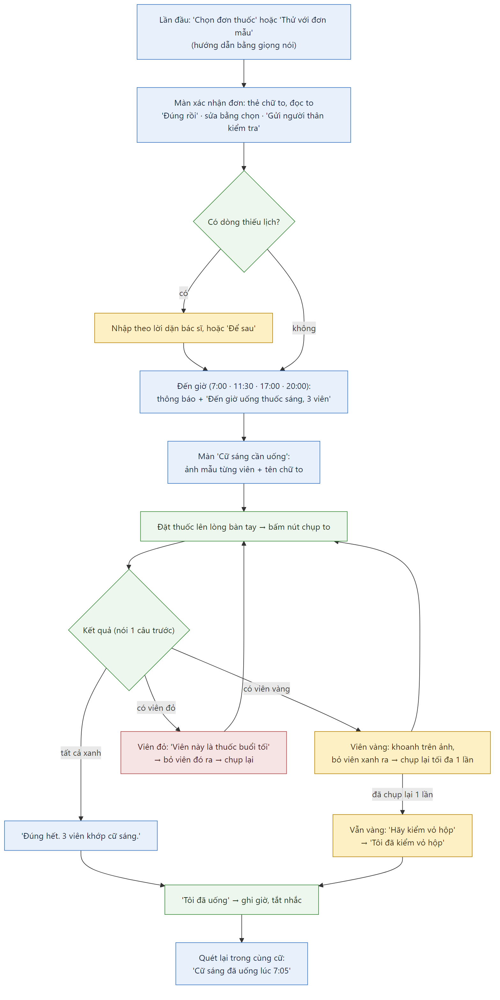
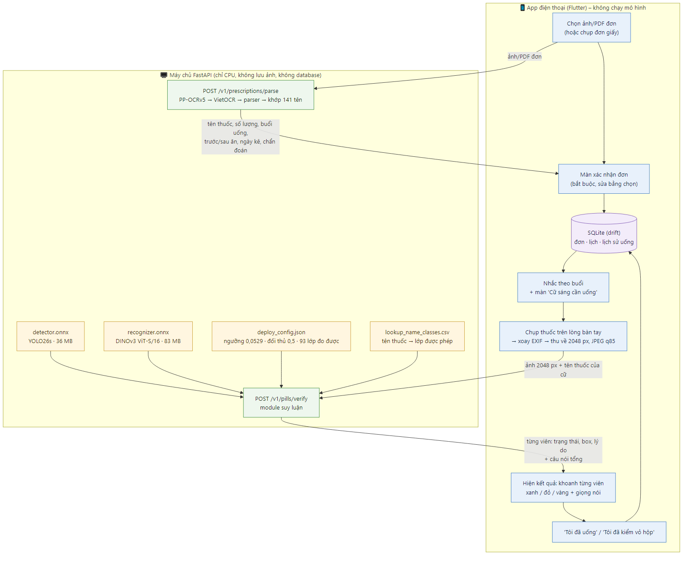

# MediCheck VN – Sản phẩm và trải nghiệm người dùng (cập nhật 2026-11-08)

> File này giữ **ý tưởng, phạm vi, người dùng và thiết kế trải nghiệm** của app. Quyết định kỹ thuật (mô hình, ngưỡng, dữ liệu, API) nằm ở `MediCheck_decisions.md` và được ưu tiên khi mâu thuẫn. Tiến độ: `MediCheck_AI_progress.md`. Sự thật về dữ liệu: `vaipe_analysis.md`.
>
> Bản này đã dọn các đề xuất cũ không còn dùng (pipeline EfficientNet, Colab, Hugging Face Spaces, phép loại trừ và mô tả màu khi vàng, "cặp thuốc nguy hiểm", timeline cũ).

---

## 1. Ý tưởng

Trợ lý AI kiểm tra an toàn dùng thuốc qua camera điện thoại. Đối chiếu **Đơn thuốc – Lịch uống theo buổi – Viên thuốc thực tế trên tay** chỉ bằng thao tác chụp.

**Vấn đề thực tiễn** (người từ 45 tuổi trở lên, mắt kém):
- Lấy nhầm thuốc ngoài đơn → quá liều, trùng hoạt chất, phản ứng chéo.
- Uống nhầm cữ (thuốc tối uống buổi sáng) hoặc sai số viên.
- Tâm lý phụ thuộc: phải chờ người thân chia hoặc kiểm tra hộ.

**Luồng sử dụng:**
1. Chọn ảnh/PDF đơn (hoặc chụp đơn giấy) một lần sau khi đi khám → app tạo lịch uống.
2. Mỗi ngày app nhắc theo lịch.
3. Đến giờ uống: thuốc trên lòng bàn tay, chụp → báo kết quả bằng giọng nói + hình.

**Yêu cầu chung:** nhanh – gọn – chính xác – dễ dùng. Định vị là công cụ hỗ trợ, không thay thế dược sĩ.

---

## 2. Phạm vi

| Mục | Chốt |
|---|---|
| Người dùng | Người cao tuổi mắt kém, **tự sử dụng**. Chưa làm chế độ người thân theo dõi |
| Nguồn đơn | Đơn BHYT in từ bệnh viện (2 mẫu đơn VAIPE). Đường chính: chọn ảnh/PDF đơn; chụp giấy là đường phụ |
| Danh mục | Đóng: 141 tên thuốc / 107 lớp viên của VAIPE. Thuốc ngoài danh mục chỉ nhắc lịch |
| Tính năng lõi 1 | Đơn → OCR → người dùng xác nhận/sửa → lịch uống theo buổi; hiển thị "Bệnh: …" từ chẩn đoán |
| Tính năng lõi 2 | Chụp các viên của cữ trên tay → khoanh từng viên xanh/vàng/đỏ, kiểm cả loại lẫn số lượng |
| Đi kèm | Nhắc theo buổi, "Tôi đã uống" (chống uống trùng), "Tôi đã kiểm vỏ hộp" |
| Giai đoạn sau | Làm quen thuốc (enrollment), tương tác thuốc (DDInter), chế độ người thân, chạy mô hình trên máy, tự động chụp |
| Nhóm, hạn | 3 người (1 AI, 2 mobile), cuối 12/2026. Chỉ dùng dataset sẵn có, không gán nhãn tay |
| Nền tảng | Flutter (Android/iOS); máy chủ FastAPI chạy CPU trên laptop khi demo |

---

## 3. Persona và nguyên tắc thiết kế

**Persona:** bác Lan, 68 tuổi, tăng huyết áp, đục thủy tinh thể nhẹ, tay hơi run. Dùng được Zalo, gọi video, nhưng không rành cài đặt. Mỗi ngày uống 2 cữ, mỗi cữ 2–4 viên. Sợ "bấm nhầm làm hỏng máy".

**Nguyên tắc (dùng để kiểm mọi quyết định):**
1. Mỗi bước người dùng làm phải có lý do họ hiểu được; phần phức tạp để máy chủ chịu.
2. Một màn hình – một việc – một nút chính.
3. Kết quả nói trước bằng **một câu**, chi tiết để sau.
4. Không dựa vào màu đơn thuần: màu + biểu tượng + giọng nói.
5. Khi app không chắc thì nói thẳng và đưa lối thoát ("hãy kiểm vỏ hộp"), không bắt thử mãi.
6. **Phòng ngừa trước, kiểm tra sau:** giúp lấy đúng ngay từ đầu tốt hơn bắt lỗi sau.
7. Không bắt người mắt kém làm đúng việc họ đang gặp khó (đọc chữ nhỏ, phân biệt viên nhỏ).
8. **Báo xanh nhầm là lỗi nguy hiểm nhất**; vàng là an toàn. Câu chữ: "khớp với đơn", không nói "an toàn để uống".

---

## 4. Thiết kế các luồng

*Sơ đồ: `docs/diagrams/07_luong_nguoi_dung.png` (nguồn sửa được: `docs/diagrams/07_luong_nguoi_dung.mmd`).*

*Sơ đồ: `docs/diagrams/01_tong_quan_he_thong.png` (nguồn sửa được: `docs/diagrams/01_tong_quan_he_thong.mmd`).*

### 4.1. Đơn thuốc → lịch uống
- Đường chính **chọn ảnh/PDF đơn** từ điện thoại (đúng loại dữ liệu đã đo: 49/49 dòng đúng trên PDF sạch). Chụp giấy là đường phụ, có kiểm chất lượng ảnh.
- **Màn xác nhận bắt buộc** trên mọi đơn:
  - lịch đã đọc hiện dạng **thẻ chữ to** và đọc to;
  - chỉ dòng app không chắc hoặc thiếu lịch mới tô vàng cần hành động; các dòng còn lại chỉ một nút **"Đúng rồi"**;
  - sửa bằng **chọn**, không gõ phím: chọn tên thuốc từ gợi ý (khớp mờ từ điển), chọn buổi/số viên bằng nút lớn.
- Nút **"Gửi người thân kiểm tra"** nổi bật ở màn xác nhận:
  - gửi ảnh đơn gốc cạnh lịch trích xuất;
  - mặc định ẩn họ tên và số BHYT;
  - đánh dấu dòng kém tin cậy.
- **Chẩn đoán:** hiện "Bệnh: …" trong chi tiết đơn và lịch uống; chỉ để người dùng biết thuốc chữa gì, không ảnh hưởng kiểm thuốc.
- **Đơn thiếu lịch** (12,6% đơn):
  - không tự suy liều;
  - thuốc vào trạng thái "chưa có lịch", chỉ khóa thuốc đó;
  - nhập bằng nút lớn kèm câu "Nhập theo lời dặn của bác sĩ hoặc dược sĩ"; có lựa chọn "Để sau".
- **Liều 1/2 viên:** nhắc lịch nhưng không chấm ảnh (mảnh viên không có trong dữ liệu); app nói "Thuốc này uống nửa viên, hãy tự kiểm theo vỏ hộp". **Liều khi cần:** chỉ hiển thị, không nhắc.
- **Trước/sau ăn:** hiển thị và đọc nguyên văn, không đổi giờ.

### 4.2. Nhắc thuốc và phòng ngừa
- Giờ nhắc mặc định: Sáng 7:00, Trưa 11:30, Chiều 17:00, Tối 20:00. **Không hỏi khi cài đặt**; đổi được trong cài đặt.
- Bấm thông báo → màn **"Cữ sáng cần uống"**:
  - ảnh mẫu từng viên (crop từ VAIPE, ghi "ảnh minh họa"), tên chữ to, số viên, đọc to;
  - thuốc không có ảnh mẫu thì chỉ hiện tên.
- Giọng nói: *"Đến giờ uống thuốc sáng, 3 viên."*

### 4.3. Kiểm thuốc theo cữ (chế độ B)
- Đặt **đúng những viên sắp uống của cữ** lên lòng bàn tay rồi chụp. App so tập viên phát hiện được với tập kỳ vọng (ví dụ {Renapril ×1, Hoạt huyết ×2}), kiểm cả loại lẫn số lượng, báo thiếu/thừa. (Chế độ A "1 viên mỗi loại" đã bỏ vì phải lấy thuốc hai lần.)
- **Vị trí chụp:** lòng bàn tay là hướng dẫn chính, vì khi uống thuốc người dùng cũng cầm trên tay; mặt phẳng sáng màu là tùy chọn. VAIPE có cả ảnh nền tay và mặt phẳng nên mô hình học được cả hai. Câu hướng dẫn: *"Xòe bàn tay ra, đặt thuốc lên lòng bàn tay, các viên rời nhau, rồi chụp."*
- **Một nút chụp to**; tự động chụp để giai đoạn 2 (luôn giữ nút tay).
- **Kiểm chất lượng ảnh ngay sau khi chụp** (< 1 giây):
  - kiểm mờ, tối, viên nằm trong khung và đủ lớn, viên không bị ngón tay che;
  - không đạt thì nói lỗi cụ thể: *"Ảnh tối quá, hãy bật đèn"*, *"Dàn thuốc ra cho rời nhau"*.
- App chỉ đếm viên có tâm trong **khung chụp** (bỏ qua vỉ thuốc, viên trên bàn phía sau).
- App thu ảnh về cạnh dài 2048 px trước khi gửi (~290 KB, tải lên < 1 giây với 4G).

### 4.4. Báo kết quả
| Trạng thái | Khi nào | Câu nói |
|---|---|---|
| Xanh (✓, khung nét liền) | Khớp chắc thuốc của cữ này, đúng số lượng | "Đúng hết. 3 viên khớp cữ sáng." |
| Đỏ – nhầm cữ (✗, khung dày) | Khớp chắc thuốc cữ khác | "Viên này là thuốc buổi tối." |
| Đỏ – ngoài đơn | Chắc chắn không thuộc đơn | "Viên này không khớp thuốc nào trong đơn, hãy kiểm vỏ hộp trước khi uống." |
| Vàng do ảnh (?, khung nét đứt) | Mờ, tối, viên che nhau | Nêu lỗi, chụp lại 1 lần |
| Vàng do thuốc | Còn lại, gồm lệch số lượng và 14 lớp không đo được | "App chưa xác nhận được viên này, hãy kiểm vỏ hộp." |

- **Một câu tổng nói trước**, rồi mới chi tiết. Báo cả **thiếu** ("Còn thiếu 1 viên Hoạt huyết dưỡng não") và **thừa** ("Có 1 viên lạ").
- **Khoanh từng viên trên ảnh vừa chụp.** Viên đã xanh giữ nguyên xanh; không khóa cả lượt vì một viên vàng.
- **Chụp lại tối đa 1 lần**: app khoanh viên cần bỏ ra/giữ lại ngay trên ảnh, rồi chỉ chụp lại các viên chưa chắc. Sau đó vẫn vàng thì dừng ở "hãy kiểm vỏ hộp", kèm nút **"Tôi đã kiểm vỏ hộp"** (lịch sử ghi là tự xác nhận).
- **Không** đoán "có thể là thuốc Z", **không** mô tả màu viên (màu trong ảnh thay đổi theo đèn và máy).

### 4.5. Ghi nhận đã uống (chống uống trùng)
- Sau kết quả xanh hết → nút to **"Tôi đã uống"** (1 chạm) → tắt nhắc, ghi giờ.
- Quét lại trong cùng cữ → *"Cữ sáng đã uống lúc 7:05."*
- Không bấm → nhắc lại sau 15 phút, tối đa 2 lần.
- Tính năng này chống quá liều trực tiếp, quan trọng ngang việc so viên, mà chi phí làm rất thấp.

### 4.6. Lần đầu dùng (onboarding bằng giọng nói)
- Mở app lần đầu: nút to "Chọn đơn thuốc" và nút phụ **"Thử với đơn mẫu"** (đơn + ảnh VAIPE) để thấy kết quả ngay. Không đăng ký/đăng nhập; dữ liệu lưu trên máy.
- Lần đầu chụp đơn: *"Đặt đơn lên mặt bàn, giữ máy ngang phía trên đơn. Bấm nút tròn lớn khi đơn nằm gọn trong khung."* + ảnh minh họa + nút "Tôi hiểu rồi".
- Lần đầu chụp thuốc: *"Xòe bàn tay ra, đặt thuốc lên lòng bàn tay, các viên rời nhau. Cầm máy bằng tay kia, chụp từ trên xuống."* + ảnh minh họa + nút "Bỏ qua" to. Từ lần 2 vào thẳng màn chụp.
- Mọi kết quả quan trọng đọc to bằng TTS; nút 🔊 nghe lại ở mỗi màn; giọng nói mặc định bật, tắt được trong cài đặt.
- Chữ lớn, tương phản cao, một nút chính mỗi màn. Tránh quá nhiều vàng ở lần đầu: ngưỡng được chọn để báo xanh tối đa trong chuẩn an toàn (89,5% cữ đúng báo xanh trên val).

### 4.7. Hành trình một ngày của bác Lan
1. **Lần đầu:** chọn ảnh đơn → app đọc to lịch (thẻ chữ to) → 1 dòng vàng (thiếu lịch) → chọn "Để sau" → bấm "Gửi người thân kiểm tra" qua Zalo.
2. **7:00:** thông báo + giọng nói *"Đến giờ uống thuốc sáng, 3 viên."* → mở ra thấy ảnh mẫu từng viên + tên chữ to.
3. Bóc thuốc vào lòng bàn tay → bấm nút chụp to → *"Đúng hết. 3 viên khớp cữ sáng."* → bấm "Tôi đã uống".
4. **7:40** quên, mở app định uống tiếp → *"Cữ sáng đã uống lúc 7:05."*

Mỗi cữ: **mở thông báo → chụp → "Tôi đã uống"** = 3 chạm.

---

## 5. Tham khảo đã xem

- **App eMed** (5 ảnh mẫu: nhập đơn, chụp đơn, kết quả OCR, chụp thuốc trên tay, kết quả). MediCheck theo luồng tương tự nhưng khác ở 4 điểm:
  - voice-first;
  - 3 trạng thái xanh/vàng/đỏ thay vì chỉ "đúng";
  - nhắc hằng ngày + chống uống trùng;
  - chữ to, biểu tượng cho người mắt kém.
- **Bài báo SOICT 2023** "A Novel Approach for Extracting Key Information from Vietnamese Prescription Images" (HUST + VinUni, nhóm VAIPE):
  - phương pháp: PhoBERTGrid + Swin Transformer;
  - F1 trung bình 97,21% trên 5 trường (tên thuốc 98,86%, số lượng 97,96%, cách dùng 98,29%, chẩn đoán 94,16%).
  Không áp dụng cho MVP: quá nặng, cần GPU. Đơn BHYT có format cố định nên OCR + parser quy tắc là đủ. Ghi nhận làm hướng nâng cấp OCR ở giai đoạn 2. Bài báo cũng cho thấy GNN (PICK, TRIE) kém hơn (94,50%).
- **VLM qua API cho OCR:** không dùng trong sản phẩm (tốn tiền, gửi dữ liệu y tế ra ngoài, nguy cơ bịa liều).

---

## 6. MVP và giai đoạn 2

| Hạng mục | MVP (môn học) | Giai đoạn 2 |
|---|---|---|
| Chọn/chụp đơn + OCR + parser + màn xác nhận + gửi người thân | ✓ | OCR mạnh hơn (theo bài báo SOICT 2023) |
| Lịch + nhắc cục bộ + TTS + onboarding bằng giọng nói | ✓ | |
| Màn "Cữ cần uống" có ảnh mẫu | ✓ | |
| Kiểm thuốc chế độ B, 3 trạng thái, khoanh trên ảnh, chụp lại 1 lần | ✓ (qua máy chủ) | Chạy mô hình trên máy |
| Kiểm chất lượng ảnh sau chụp | ✓ | Tự động chụp |
| "Tôi đã uống", "Tôi đã kiểm vỏ hộp", chống uống trùng | ✓ | |
| Làm quen thuốc (enrollment) | | ✓ |
| Tương tác thuốc (DDInter), chế độ người thân | | ✓ |

---

## 7. Nhật ký quyết định sản phẩm (mới nhất ở trên)

| Ngày | Quyết định |
|---|---|
| 2026-11-08 | **Bản cuối phần AI:** YOLO26s + DINOv3 ViT-S/16, cả chuỗi 89,5% cữ đúng báo xanh trên val, an toàn ≤ 2%, ~1 giây cho 4 viên trên CPU. App gửi ảnh 2048 px JPEG q85, không chạy mô hình trên máy. Chi tiết `MediCheck_decisions.md` mục 0, 12 |
| 2026-11-07 | OCR tách thêm chẩn đoán, hiển thị "Bệnh: …", chỉ UI/UX (người dùng chọn) |
| 2026-11-06 | Train chuyển sang Kaggle (người dùng chọn). Giữ chuẩn chấp nhận nhầm ≤ 2%, không nới |
| 2026-11-03 | Phạm vi prototype danh mục đóng VAIPE; làm quen thuốc sang giai đoạn 2. Ràng buộc: 3 người, hạn 12/2026, không gán nhãn tay, không thu thập mới, không dùng bộ định danh thuốc nước ngoài. Database SQLite (`drift`) trên điện thoại, máy chủ không có database |
| 2026-11-03 | 14 câu hỏi dataset đã chốt (`MediCheck_decisions.md` mục 6): kiểm đúng tên trên đơn, không cảnh báo hàm lượng, đơn thiếu lịch không suy liều, trước/sau ăn đọc nguyên văn, bỏ mô tả màu |
| 2026-11-03 | Trạng thái kết quả: bỏ phép loại trừ "có thể là Z", bỏ mô tả màu/hình, thêm nút "Tôi đã kiểm vỏ hộp" |
| 2026-10-26 | Dataset chính VAIPE; luồng chụp lại: khoanh trên ảnh, tối đa 1 lần; onboarding bằng giọng nói; tham khảo UI eMed |
| 2026-10-22 | Chụp trên lòng bàn tay là chính; chế độ B; thuốc ngoài danh mục → "chỉ nhắc lịch"; màn "Cữ cần uống" |
| 2026-10-21 | Người cao tuổi tự dùng; chỉ đơn BHYT bệnh viện; app điện thoại; chỉ dùng dataset sẵn có; có màn sửa OCR và gửi người thân kiểm tra |
