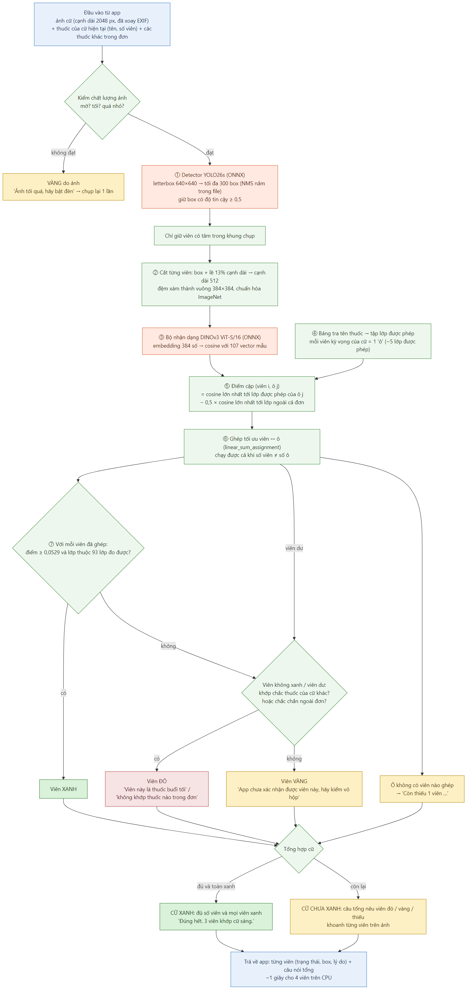
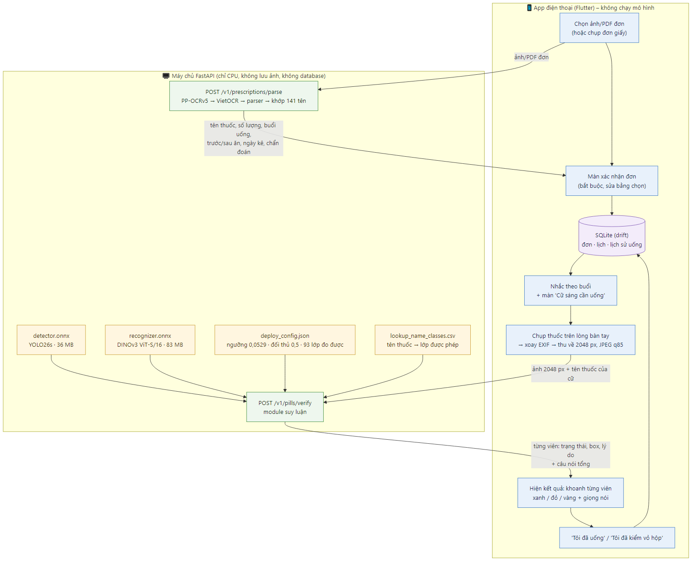
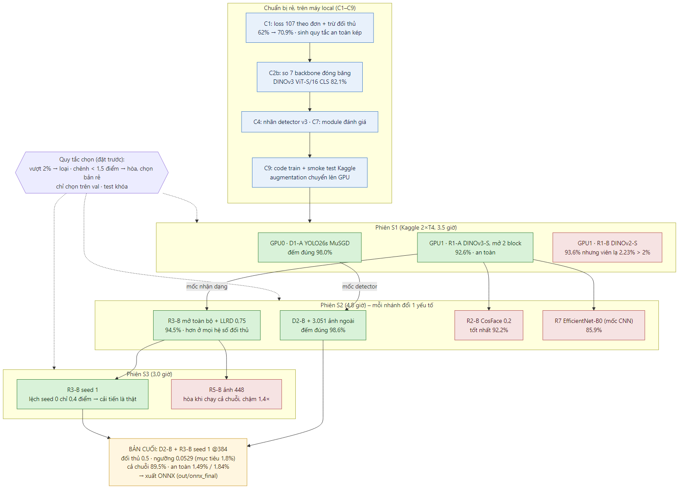
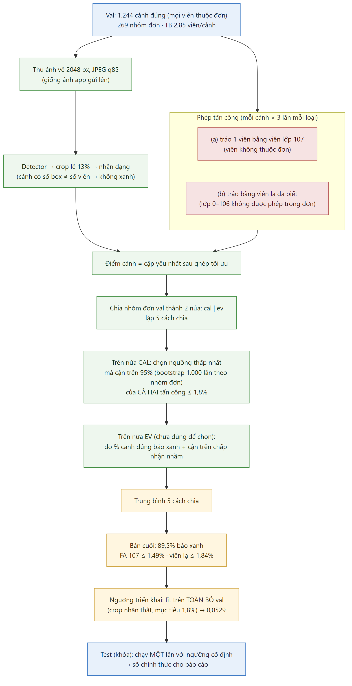

# MediCheck VN – Sổ quyết định kỹ thuật (cập nhật 2026-11-08)

> Nguồn quyết định kỹ thuật cao nhất của dự án. Khi các tài liệu khác mâu thuẫn với file này, file này đúng. Phần chọn phương án kỹ thuật/UX được quyết kèm bằng chứng; các lựa chọn do người phụ trách AI tự chốt được ghi rõ "người dùng chọn".
>
> Mục 0–11: quyết định đang có hiệu lực. Mục 12: bằng chứng (thử nghiệm đã chạy, đã gộp gọn). Tiến độ và việc tiếp theo: `MediCheck_AI_progress.md`.

---

## 0. Tóm tắt bản cuối (chốt 2026-11-08)

| Thành phần | Bản cuối | Nguồn |
|---|---|---|
| Detector | **YOLO26s** (D2-B: VAIPE nhãn v3 + Negatives + 3.051 ảnh ngoài), ảnh 640, nhánh NMS, ngưỡng tin cậy 0,5 | `out/s2/det/d2b/weights/best.pt` |
| Bộ nhận dạng | **DINOv3 ViT-S/16** (token CLS), ảnh 384, mở toàn bộ backbone + LLRD 0,75, đầu cosine 107 lớp, seed 1 (R3-B seed 1) | `out/s3/r3b_seed1/model.pt` |
| Quyết định | Ghép tối ưu viên ↔ dòng thuốc; điểm = cosine lớp được phép − 0,5 × cosine đối thủ ngoài đơn; ngưỡng **0,0529**; 14 lớp luôn vàng | `out/onnx_final/deploy_config.json` |
| File triển khai | `detector.onnx` (36 MB), `recognizer.onnx` (83 MB), `deploy_config.json` – khớp PyTorch | `out/onnx_final/` |
| Tốc độ (CPU i5-10400F) | Detector ~140 ms/ảnh, nhận dạng ~190 ms/viên → ~1 giây cho 4 viên | mục 12.6 |

**Kết quả** (test chạy một lần ngày 08/11, mục 14.1):
| Chỉ số | Giá trị |
|---|---|
| **TEST – cữ đúng được báo xanh** (qua module, ngưỡng cố định) | **90,2%** |
| **TEST – cận trên 95% chấp nhận nhầm: viên 107 / viên lạ** | **1,09% / 1,31%** (chuẩn ≤ 2%) |
| Detector đếm đúng số viên (ảnh) | 98,7% (mAP50 99,4, recall 99,45); test 98,5% |
| Nhận dạng đúng trong ứng viên (viên, crop nhãn thật) | 95,8% |
| Cữ đúng được báo xanh, cả pipeline, val (PyTorch, cal/ev 5 cách chia) | 89,5% (qua module: 90,9%) |
| Cận trên 95% chấp nhận nhầm, val (PyTorch): viên 107 / viên lạ đã biết | 1,49% / 1,84% (qua module: 1,19% / 1,79%) |

**Module suy luận + máy chủ API** (mục 13): `backend/`, tài liệu cho nhóm app `backend/API.md`. Qua module trên val: 90,9% báo xanh, cận trên 1,19% / 1,79%. **Test (chạy một lần, số chính thức): 90,2% cữ đúng được báo xanh; cận trên nhận nhầm 1,09% (viên ngoài đơn) / 1,31% (viên lạ) → đạt chuẩn ≤ 2%.**

---

## 1. Phạm vi và cam kết

| Mục | Chốt |
|---|---|
| Cam kết | Prototype xác minh thuốc trên **danh mục đóng VAIPE** (107 lớp, 141 tên thuốc), khai báo rõ giới hạn. Không cam kết dùng an toàn với mọi thuốc ngoài đời |
| Tính năng lõi | (1) Đơn thuốc → lịch uống; (2) Kiểm viên thuốc theo cữ. Nhắc thuốc và "Tôi đã uống" đi kèm để hai lõi dùng được |
| Nhóm và hạn | 3 người: 1 AI, 2 mobile. Kết thúc cuối 12/2026 |
| Ràng buộc dữ liệu | Không gán nhãn tay, không thu thập mới, không dùng bộ định danh thuốc nước ngoài |
| Để sau | Làm quen thuốc, tương tác thuốc, chế độ người thân, chạy trên máy, tự động chụp |

---

## 2. Kiến trúc nhận dạng

**Danh mục + mô hình xuất embedding**, không phân loại đóng. Chuỗi xử lý khi app chạy:

```
ảnh cữ (app thu về cạnh dài 2048 px, JPEG q85, đã xoay EXIF)
 → YOLO26s (640, NMS, ngưỡng 0,5) → chỉ giữ viên có tâm trong khung chụp
 → crop box + lề 13% cạnh dài, cạnh dài 512 → DINOv3 ViT-S/16 @384 + đầu cosine → cosine viên × 107 lớp
 → tên thuốc của cữ (từ OCR) → bảng tra tên → tập lớp được phép
 → điểm có trừ đối thủ → ghép tối ưu (linear_sum_assignment) → so ngưỡng → xanh / đỏ / vàng
```



*Sơ đồ: `docs/diagrams/02_suy_luan_kiem_thuoc.png` (nguồn sửa được: `docs/diagrams/02_suy_luan_kiem_thuoc.mmd`).*

Lý do chọn danh mục + embedding (so trên 400 đơn, DINOv2 chưa fine-tune): danh mục đúng trong ứng viên 93,1% so với 80–84% của "làm quen 1–3 ảnh", nên làm quen thuốc để giai đoạn 2.

---

## 3. Mô hình và cách train

| Thành phần | Chốt | Lý do |
|---|---|---|
| Detector | **YOLO26s**, 1 lớp, imgsz 640, pretrained COCO (10,0 triệu tham số), `ultralytics==8.4.204`. **MuSGD lr0 0,01** đặt tường minh, batch 32, 100 epoch, dừng sớm sau 20. Train: VAIPE nhãn v3 + Negatives + ảnh ngoài (Personal ×3, pills-2602, pills-search, Various, Ultralytics-medical-pills; không dùng NIH) | Theo Ultralytics: 48,6 mAP, CPU 87 ms (hơn YOLO11s). Đã chạm trần trên val (mục 12.4). Ảnh ngoài thắng A/B D2 |
| Nhánh detector | **NMS**, ngưỡng tin cậy 0,5 | Nhánh end-to-end kém ~4 điểm đếm đúng (mục 12.4) |
| Bộ nhận dạng | **DINOv3 ViT-S/16** (`vit_small_patch16_dinov3.lvd1689m`, **`global_pool="token"`**), crop nguồn 512, ảnh vào 384 (lưới 24×24 token), đầu cosine 107 lớp | Đóng băng hơn DINOv2-S 9,4 điểm báo xanh, cùng độ trễ (mục 12.1); fine-tune DINOv2-S trượt an toàn (mục 12.4) |
| Giai đoạn 1 | Đóng băng: đầu cosine khởi tạo bằng trung bình lớp, fit như `Bench.head_matrix` | Epoch 0 tái lập số đóng băng → kiểm được đường ống |
| Giai đoạn 2 | **Mở toàn bộ block, LLRD 0,75** (mỗi tầng thấp hơn có lr × 0,75), AdamW (lr backbone 5e-5 ở block trên, đầu 5e-4, wd 1e-4), warm-up 1 epoch + cosine, fp16, cắt gradient 1,0, batch 64, 20 epoch | Thắng "mở 2 block cuối" ở mọi hệ số đối thủ (A/B R3, mục 12.4) |
| Loss | Cosine softmax, label smoothing 0,05 + **loss 107 có điều kiện theo đơn** (λ = 1, 20% mỗi batch là viên 107). Không dùng CosFace | Loss 107: +6 điểm báo xanh ở cùng mức an toàn (mục 12.1). CosFace thua (mục 12.4) |
| Lấy mẫu, augmentation | Căn bậc hai tần suất lớp. Augmentation **trên GPU**: dao động box ±8% mỗi cạnh, xoay 0–360°, lật, màu, mờ (p 0,2), giảm độ phân giải (p 0,2) | Màu không ổn định; box detector lệch box gốc; CPU Kaggle là nút cổ chai (mục 12.3) |
| Chọn checkpoint | **Checkpoint cuối**, không chọn epoch trên val | Chọn epoch trên val rồi báo số trên chính val là lạc quan |
| Suy luận | Không TTA, không ghép nhiều mô hình | TTA +0,7 điểm nhưng chậm 8 lần; ghép mô hình không hơn (mục 12.4) |
| Baseline báo cáo | EfficientNet-B0 cùng giao thức: 85,9% báo xanh (kém DINOv3 6,6 điểm) | Mốc CNN cho báo cáo |

**Nền tảng train** (người dùng chọn 2026-11-06): Kaggle Notebook 2 × T4 (15 GB mỗi GPU), quota 30 giờ/tuần, mỗi GPU một thử nghiệm song song. Dữ liệu là Kaggle Dataset riêng tư: `thinhlai/medicheck-crops` (crop 256 + 512, nhãn v2, split v2, bảng tra), `thinhlai/medicheck-det` (9.502 ảnh cạnh dài 1280, nhãn YOLO v3), `thinhlai/medicheck-code` (gói `medicheck_ai`); bộ bổ trợ `alexanderyyy/pills-detection-dataset` gắn trực tiếp. Checkpoint mỗi epoch, chạy tiếp được. Máy local (GTX 1650) chỉ thử nhanh và chạy suy luận/đánh giá.

---

## 4. Chỉ số an toàn và quy tắc chọn

**Chỉ số chính:** chấp nhận nhầm cấp cảnh, đo **hai loại tấn công**: tráo 1 viên đúng bằng (a) 1 viên lớp 107, (b) 1 viên lớp đã biết không thuộc tập lớp được phép của đơn ("viên lạ đã biết"). Mỗi cảnh thử 3 lần mỗi loại.

**Quy tắc an toàn (không nới):** cận trên CI 95% (bootstrap 1.000 lần theo nhóm đơn) của chấp nhận nhầm **≤ 2% cho cả hai loại tấn công**. Hiệu năng chỉ được tăng bằng mô hình tốt hơn, không bằng nới chuẩn.

**Giao thức đo (phát triển):** fit ngưỡng trên nửa cal của nhóm đơn val, đo trên nửa ev, lặp **5 cách chia** rồi lấy trung bình. Số chính thức là **cả pipeline** (detector → crop → nhận dạng → ghép) trên ảnh 2048 px (`Bench.evaluate_e2e_splits`). Fit và đo trên cùng dữ liệu không được dùng làm bằng chứng an toàn.

**Ngưỡng triển khai:** fit trên **toàn bộ crop nhãn thật của val** với **mục tiêu cận trên 1,8%** (dư 0,2 điểm). Lý do: crop của detector làm viên lạ lọt nhiều hơn crop nhãn thật ~0,1 điểm, và ở mục tiêu 2,0 cả pipeline chạm đúng 2,00% (mục 12.5). Hệ số đối thủ **0,5**.

**Quy tắc đo được:** 14 lớp chỉ xuất hiện ở 1 nhóm đơn (9, 13, 16, 20, 25, 32, 35, 49, 53, 66, 85, 86, 94, 102) luôn báo vàng vì không đo được trên đơn mới (người dùng duyệt 2026-11-07; thay quy tắc recall ≥ 80% cũ, vốn làm báo xanh rơi 82% → ~50% mà không thêm an toàn).

**Quy tắc chọn giữa các nhánh thử nghiệm:**
- Nhánh vượt chuẩn an toàn bị loại, dù báo xanh cao.
- Chênh báo xanh < 1,5 điểm = **hòa** → chọn nhánh rẻ/nhanh hơn khi suy luận. Độ dao động đo được giữa 2 seed: 0,4 điểm trên crop, ~1 điểm trên cả pipeline.
- Mỗi A/B chỉ đổi một yếu tố; nhánh thắng thành mặc định cho A/B sau.
- Tập test không được đọc trong suốt quá trình chọn; chỉ chạy **một lần** với bản cuối.

| Cảnh đúng được báo xanh | Hành động |
|---|---|
| ≥ 70% | Đạt mục tiêu (test: 90,2%) |
| 50–70% | Vẫn báo xanh, nhiều vàng hơn, ghi rõ trong báo cáo |
| < 50% | Bỏ báo xanh tự động, app nhắc lịch và gợi ý kiểm tra |

---

## 5. Trạng thái kết quả

| Trạng thái | Điều kiện | Câu nói |
|---|---|---|
| Xanh | Khớp chắc thuốc của cữ này, đúng số lượng | "Khớp với đơn" |
| Đỏ – nhầm cữ | Khớp chắc thuốc cữ khác, thuốc đó không thuộc cữ này | "Viên này là thuốc buổi tối" |
| Đỏ – ngoài đơn | Chắc chắn là lớp ngoài tập được phép của cả đơn | "Viên này không khớp thuốc nào trong đơn, hãy kiểm vỏ hộp trước khi uống" |
| Vàng do ảnh | Mờ, tối, viên che nhau | Nêu lỗi, chụp lại 1 lần |
| Vàng do thuốc | Còn lại, kể cả lệch số lượng và 14 lớp không đo được | "App chưa xác nhận được viên này, hãy kiểm vỏ hộp" |

- Có nút **"Tôi đã kiểm vỏ hộp"**, lịch sử ghi là tự xác nhận và tắt nhắc.
- Bỏ phép loại trừ "có thể là Z", bỏ mô tả màu/hình, bỏ quy tắc "không bao giờ nói không nhận ra được".
- Viên đã xanh giữ nguyên xanh khi chụp lại.

---

## 6. Dữ liệu và 14 câu hỏi dataset

### Bộ chia v2 (`out/v2/split.csv`)

| Phần | Ảnh | Đơn | Nhóm | Box nhận dạng | Lớp | Box 107 |
|---|---|---|---|---|---|---|
| Train | 6.256 | 585 | 503 | 17.179 (70,5%) | 107 | 5.128 |
| Val | 1.604 | 294 | 269 | 3.586 (14,7%) | 93 | 1.570 |
| Test (khóa) | 1.576 | 294 | 266 | 3.460 (14,2%) | 86 | 1.700 |
| Giữ riêng theo ảnh | 66 | 8 | 8 | 150 (0,6%) | 18 | 0 |

Không nhóm đơn nào nằm ở nhiều phần. 86 lớp có ≥ 3 nhóm có mặt đủ train, val, test; 7 lớp 2 nhóm có mặt ở train và val; 14 lớp 1 nhóm chỉ để train. Detector dùng cùng bộ chia với nhãn v3 (mục 12.2); 66 ảnh giữ riêng vào train detector.

### 14 câu

| # | Câu hỏi | Chốt | Căn cứ |
|---|---|---|---|
| 1 | Chia train/val | Như bảng trên. Lớp 1 nhóm luôn báo vàng | Bản cũ làm 7 lớp có 3–9 nhóm vắng khỏi val |
| 2 | Đơn trùng | Dùng 1.038 nhóm đã gom, không gom theo phác đồ | Cùng phác đồ ở bệnh nhân khác là tình huống cần đo |
| 3 | Lớp không thuần | **Đã sửa tự động (nhãn v2):** 76 box Tydol từ lớp 1 sang 60; mapping đơn 119, 120; 55 box ngoài đơn (đơn 574, 575, 1168) loại khỏi bộ nhận dạng, giữ cho detector; dòng Paracetamol đơn 708 loại khỏi bảng tra. **Giữ nguyên:** lớp 2, 37, 40, 104 | Tydol: cosine 0,983, ảnh giống hệt. Đơn 401 không xác định được bên nào đúng nên không xóa |
| 4 | Hàm lượng | **Không cảnh báo** (người dùng chọn). Ghi vào giới hạn | Tập trung 2 tính năng lõi |
| 5 | Lớp 107 | Detector coi là viên thuốc. Không train thành lớp; dùng làm mẫu âm có điều kiện theo đơn và phép tấn công khi đo | Mục 12.1 |
| 6 | OCR | Xem mục 7 | Đã đo |
| 7 | Đơn thiếu lịch | Không suy liều, chỉ khóa thuốc đó (người dùng chọn) | 12,6% số đơn |
| 8 | Liều 1/2, khi cần | 1/2: nhắc lịch, không chấm ảnh, tính vào số viên kỳ vọng dạng "không chấm". Khi cần: chỉ hiển thị, không nhắc | 62 dòng ở 58 đơn; 2 dòng khi cần |
| 9 | Trước/sau ăn | Hiển thị và đọc nguyên văn, không đổi giờ (người dùng chọn) | 366 dòng (12,9%) |
| 10 | Tên hay hoạt chất | Kiểm **đúng tên trên đơn**: viên thuộc tập lớp được phép của tên đó (người dùng chọn) | Bảng tra triển khai `out/onnx_final/lookup_name_classes.csv` (chỉ lập từ train, 138 tên; mục 13) |
| 11 | Mô tả viên | Bỏ mô tả màu và hình. Dùng vị trí, khoanh trên ảnh, ảnh mẫu tối đa 3 hình kèm "ảnh minh họa" | Màu không ổn định |
| 12 | VAIPE-test | Kiểm detector độc lập và demo; không đánh giá phân loại | Không có nhãn lớp; box do bên thứ ba gán |
| 13 | Bộ Kaggle bổ trợ | Nhãn detector v3 (box chặt truy từ VAIPE-reannotated/mosaic) + Negatives + ảnh ngoài vào train detector. Không dùng NIH, không train trên VAIPE-test, không dùng ảnh thu nhỏ của tác giả | Chỉ có 1 lớp nên chỉ bổ trợ detector. CC BY-NC-SA |
| 14 | Phạm vi detector | Phát hiện mọi viên rời, app chỉ đếm viên có tâm trong **khung chụp** | Khó học "viên thuộc lượt chụp" từ ảnh |

Không dùng MEDISEG, ePillID (thuốc nước ngoài). CURE, VAIPE đầy đủ: không có nguồn tải công khai.

---

## 7. OCR

**Chuỗi:** PP-OCRv5 mobile detection → **VietOCR `vgg_transformer`** → parser quy tắc → khớp mờ từ điển 138 tên (chỉ lập từ train). Không train lại (dùng trọng số công bố).

**Trường tách ra:** tên thuốc, số lượng, buổi uống và số viên mỗi buổi, ghi chú trước/sau ăn, ngày kê đơn, **chẩn đoán** (người dùng chọn 2026-11-07). Chẩn đoán **chỉ để hiển thị** ("Bệnh: …" trong chi tiết đơn và lịch uống), không dùng cho quyết định nào của AI. Cả 1.173 đơn VAIPE có ô chẩn đoán (1.650 ô, nhãn `diagnose`), 75% có mã ICD-10. Parser: lấy dòng bắt đầu bằng "Chẩn đoán" (chịu lỗi dấu "Chần/Chấn"), nối dòng bị ngắt tới trường kế tiếp, tách bệnh theo ";", hiển thị tên bệnh (giữ mã ICD trong dữ liệu). Lỗi hay gặp: "I10" thành "110"; người dùng sửa được trên màn xác nhận. API `POST /v1/prescriptions/parse` trả thêm trường `diagnosis`.

Nhận dạng trên box chuẩn, 40 đơn, 318 ô, ảnh sạch:
| Mô hình | Tên thuốc đúng hẳn | Số lượng | Lịch uống | Giây/ô (CPU) |
|---|---|---|---|---|
| VietOCR transformer | 80% | 100% | **98%** | 0,255 |
| VietOCR seq2seq | 65% | 96% | 90% | – |
| PP-OCRv5 latin mobile | 75% | 100% | 40% (mất dấu "Chiều") | 0,081 |

Toàn chuỗi, 20 đơn, 49 dòng thuốc: PDF sạch **49/49** dòng đúng (20/20 đơn); làm nhiễu mạnh (xoay 2°, bóng, mờ, JPEG 45) **10/49** (0/20 đơn). Parser trên 3.994 ô lịch: 99,8% khớp quy tắc.

Quyết định:
- Đường chính là **chọn ảnh/PDF đơn từ điện thoại** (đúng loại dữ liệu đã đo). Chụp giấy là đường phụ, có **chỉnh nghiêng + gom hàng** (đã làm, kết quả ở mục 15).
- Màn xác nhận bắt buộc trên mọi đơn.
- Báo cáo nêu rõ: **chưa đo trên ảnh chụp giấy thật** (mục 15 chỉ đo trên ảnh làm nhiễu mô phỏng).
- Trên Windows phải tắt oneDNN ở Paddle (`enable_mkldnn=False`).

---

## 8. Tech stack và phân công triển khai

| Tầng | Chốt |
|---|---|
| Mobile | Flutter; `camera`; `file_picker`; `flutter_local_notifications`; `flutter_tts` (giọng vi-VN cần thử trên máy thật) |
| Database trên điện thoại | **SQLite qua `drift`** (type-safe query, có migration) |
| Database phía server | **Không có.** Server không giữ trạng thái. Danh mục (bảng tra, trọng số, ảnh mẫu, `deploy_config.json`) là file có phiên bản, nạp khi khởi động |
| Backend | Python 3.10, FastAPI, Uvicorn, không lưu ảnh, **chỉ CPU** |
| Inference | ONNX Runtime cho YOLO26s và DINOv3; PyTorch CPU cho VietOCR; PaddlePaddle cho text detection; `pypdfium2` đọc PDF |
| Train | Kaggle Notebook (2 × T4), PyTorch, `timm`, `ultralytics` (AGPL-3.0) |
| Triển khai demo | Laptop chạy FastAPI, điện thoại nối qua Wi-Fi LAN hoặc tunnel HTTPS. Không dùng Hugging Face Spaces |



*Sơ đồ: `docs/diagrams/01_tong_quan_he_thong.png` (nguồn sửa được: `docs/diagrams/01_tong_quan_he_thong.mmd`).*

**API:** `POST /v1/prescriptions/parse` và `POST /v1/pills/verify`. App gửi ảnh viên cạnh dài **2048 px, JPEG q85, đã xoay EXIF** (~290 KB; mục 12.5) kèm danh sách tên thuốc và cữ hiện tại. **App không chạy mô hình.**

**Phân công phần nhận dạng viên:**
| Phần | Việc | Ai |
|---|---|---|
| Module suy luận | Ảnh + danh sách thuốc của cữ → 2 mô hình ONNX → crop lề 13% → ghép, trừ đối thủ, ngưỡng → xanh/đỏ/vàng từng viên (đúng logic đã đo) | **AI** |
| Lớp API | Bọc module thành `POST /v1/pills/verify` (FastAPI) | **AI viết** (người dùng chọn): `backend/medicheck_server/app.py`, hợp đồng `backend/API.md` |
| App | Chụp, thu nhỏ 2048 px, gửi lên, hiển thị, đọc giọng nói | Mobile |

### Thiết kế database trên điện thoại

SQLite cục bộ vì dữ liệu quan hệ, phải chạy khi mất mạng để nhắc thuốc, một người dùng trên một máy, không có tài khoản.

| Bảng | Trường chính | Quan hệ |
|---|---|---|
| `prescription` | id, source_type (ảnh/PDF/chụp), issued_date, **diagnosis_text** (chỉ hiển thị), imported_at, status | 1–n `drug_line` |
| `drug_line` | id, prescription_id, raw_text, matched_name, quantity, note_text, dose_type (thường/nửa viên/khi cần/thiếu lịch), check_mode (chấm ảnh/chỉ nhắc), confirmed_at | 1–n `dose_schedule` |
| `dose_schedule` | id, drug_line_id, session (sáng/trưa/chiều/tối), amount | n–1 `drug_line` |
| `dose_event` | id, event_date, session, status (chờ/đã uống/bỏ qua), taken_at, confirm_type (app xác nhận/tự xác nhận) | 1–n `verification_attempt` |
| `verification_attempt` | id, dose_event_id, attempt_no, summary, created_at | 1–n `verification_item` |
| `verification_item` | id, attempt_id, drug_line_id (có thể rỗng), state (xanh/vàng/đỏ/không chấm), reason, bbox | n–1 `verification_attempt` |
| `setting` | key, value (giờ từng buổi, bật giọng nói, phiên bản danh mục) | – |

Bảo mật: **không lưu họ tên, số BHYT, ảnh đơn hay ảnh thuốc**. Chẩn đoán là dữ liệu sức khỏe nhạy cảm: chỉ lưu trên điện thoại, xóa cùng đơn, không gửi đi đâu ngoài lần xử lý OCR. Ảnh gửi lên server chỉ để xử lý rồi bỏ. Chưa mã hóa database ở MVP (dựa vào sandbox hệ điều hành; ghi vào giới hạn). **Demo:** có chế độ ảnh và đơn mẫu VAIPE.

---

## 9. Kế hoạch còn lại

| Thời gian | AI | Mobile |
|---|---|---|
| ✅ 3–8/11 | Dữ liệu, thử nghiệm C1–C9, train S1–S3 trên Kaggle, đánh giá cả pipeline, ONNX bản cuối | Khung app, database, màn đơn thuốc, lịch, nhắc, mock API |
| ✅ 8/11 | Module suy luận + server FastAPI (`backend/`), kiểm trên val qua module (mục 13) | |
| ✅ 8/11 | Chạy test một lần qua module (mục 14.1); giao `backend/` + `API.md` cho nhóm mobile | |
| 9–22/11 | **Cổng 22/11:** đo độ trễ trên laptop demo, hỗ trợ nhóm mobile ghép API | Màn chụp, kết quả xanh/vàng/đỏ, TTS, gọi API thật |
| ✅ 9/11 | OCR: chỉnh nghiêng, gom hàng, parser chẩn đoán, đo độ chính xác (mục 15) | Màn xác nhận đơn, đơn thiếu lịch |
| ✅ 9/11 | Thêm `POST /v1/prescriptions/parse` (OCR) vào server | Tích hợp API đọc đơn |
| ✅ 10/11 | Đồng bộ báo cáo `.docx` (bản v6) | Sửa lỗi, "Tôi đã uống", chế độ demo |
| 21–31/12 | Báo cáo, demo | Báo cáo, demo |

Kaggle: bản cuối không cần train thêm; ~17 giờ quota còn lại giữ để dự phòng (quota không reset đến 15/11).

---

## 10. Giới hạn phải khai báo trong báo cáo

- Chưa thử trên ảnh chụp giấy thật, chưa thử với người dùng cao tuổi thật.
- Chỉ phủ danh mục 141 tên, từ một hệ thống bệnh viện. Thuốc ngoài danh mục chỉ nhắc lịch.
- Tập test cùng nguồn chụp với train, không độc lập về đợt chụp.
- App không kiểm hàm lượng. Lớp 2, 37, 40, 104 gộp nhiều thuốc hoặc hàm lượng; nhãn đơn 401 chưa xác định được.
- Sửa nhãn bằng luật + so ảnh, không có chuyên gia dược xác nhận. Nhãn box chặt (v3) do mô hình của tác giả bộ bổ sung gán rồi duyệt tay; ~17% ảnh còn viên ở nền không có nhãn.
- Viên lạ dùng để train (lớp 107 của train) và để đo đều cùng nguồn dữ liệu → chấp nhận nhầm đo được có thể lạc quan với thuốc hoàn toàn mới.
- Val đã dùng để chọn cấu hình, ngưỡng và seed; test (chạy một lần) cho số gần bằng val (báo xanh 90,2% so với 90,9%), nên mức lạc quan nhỏ.
- Báo đỏ "không khớp thuốc nào trong đơn" có thể báo oan viên đúng: 0,11% trên val nhưng 1,40% trên test (mục 14.1). Đỏ luôn kèm "hãy kiểm vỏ hộp" và không ảnh hưởng báo xanh.
- App là công cụ hỗ trợ, không thay thế dược sĩ.
- DINOv3 theo DINOv3 License của Meta (không phải mã nguồn mở OSI): phát hành phải kèm bản giấy phép; bài công bố phải ghi nhận DINOv3.
- `ultralytics` và trọng số YOLO26 theo AGPL-3.0: phát hành dịch vụ ra ngoài phải công bố mã nguồn backend. Bộ bổ trợ Kaggle CC BY-NC-SA (không thương mại).

---

## 11. Tài liệu tham khảo đã kiểm

- Báo cáo tối đa 15 tài liệu, mỗi trích dẫn có câu gốc đối chiếu trong `MediCheck_citation_evidence.md`.
- Vaze, Han, Vedaldi, Zisserman. *Open-Set Recognition: a Good Closed-Set Classifier is All You Need?* ICLR 2022. https://arxiv.org/abs/2110.06207
- Siméoni et al. *DINOv3.* 2025. https://arxiv.org/abs/2508.10104 · Giấy phép: https://github.com/facebookresearch/dinov3/blob/main/LICENSE.md — chưa kiểm câu trích dẫn trong bài, phải đối chiếu khi đưa vào báo cáo
- Oquab et al. *DINOv2: Learning Robust Visual Features without Supervision.* 2023. https://arxiv.org/abs/2304.07193
- Ultralytics YOLO26: https://docs.ultralytics.com/models/yolo26/ · YOLO11: https://docs.ultralytics.com/models/yolo11/
- VietOCR: https://github.com/pbcquoc/vietocr · PP-OCRv5: https://www.paddleocr.ai/latest/en/version3.x/algorithm/PP-OCRv5/PP-OCRv5_multi_languages.html
- AI4VN 2022 baseline: https://github.com/VAIPE-Challenge-2022/ai4vn-vaipe-baseline · đội thi: https://github.com/cubist38/AI4VN_VAIPE · https://github.com/Th1nhNg0/VAIPE-2022
- Bộ detection bổ trợ: https://www.kaggle.com/datasets/alexanderyyy/pills-detection-dataset
- Kaggle Notebooks: https://www.kaggle.com/docs/notebooks · `drift`: https://pub.dev/packages/drift · `flutter_local_notifications`: https://pub.dev/packages/flutter_local_notifications
- Ghi chú viết báo cáo: ghép viên dùng `linear_sum_assignment` của SciPy (Jonker–Volgenant cải tiến); Hungarian chỉ nhắc như thuật toán kinh điển. Chỉ số đánh giá ở mục 3.3 của báo cáo.

---

## 12. Bằng chứng các quyết định (thử nghiệm đã chạy)

Mọi số đo trong mục này trên **val**; test chỉ được đọc một lần, kết quả ở mục 14.1. Báo xanh / cận trên FA 107 / cận trên viên lạ (%) nếu không ghi khác.

### 12.1. Thử nghiệm trên embedding đóng băng (C1, C2, C2b, C7; 06–07/11)

**C1 – cách chấm điểm** (DINOv2 ViT-S/14 đóng băng, 3 seed × 2 cách chia; `scripts/exp_scoring_20261106.py`):
| Cách | Quy tắc ngưỡng | Báo xanh | FA 107 | Viên lạ |
|---|---|---|---|---|
| H0: đầu cosine | chỉ 107 | 62,1 | 2,13 | 0,89 |
| H1: + loss 107 theo đơn | chỉ 107 | 77,2 | 1,98 | **3,62** (không an toàn) |
| H1 | cả hai ≤ 2% | 66,7 | 0,92 | 1,80 |
| **H1 + trừ đối thủ 0,25** | **cả hai ≤ 2%** | **70,9** | 1,46 | 1,69 |
| kNN top-5 | chỉ 107 | 30–48 | – | – |

→ Dùng loss 107 theo đơn **kèm** điểm trừ đối thủ; quy tắc an toàn **kép** (chỉ đo 107 thì mô hình "né" đúng 107 mà lọt viên lạ khác); bỏ kNN.

**C2 – độ phân giải** (DINOv2 đóng băng): crop 512 tốt hơn 256; 336 lấy gần hết lợi ích của 448 (top-1 91,7 so với 92,0); TTA 8 góc +1–3 điểm nhưng chậm 8 lần → crop nguồn 512 cho mọi bước sau.

**C2b – so backbone đóng băng** (đầu H1, đối thủ 0,25, quy tắc kép; CPU i5-10400F, 3 crop):
| Backbone | Top-1 ứng viên | Báo xanh | CPU |
|---|---|---|---|
| DINOv2 ViT-S/14 @336 | 91,7 | 72,7 | 509 ms |
| DINOv2 ViT-B/14 @336 | 92,0 | 77,9 | 1.438 ms |
| **DINOv3 ViT-S/16 @384, token CLS** | **93,2** | **82,1** [81,3–82,8] | **521 ms** |
| DINOv3 ViT-S+/16 @384 | 93,4 | 81,2 | 665 ms |
| DINOv3 ViT-B/16 @384 | 93,1 | 80,7 | 1.570 ms |
| DINOv3 ConvNeXt-T @384 | 92,1 | 73,6 | 508 ms |
| DINOv3 ViT-S/16, avg pooling (mặc định timm) | 91,3 | 67,8 | 521 ms |

→ DINOv3 ViT-S/16 CLS: mức thấp nhất (81,3) cao hơn mức cao nhất của DINOv2-S (74,4) nên không phải nhiễu. **Lưu ý:** timm mặc định lấy trung bình patch cho DINOv3 nhưng token CLS cho DINOv2; phải đặt `global_pool="token"`. Bản B chậm gấp 3 mà không tốt hơn.

**C7 – module đánh giá** (`medicheck_ai/eval.py`, `tests/test_eval.py` 7/7 đạt): khóa test (`Bench(fold="test")` báo lỗi nếu không `unseal_test=True`); `fit_threshold()`/`measure()` tách khỏi giao thức phát triển; quy tắc recall cũ làm báo xanh rơi 82 → ~50% → đổi sang quy tắc đo được; 2 cách chia dao động ±2 điểm → dùng 5 cách chia.

### 12.2. Detector: YOLO26 và nhãn v3 (C3, C4, C5; 07/11)

- **YOLO26 trong `ultralytics==8.4.204`:** train cùng lúc nhánh NMS và nhánh end-to-end; `nms` chọn nhánh khi val/predict/export. `optimizer=auto` đổi giữa MuSGD và AdamW theo số vòng lặp (cấu hình của ta sát ngưỡng) → đặt tường minh MuSGD lr0 0,01. Batch 32 (Ultralytics gộp gradient tới 64). DDP có sẵn. Windows: DataLoader nhiều worker cần chạy từ file `.py`.
- **Nhãn v3:** VAIPE-reannotated + VAIPE-mosaic của bộ bổ trợ thực ra là bản gán lại box chặt cho gần toàn bộ ảnh VAIPE train. Truy về ảnh của ta bằng tên + perceptual hash + ghép IoU (xử lý cả ảnh bị tác giả xoay 90°/180°, letterbox): **9.018/9.502 ảnh (94,9%)**. Tiêu chí nhận: mọi cặp IoU ≥ 0,5, trung vị ≥ 0,75, ≥ 80% box gốc được ghép → 83% ảnh dùng box chặt; còn lại box gốc thu nhỏ 0,953 mỗi cạnh để cùng quy ước. Bổ sung 148 viên VAIPE bỏ sót. Không dùng ảnh thu nhỏ của tác giả → không rò rỉ. Hệ quả: crop suy luận dùng **lề 13%** trên box chặt để khung tương đương crop train (box gốc + 10%).
- **Xuất dữ liệu:** ảnh xoay EXIF, cạnh dài 1280, JPEG q92, nhãn YOLO → dataset `thinhlai/medicheck-det` (train 6.322 ảnh / 22.556 box, val 1.604 / 5.229, test 1.576 / 5.190).

### 12.3. Code train và smoke test (C9 / S0; 07/11)

`medicheck_ai/recognizer.py`, `medicheck_ai/detector.py`. Smoke test Kaggle (`thinhlai/medicheck-smoke`, 35 phút): cài đặt, đọc dữ liệu, train, giả lập sập → chạy tiếp, DDP 2 GPU đều đạt; YOLO26s batch 32 dùng 9,0 GB; epoch 0 của bộ nhận dạng tái lập số đóng băng (83,3%) → đường ống đúng. Phát hiện **nghẽn CPU** (46–49 ảnh/giây, GPU bận 30%): augmentation PIL 47,6 ms/ảnh → viết lại chạy trên GPU (`gpu_augment`), CPU còn 5,5 ms/ảnh, tốc độ lên 137–146 ảnh/giây ở S1. Số sau 2 epoch chỉ để kiểm đường ống.

### 12.4. Kết quả train trên Kaggle (S1–S3; 08/11)



*Sơ đồ: `docs/diagrams/04_train_va_chon_mo_hinh.png` (nguồn sửa được: `docs/diagrams/04_train_va_chon_mo_hinh.mmd`).*

Ba phiên: S1 3,5 giờ (`thinhlai/medicheck-s1`), S2 4,8 giờ (`-s2`), S3 3,0 giờ (`-s3`); output `out/s1/`, `out/s2/`, `out/s3/`.

**Detector** (đếm đúng số viên ở ngưỡng 0,5, nhánh NMS):
| Nhánh | val: đếm đúng / recall / mAP50 | VAIPE-test (tham khảo) | Kết luận |
|---|---|---|---|
| D1-A: VAIPE v3 + Negatives (S1; dừng sớm epoch 75) | 98,00 / 99,37 / 99,39 | 97,80 | Nhánh end-to-end kém ~4 điểm → dùng NMS |
| **D2-B: + 3.051 ảnh ngoài (S2)** | **98,57 / 99,45 / 99,43** (precision 99,60) | 96,93 | **Chọn** (quy tắc định trước: giữ nếu val không giảm > 0,5) |

Smoke test 2 epoch đã đếm đúng 98,1% → detector chạm trần sớm. VAIPE-test do nhóm khác gán nhãn nên chỉ ghi lại, không dùng để chọn.

**Bộ nhận dạng** (crop nhãn thật, 5 cách chia, đối thủ 0,5, mục tiêu 2,0; trong ngoặc: quy tắc đo được):
| Nhánh (mỗi lần đổi 1 yếu tố) | Top-1 | Báo xanh / FA 107 / viên lạ | Kết luận |
|---|---|---|---|
| R1-A: DINOv3-S, mở 2 block cuối (S1) | 95,68 | 92,58 / 1,73 / 1,80 (91,76) | Thắng R1 |
| R1-B: DINOv2-S @336 (S1) | 95,82 | 93,56 / 1,37 / **2,23** | **Loại**: viên lạ > 2% ở mọi hệ số 0–0,5 |
| **R3-B: mở toàn bộ + LLRD 0,75 (S2)** | 95,84 | **94,51 / 1,64 / 1,92** (93,24) | **Chọn**: hơn R1-A ở mọi hệ số đối thủ (+2,9 / +2,5 / +1,9 ở 0 / 0,25 / 0,5) |
| R2-B: CosFace margin 0,2 (S2) | 96,18 | tốt nhất 92,19 (ở đối thủ 0,25) | Bỏ: margin làm điểm lớp đúng và đối thủ dồn sát nhau |
| R7: EfficientNet-B0 (S2, mốc) | 94,56 | 85,95 / 1,68 / 1,87 | Mốc CNN cho báo cáo |
| R3-B seed 1 (S3) | 95,82 | 94,38 / 1,60 / 1,83 (93,62) | Seed 0 ↔ seed 1: lệch 0,4 điểm |
| R5-B: R3-B ảnh 448 (S3) | 96,07 | 95,44 / 1,82 / 1,95 (94,50) | Hòa khi chạy cả pipeline (12.5), chậm hơn 1,4 lần → không dùng |

Phát hiện phụ: sau fine-tune, đối thủ 0,5 tốt hơn 0,25 (+2,7 điểm) và vẫn an toàn (0,75 vượt 2% FA 107). TTA 8 góc +0,7 điểm, chậm 8 lần → không dùng. Báo xanh theo epoch đi ngang từ epoch 12–17. Tốc độ train T4: R1-A 84 phút, R3-B 128–145 phút, R5-B 181 phút (10,5 GB).

### 12.5. Đánh giá cả pipeline (`medicheck_ai/e2e.py`, local; 08/11)



*Sơ đồ: `docs/diagrams/05_danh_gia_ca_chuoi.png` (nguồn sửa được: `docs/diagrams/05_danh_gia_ca_chuoi.mmd`).*

Crop từ box detector (lề 13%), 1.244 cảnh val; cảnh có số box khác số viên → không xanh.

**Cỡ ảnh app gửi lên** (S1: D1-A + R1-A, đối thủ 0,5, quy tắc đo được; ngưỡng fit trên toàn val, đo trên toàn val → chỉ để so tương đối):
| Ảnh (JPEG q85) | Dung lượng TB | Báo xanh |
|---|---|---|
| Ảnh gốc 3024×4032 | ~3,0 MB | 89,7 |
| **Cạnh dài 2048 px** | **~290 KB** | **89,0** |
| Cạnh dài 1600 px | ~170 KB | 87,8 |
| Cạnh dài 1280 px | ~100 KB | 86,7 |

→ **App gửi 2048 px JPEG q85**: kém ảnh gốc 0,7 điểm (hòa) nhưng nhẹ ~10 lần; 1280 px mất 3 điểm vì crop viên bị mờ. Detector luôn chạy ở 640 nên không bị ảnh hưởng.

**Giao thức trung thực và ngưỡng có dư an toàn** (ảnh 2048 px, cal/ev 5 cách chia, đối thủ 0,5, quy tắc đo được, ngưỡng fit trên crop nhãn thật của nửa cal):
| Cấu hình | Mục tiêu fit | Báo xanh | FA 107 | Viên lạ | Cách chia thấp nhất |
|---|---|---|---|---|---|
| S1: D1-A + R1-A | 2,0 | 86,44 | 1,69 | 1,79 | – |
| D2-B + R3-B seed 0 | 2,0 | 89,90 | 1,62 | **1,99–2,00** | – |
| D2-B + R3-B seed 0, đối thủ 0,25 | 2,0 | 87,68 | 0,52 | 1,91 | – |
| D2-B + R3-B seed 0 | 1,8 | 88,47 | 1,28 | 1,77 | 85,6 |
| **D2-B + R3-B seed 1 (bản cuối)** | **1,8** | **89,45** | **1,49** | **1,84** | 87,6 |
| D2-B + R5-B 448 | 1,8 | 89,22 | 1,36 | 1,81 | 87,7 |
| Ghép seed 0 + seed 1 (trung bình cosine) | 1,8 | 88,89 | 1,43 | 1,73 | 86,4 |
| Ghép cả 3 | 1,8 | 89,44 | 1,41 | 1,80 | 86,8 |

Phát hiện:
1. Ở mục tiêu 2,0, viên lạ chạm đúng 2,00%; nếu fit trên toàn bộ crop nhãn thật rồi chạy cả pipeline thì 2,10% → **fit với mục tiêu 1,8%** (mất 1,4 điểm báo xanh). Fit trên crop nhãn thật hay crop detector cho kết quả như nhau (≤ 0,3 điểm) → chọn crop nhãn thật (đơn giản hơn: đổi bộ nhận dạng không cần chạy lại detector).
2. Cách chia tệ nhất vượt 2% ở mọi cấu hình, kể cả S1, vì nửa ev chỉ bằng một nửa val (khoảng tin cậy rộng hơn). Quy tắc dùng trung bình 5 cách chia; cách chia tệ nhất ghi lại để minh bạch.
3. Từ crop nhãn thật (~93%) xuống cả pipeline (~89%): 1,3% cảnh detector đếm sai số viên, phần còn lại do khung box. Ảnh gốc chỉ hơn 2048 px 0,1–1,2 điểm (tùy cách đo) → độ phân giải không phải nút thắt chính.
4. 448 và ghép mô hình không hơn mô hình đơn 384 → bản cuối là R3-B seed 1 @384. Chọn seed 1 vì cao hơn trên val; hai seed cùng cấu hình nên chỉ làm số val lạc quan nhẹ.
5. Lỗi phương pháp đã sửa: bản đầu đo "ngưỡng fit trên crop detector" bằng cách fit và đo trên cùng toàn bộ val (cận trên ≤ 2% đúng theo cách tính, không chứng minh được gì). Đã thêm `Bench.evaluate_e2e_splits` để luôn fit trên cal, đo trên ev.

### 12.6. Xuất ONNX (`medicheck_ai/export_onnx.py`, local; 08/11)

ONNX Runtime 1.23.2, CPU i5-10400F 4 luồng (máy chủ không có GPU). Bản cuối `out/onnx_final/`:
| Mô hình | File | Kiểm so với PyTorch | Độ trễ CPU |
|---|---|---|---|
| Detector YOLO26s D2-B, NMS nhúng trong ONNX (`nms=True`), 640 | 36 MB | Số viên trùng 100% trên 50 ảnh val (ngưỡng 0,5) | ~110–140 ms/ảnh |
| Bộ nhận dạng R3-B seed 1 @384 + chuẩn hóa + cosine 107 lớp (ra embedding và cosine) | 83 MB | Chênh cosine tối đa 8,5e-6, top-1 trùng 100% | ~140–190 ms/viên |

4 viên ≈ 1 giây suy luận + ~0,5 giây tải ảnh 2048 px → dưới mục tiêu 3 giây, không cần GPU. TTA 8 góc sẽ đưa phần nhận dạng lên ~4,5 giây.

### 12.7. Các A/B không chạy và lý do

| A/B | Lý do bỏ |
|---|---|
| D1-B AdamW cho detector | Detector không phải điểm yếu (đếm đúng 98,1% sau 2 epoch); MuSGD là mặc định của YOLO26 |
| D3-B YOLO26m | ~9–11 giờ train, chậm 2–3 lần khi chạy; YOLO26s đã chạm trần |
| R4-B bỏ loss 107 (λ = 0) | Loss 107 là thành phần an toàn, không tốn gì khi suy luận; bỏ chỉ có thể làm an toàn kém đi |
| R6 DINOv3 ViT-B | Chậm 3 lần; đóng băng không hơn ViT-S |
| Ảnh 512, ghép mô hình, train lâu hơn (S4) | Sau S3: mọi hướng còn lại hứa hẹn ≤ 1 điểm, bằng độ dao động giữa seed → không phân biệt được; 448 đã hòa, ghép mô hình không hơn |

### 12.8. Phản biện đã xử lý (07/11)

Người dùng yêu cầu mọi quyết định được phản biện từ nhiều góc (hiệu năng, an toàn, thời gian/quota, ràng buộc dữ liệu, khả năng bảo vệ). Giữ: chia theo nhóm đơn, quy tắc an toàn kép, loss 107 theo đơn, crop 512, nhãn v3. Bổ sung từ phản biện: so backbone (→ DINOv3), A/B margin loss, cỡ detector, optimizer, ảnh ngoài cho detector (đã chạy hoặc đã bỏ có lý do ở 12.4, 12.7).

---

## 13. Module suy luận, máy chủ API và kiểm trên val (task 2–3, 08/11/2026)

Code: `backend/medicheck_server/infer.py` (module `PillVerifier`), `backend/medicheck_server/app.py` (FastAPI), `backend/API.md` (hợp đồng API cho nhóm mobile), `backend/tests/test_decide.py` (7 kiểm thử), `medicheck_ai/validate_infer.py` (kiểm cả chuỗi qua module; chỉ ở máy local). Kết quả `out/infer_val/validate.json`.

**Quyết định thiết kế và phản biện:**
| Quyết định | Phương án khác | Vì sao chọn |
|---|---|---|
| AI viết luôn module + server FastAPI + tài liệu API (người dùng chọn) | Chỉ viết hàm Python | Nhóm không có người backend; một người giữ logic an toàn thì không lệch |
| Máy chủ chỉ cần onnxruntime, numpy, OpenCV, Pillow, SciPy (không PyTorch) | Chạy bằng PyTorch | Cài nhẹ, khởi động ~3 giây, chạy trên laptop CPU; ONNX đã kiểm khớp PyTorch |
| Tái tạo đúng từng bước đã đo: letterbox Ultralytics, crop lề 13% → cạnh 512, đệm xám 128 thành 384, điểm có trừ đối thủ 0,5, ghép tối ưu, 93 lớp đo được, ngưỡng 0,0529 | Viết lại "gần đúng" | Kiểm trên cùng ma trận cosine của val: điểm cảnh trùng **tuyệt đối** với `eval.scene_score` (chênh 0,0; 1.244/1.244 cảnh cùng kết luận) |
| **Bảng tra triển khai = bảng chỉ lập từ train (138 tên)**, đóng gói trong `out/onnx_final/` | `out/v2/lookup_name_classes.csv` (141 tên) | File v2 lập từ **mọi fold** (cả test): dùng nó thì lần chạy test bị rò rỉ nhãn, và máy chủ khác cái đã đo. Cái giá: 3 tên (menison 4mg, otdxicam 7.5mg, vitaminad) thành "chỉ nhắc lịch". Tài liệu cũ ghi file v2 "chỉ lập từ train" là sai, đã sửa |
| Cữ xanh khi **số viên = số viên kỳ vọng** và mọi viên xanh (máy chủ không có nhãn để so khung) | Như code đánh giá: mỗi box phải trùng khung nhãn thật | Chỉ có cách này chạy được ngoài đời. Đã đo lại an toàn theo đúng luật này (bảng dưới) |
| **Đỏ "thuốc cữ khác"**: viên khớp thuốc của cữ khác trong đơn (không tính lớp trùng với cữ này), cùng công thức điểm, ngưỡng 0,0529 | Không báo đỏ, chỉ vàng | Lỗi hay gặp nhất là nhầm buổi; đo trên val: bắt 95% viên bị chuyển sang cữ khác, báo oan ≤ 0,21% viên đúng |
| **Đỏ "không thuộc đơn"**: cosine lớp ngoài đơn − 0,5 × cosine lớp trong đơn ≥ **0,30** | Ngưỡng 0,0529 (= ngưỡng xanh) hoặc 0,25 | Ở 0,0529, 2,67% viên đúng bị báo đỏ oan. 0,25: báo oan 0,91%, bắt 85% viên lạ. **0,30: báo oan 0,31%, bắt 63% viên lạ đã biết.** Viên lạ không đỏ thì vẫn vàng (an toàn). "Đừng uống" sai cho người cao tuổi có thể làm bỏ liều → ưu tiên báo oan thấp |
| Đỏ chỉ là lời khuyên | — | Không bao giờ làm cữ thành xanh → con số an toàn không đổi |
| Kiểm chất lượng ảnh: tối nếu độ sáng < 50, mờ nếu độ nét Laplacian < 4 (mức 0,5% thấp nhất của ảnh val) | Chặn ảnh xấu trước khi nhận dạng | Chặn trước sẽ biến cữ xanh thành vàng (mất báo xanh) mà không thêm an toàn. Chỉ thêm lời khuyên "chụp lại" khi cữ đã không xanh |
| `unchecked_count`, `frame` trong API | Bỏ | Thuốc "chỉ nhắc lịch"/nửa viên không bị báo đỏ oan; vỉ thuốc ngoài khung không bị đếm |

**Kiểm cả chuỗi qua module trên val:**
- **Đầu vào:** ảnh gốc → 2048 px JPEG q85 → module.
- **Môi trường:** ONNX trên CPU, 1.244 cảnh, mỗi cảnh 3 + 3 phép tấn công.
- **Giao thức:** như mục 12.5, mục tiêu fit 1,8%.

| Đo | Báo xanh | Cận trên FA 107 | Cận trên viên lạ |
|---|---|---|---|
| PyTorch trước đây (cal/ev, fit trên crop nhãn thật) | 89,45 | 1,49 | 1,84 |
| **Module, cal/ev, fit trên crop nhãn thật** | **91,07** | **1,52** | **1,81** |
| Module, cal/ev, fit trên điểm của chính module | 90,43 | 1,35 | 1,64 |
| Module, **ngưỡng triển khai cố định 0,0529**, toàn bộ val | 90,92 | 1,19 | 1,79 |

- Module cao hơn ~1,6 điểm, an toàn tương đương.
- Lý do chính: luật đếm của máy chủ cho 98,55% cảnh đủ điều kiện, so với 97,67% của luật "box phải trùng khung nhãn" trong code đánh giá. Ngoài ra crop không bị nén JPEG lại.
- Cách chia tệ nhất: FA 2,29%, viên lạ 2,52%, giống mức của PyTorch (mục 12.5).

**Đặc điểm khác đo được trên val:**
- **Kết quả cữ ở ngưỡng cố định:** 1.131 xanh, 18 "partial" (có thuốc chỉ nhắc lịch), 95 chưa xanh.
- **Độ trễ trên CPU i5-10400F, 6 luồng:** đọc ảnh 34 ms, detector 130 ms, nhận dạng 183 ms/viên. Cữ 3 viên mất khoảng 0,7 giây.
- **Phép tấn công đi qua module:**
  - viên 107: 1,2% lọt xanh, phần còn lại đỏ/vàng;
  - viên lạ đã biết: 1,6% lọt xanh.
  - Đây là tỉ lệ thô trên từng phép thử, khác với cận trên theo cảnh.

---

## 14. Đánh giá trên tập test – đăng ký trước khi chạy (08/11/2026)

Ghi **trước khi mở khóa test** để không chọn số sau khi thấy kết quả:
- **Chạy một lần duy nhất**, bằng lệnh `python -m medicheck_ai.validate_infer --fold test --unseal-test --out out/infer_test`.
- Đường đi giống hệt app: ảnh gốc → 2048 px JPEG q85 → module `PillVerifier` (ONNX, CPU).
- Dùng `deploy_config.json` và bảng tra như đã đóng băng ở commit "Add inference module + FastAPI server". Không đổi gì sau khi xem kết quả.
- **Số chính thức** (`deployment_fixed_threshold`): ngưỡng cố định 0,0529, đo trên **toàn bộ** cảnh test. Gồm:
  - tỉ lệ cữ đúng được báo xanh;
  - cận trên 95% (bootstrap theo nhóm đơn) của chấp nhận nhầm viên 107 và viên lạ đã biết (3 + 3 phép tráo mỗi cảnh).
- **Tiêu chí:**
  - **Đạt an toàn** khi cả hai cận trên ≤ 2%. Nếu vượt thì báo cáo nguyên số và ghi rõ là không đạt; không chỉnh ngưỡng.
  - **Đạt mục tiêu tiện dụng** khi báo xanh ≥ 70%.
- **Số phụ** (chỉ mô tả, không dùng để chỉnh gì):
  - tỉ lệ báo đỏ oan và tỉ lệ bắt viên lạ/nhầm cữ ở ngưỡng đỏ đã chốt;
  - số đếm đúng của detector;
  - độ trễ.
  - Các số "cal/ev" trong file kết quả fit lại ngưỡng trên test, nên **không** phải số chính thức.

### 14.1. Kết quả test (chạy một lần, 08/11/2026)

`out/infer_test/validate.json`, 1.230 cảnh test (mỗi cảnh 3 + 3 phép tráo), ONNX trên CPU, 36 phút. Bảng tra 138 tên khớp với code đánh giá; 93 lớp đo được.

**Số chính thức** (ngưỡng cố định 0,0529, toàn bộ test):
| Chỉ số | Test | Val (cùng cách đo, qua module) | Tiêu chí |
|---|---|---|---|
| **Cữ đúng được báo xanh** | **90,16%** (1.109 xanh, 8 partial, 113 chưa xanh) | 90,92% | ≥ 70% → **đạt** |
| **Cận trên 95% chấp nhận nhầm viên 107** | **1,09%** (trung bình 0,76%) | 1,19% | ≤ 2% → **đạt** |
| **Cận trên 95% chấp nhận nhầm viên lạ đã biết** | **1,31%** (trung bình 1,00%) | 1,79% | ≤ 2% → **đạt** |

Test gần bằng val (báo xanh −0,8 điểm, an toàn còn tốt hơn), nên việc chọn trên val không làm số lạc quan đáng kể.

**Số phụ** (mô tả):
- **Detector:** đếm đúng số viên ở 98,54% cảnh (val 98,55%).
- **Báo đỏ:**
  - viên bị chuyển sang cữ khác: bắt 95,8%, báo oan 0,22%;
  - viên lạ đã biết: 64,3% bị báo đỏ "không thuộc đơn";
  - viên 107: 0,2% đỏ, còn lại vàng.
  - **Viên đúng bị báo đỏ oan: 1,40%** (val 0,11%). Mức này cao hơn val. Theo đăng ký trước, ngưỡng đỏ không được chỉnh theo test. Đỏ chỉ là lời khuyên (luôn kèm "hãy kiểm vỏ hộp") và không ảnh hưởng con số an toàn; ghi vào giới hạn.
- **Độ trễ CPU:** detector 119 ms, nhận dạng 168 ms/viên.
- Số "cal/ev" trong file (90,1–90,2%) fit lại ngưỡng trên test, chỉ để tham khảo.

**Thay đổi sau khi đóng băng (khai báo):**
- **Nội dung:** trong lúc test đang chạy, phép thử server bằng curl phát hiện lỗi: viên của thuốc "chỉ nhắc lịch" có thể bị báo đỏ "không khớp thuốc nào trong đơn".
- **Cách sửa:** khi cữ còn viên chỉ nhắc lịch, viên dư được báo vàng "chưa kiểm được bằng hình".
- **Thời điểm:** sửa trước khi xem kết quả test.
- **Phạm vi:** chỉ đổi đỏ → vàng, không ảnh hưởng báo xanh hay an toàn. Số báo đỏ oan ở trên đã tính bằng module đã sửa; module lúc chạy test cho 1,57%.

---

## 15. OCR qua server: kết quả val và test (09/11/2026)

**Cách làm:** PP-OCRv5 mobile det và VietOCR `vgg_transformer` xuất sang ONNX, chạy bằng ONNX Runtime CPU, không cần Paddle hay PyTorch. Bản ONNX khớp bản gốc: 180/180 ô chữ, 611/611 box. Parser và các luật chỉ được chỉnh trên **val**; test chỉ chạy **một lần** sau khi chốt code (`out/ocr_test/ocr_eval.json`).

**Cách chấm:** một dòng đúng hoàn toàn khi tên, số lượng và lịch uống đều đúng. Tên được tính đúng khi trỏ về cùng tập lớp viên với tên thật. "Mô phỏng chụp giấy" là ảnh gốc làm nhiễu (xoay 3°, ánh sáng không đều, nhiễu, mờ, JPEG 45).

| Chỉ số | Test, ảnh gốc | Test, mô phỏng chụp giấy | Val, ảnh gốc | Val, mô phỏng |
|---|---|---|---|---|
| Tên thuốc | 100% | 100% | 100% | 99,55% |
| Số lượng | 100% | 100% | 100% | 99,70% |
| Lịch uống | 99,85% | 98,93% | 99,70% | 99,55% |
| **Dòng thuốc đúng hoàn toàn** | **99,85%** | **98,93%** | 99,70% | 99,25% |
| **Đơn đúng hoàn toàn** | **99,66%** | **97,96%** | 99,32% | 98,98% |
| Ngày kê | 100% | 98,98% | 100% | 99,66% |
| Chẩn đoán (đúng theo ký tự) | 98,50% | 94,85% | 98,88% | 95,20% |
| Giây/đơn (CPU) | 5,3 | 5,8 | 4,7 | 4,8 |

Test: 294 đơn, 655 dòng thuốc. Val: 294 đơn, 667 dòng.

**Lỗi còn lại trên test:**
- Ảnh gốc: 1 dòng (đơn 355, Kagasdine). OCR đọc thêm "Sáng" mà nhãn VAIPE không có; cùng kiểu với đơn 820, 821 trên val.
- Mô phỏng: 7 dòng, đều sai lịch uống: có dòng mất một buổi, có dòng mất cả lịch.

**Giới hạn:** chưa đo trên ảnh chụp giấy thật; ảnh mô phỏng không thay được ảnh thật. Vì vậy màn xác nhận vẫn bắt buộc trên mọi đơn.
