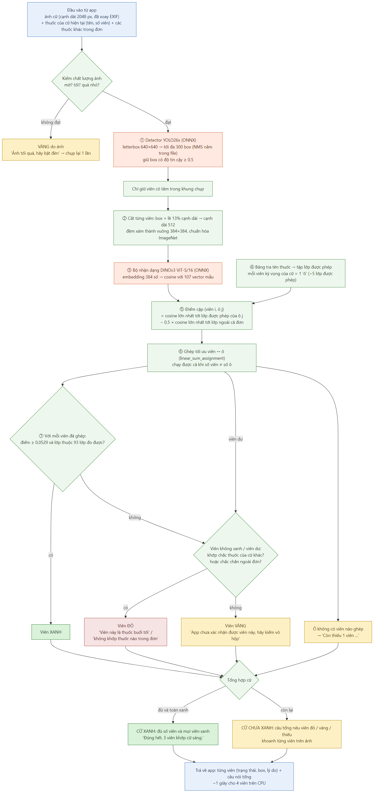
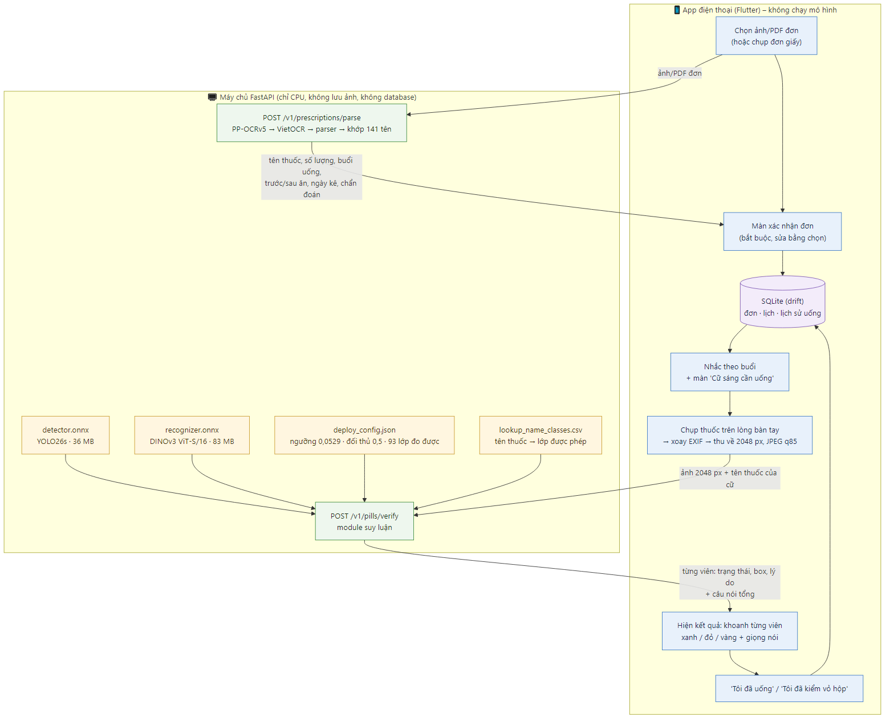

# MediCheck VN – phần AI

Trợ lý kiểm tra thuốc cho người cao tuổi qua camera điện thoại. Có 2 việc chính:
1. **Đơn thuốc → lịch uống**: đọc đơn bằng OCR, người dùng xác nhận.
2. **Kiểm viên thuốc theo cữ**: chụp các viên sắp uống, app báo từng viên **xanh** (khớp đơn), **đỏ** (sai cữ hoặc ngoài đơn) hoặc **vàng** (chưa chắc, hãy kiểm vỏ hộp).

Repo này chứa **tài liệu dự án** và **mô hình AI cuối cùng** (chốt ngày 08/11/2026). Code train, dữ liệu và kết quả thử nghiệm giữ ở máy của người phụ trách AI.

---

## Trạng thái (cập nhật 08/11/2026)

| Việc | Trạng thái |
|---|---|
| Thử nghiệm chọn mô hình (3 phiên train trên Kaggle) | ✅ Xong |
| Chốt mô hình cuối | ✅ Xong |
| Xuất file ONNX để máy chủ chạy | ✅ Xong (`out/onnx_final/`) |
| Module suy luận + máy chủ API (`backend/`) | ✅ Xong, kiểm trên val: 90,9% báo xanh, an toàn ≤ 2% |
| Chạy tập test (một lần duy nhất) | ⏳ Đang làm |
| OCR đơn thuốc: chỉnh nghiêng, gom hàng, tách chẩn đoán | ⏳ 23–29/11 |

---

## Mô hình cuối

Hai mô hình chạy nối tiếp, sau đó là một bước ghép với đơn thuốc (luật, không phải mô hình học):

```
ảnh cữ thuốc (2048 px)
  → Detector YOLO26s: tìm vị trí từng viên
  → cắt từng viên (lề 13%)
  → Bộ nhận dạng DINOv3 ViT-S/16: điểm giống với 107 loại viên
  → ghép với thuốc của cữ trong đơn + so ngưỡng
  → xanh / đỏ / vàng cho từng viên
```



*Sơ đồ: `docs/diagrams/02_suy_luan_kiem_thuoc.png` (nguồn sửa được: `docs/diagrams/02_suy_luan_kiem_thuoc.mmd`).*

| | Detector | Bộ nhận dạng |
|---|---|---|
| Mô hình | YOLO26s (Ultralytics), 1 lớp "pill" | DINOv3 ViT-S/16 (~21 triệu tham số) + đầu cosine 107 lớp |
| Train trên | Ảnh VAIPE + ảnh nền trống + 3.051 ảnh ngoài | Crop viên VAIPE, mở toàn bộ backbone |
| File ONNX | `out/onnx_final/detector.onnx` (36 MB) | `out/onnx_final/recognizer.onnx` (83 MB) |
| Tốc độ CPU | ~140 ms / ảnh | ~190–220 ms / viên |

Khoảng **1 giây cho 4 viên** trên CPU laptop, nên máy chủ không cần GPU.

### Kết quả (trên tập validation)

| Chỉ số | Kết quả |
|---|---|
| **Cữ thuốc đúng được báo xanh** (chạy cả chuỗi từ ảnh) | **89,5%** (mục tiêu ≥ 70%) |
| Báo xanh nhầm khi có viên ngoài đơn (cận trên 95%) | ≤ 1,49% (chuẩn ≤ 2%) |
| Báo xanh nhầm khi có viên lạ đã biết (cận trên 95%) | ≤ 1,84% (chuẩn ≤ 2%) |
| Detector đếm đúng số viên | 98,7% số ảnh |
| Nhận đúng loại thuốc từng viên | 95,8% số viên |

Lưu ý:
- Đây là số **validation**. Số chính thức là **test**, chỉ chạy một lần khi mọi thứ đã khóa, và sẽ cập nhật vào đây.
- Phần cữ không được báo xanh sẽ báo **vàng** ("hãy kiểm vỏ hộp"), không phải báo sai.

---

## Dành cho nhóm app / backend



*Sơ đồ: `docs/diagrams/01_tong_quan_he_thong.png` (nguồn sửa được: `docs/diagrams/01_tong_quan_he_thong.mmd`).*

- **App không chạy mô hình.** App chụp ảnh, xoay theo EXIF, thu về **cạnh dài 2048 px, JPEG chất lượng 85** (~290 KB), rồi gửi lên máy chủ kèm tên thuốc của cữ hiện tại:
  - `POST /v1/pills/verify`: kiểm viên thuốc;
  - `POST /v1/prescriptions/parse`: đọc đơn.
- Máy chủ (FastAPI, chỉ CPU) chạy 2 file ONNX bằng ONNX Runtime: **[backend/API.md](backend/API.md)** (cách chạy, request/response, ví dụ). Chạy: `pip install -r backend/requirements.txt` rồi `uvicorn backend.medicheck_server.app:app --host 0.0.0.0 --port 8000`, xem `/docs`.
- Kết quả trả về từng viên: trạng thái xanh/đỏ/vàng, vị trí box (để khoanh trên ảnh) và lý do.
- Trạng thái và câu nói cho người dùng: [MediCheck_decisions.md](MediCheck_decisions.md) mục 5.
- Các luồng màn hình: [MediCheck_brainstorm.md](MediCheck_brainstorm.md) mục 4.

### Định dạng file ONNX

| File | Đầu vào | Đầu ra |
|---|---|---|
| `detector.onnx` | `images` float `[1, 3, 640, 640]` (letterbox kiểu Ultralytics, RGB, 0–1) | `output0` `[1, 300, 6]` = x1, y1, x2, y2, độ tin cậy, lớp (NMS đã nằm trong file) |
| `recognizer.onnx` | `image` float `[n, 3, 384, 384]`: crop viên đệm xám thành vuông, chuẩn hóa ImageNet | `embedding` `[n, 384]`, `cosine` `[n, 107]` |

`out/onnx_final/deploy_config.json` ghi các tham số triển khai, không được sửa tay:
- ngưỡng tin cậy detector 0,5;
- lề crop 13%;
- hệ số đối thủ 0,5;
- ngưỡng báo xanh 0,0529;
- danh sách 93 lớp được phép báo xanh (14 lớp còn lại luôn báo vàng);
- cỡ ảnh gửi lên.

`out/onnx_final/lookup_name_classes.csv` là bảng tra **tên thuốc trên đơn → các lớp viên được phép** (138 tên, chỉ lập từ tập train, đúng bảng đã dùng khi đo an toàn).

---

## Nội dung repo

| Đường dẫn | Nội dung |
|---|---|
| [MediCheck_AI_progress.md](MediCheck_AI_progress.md) | **Đọc đầu tiên:** trạng thái, việc tiếp theo, danh sách cần cập nhật vào báo cáo |
| [MediCheck_decisions.md](MediCheck_decisions.md) | Sổ quyết định kỹ thuật (nguồn cao nhất). Mục 0 tóm tắt bản cuối, mục 12 là bằng chứng thử nghiệm |
| [MediCheck_AI_tong_hop.md](MediCheck_AI_tong_hop.md) | Tài liệu ôn bảo vệ phần AI, có giải thích dễ hiểu và câu hỏi hội đồng hay hỏi |
| [MediCheck_brainstorm.md](MediCheck_brainstorm.md) | Sản phẩm và trải nghiệm: phạm vi, persona, các luồng màn hình |
| [vaipe_analysis.md](vaipe_analysis.md) | Sự thật về bộ dữ liệu VAIPE |
| [MediCheck_citation_evidence.md](MediCheck_citation_evidence.md) | Câu gốc đối chiếu cho từng tài liệu tham khảo của báo cáo |
| `out/onnx_final/` | **Bản triển khai:** `detector.onnx`, `recognizer.onnx`, `deploy_config.json`, `export.json` (kết quả kiểm khớp PyTorch, độ trễ) |
| `out/s2/det/d2b/weights/best.pt`, `eval_val.json` | Detector cuối dạng PyTorch + số đo trên val |
| `out/s3/r3b_seed1/model.pt`, `final.json` | Bộ nhận dạng cuối dạng PyTorch + số đo trên val |
| [backend/](backend/) | **Máy chủ AI**: module suy luận (`medicheck_server/infer.py`), FastAPI (`app.py`), [API.md](backend/API.md), `requirements.txt`, kiểm thử |
| `docs/diagrams/` | 7 sơ đồ pipeline (ảnh PNG + nguồn Mermaid `.mmd`): tổng quan hệ thống, kiểm thuốc khi app chạy, tiền xử lý dữ liệu, train và chọn mô hình, đánh giá cả chuỗi, OCR, luồng người dùng |
| [BAO_CAO_CONG_VIEC.md](BAO_CAO_CONG_VIEC.md) | Báo cáo ngắn sau mỗi phần việc |
| [LICENSE-DINOv3.md](LICENSE-DINOv3.md) | Giấy phép DINOv3 (bắt buộc kèm theo khi phân phối trọng số dẫn xuất từ DINOv3) |

**Nên đọc theo thứ tự:**
1. README này;
2. [MediCheck_AI_progress.md](MediCheck_AI_progress.md) mục 1–2;
3. [MediCheck_brainstorm.md](MediCheck_brainstorm.md) (nhóm app);
4. [MediCheck_AI_tong_hop.md](MediCheck_AI_tong_hop.md) (chuẩn bị bảo vệ).

---

## Dữ liệu

- **VAIPE_PILL** (dữ liệu cuộc thi AI4VN 2022, Hugging Face `Elfsong/VAIPE_PILL`): 9.502 ảnh viên thuốc, 107 lớp, 1.173 đơn thuốc, 141 tên thuốc.
- **Bộ bổ trợ** Kaggle `alexanderyyy/pills-detection-dataset` (CC BY-NC-SA 4.0): chỉ dùng cho detector.
- **Chia train/val/test theo nhóm đơn gần trùng.** Tập test khóa đến lần chạy cuối.

---

## Giới hạn và giấy phép

- **Phạm vi:**
  - Prototype cho danh mục đóng: 141 tên thuốc của một hệ thống bệnh viện. Thuốc ngoài danh mục chỉ được nhắc lịch.
  - Không kiểm hàm lượng.
  - Chưa thử với ảnh chụp đơn giấy thật và người cao tuổi thật.
- **Số đo:** số an toàn đo bằng viên lạ cùng nguồn dữ liệu, nên có thể lạc quan với thuốc hoàn toàn mới.
- App là **công cụ hỗ trợ, không thay thế dược sĩ**.
- **Giấy phép:**
  - YOLO26 / Ultralytics: **AGPL-3.0**. Phát hành dịch vụ ra ngoài phải công bố mã nguồn backend.
  - DINOv3: **DINOv3 License** của Meta (xem [LICENSE-DINOv3.md](LICENSE-DINOv3.md)). Công bố phải ghi nhận DINOv3.
  - Bộ bổ trợ: CC BY-NC-SA 4.0, không thương mại.

Dự án môn học, nhóm 3 người, hoàn thành cuối 12/2026.
