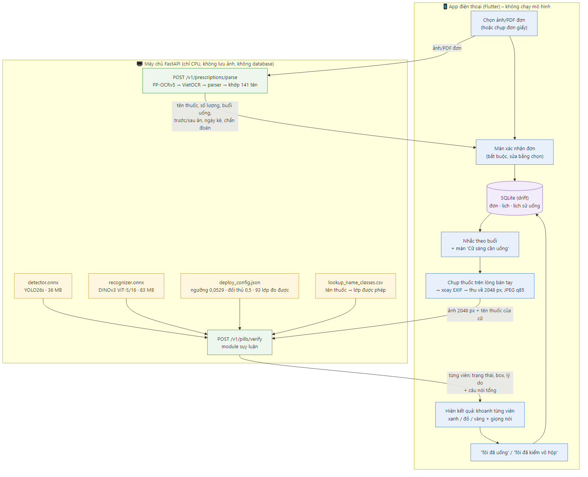

# MediCheck VN

App giúp người cao tuổi **uống đúng thuốc theo đơn** bằng camera điện thoại:

1. **Đơn thuốc → lịch uống:** chọn hoặc chụp đơn BHYT; server đọc đơn (OCR); người dùng xác nhận trên màn chữ to; app nhắc theo 4 buổi.
2. **Kiểm thuốc theo cữ:** đặt các viên sắp uống lên lòng bàn tay, chụp; app khoanh từng viên **xanh** (khớp đơn), **đỏ** (sai cữ hoặc ngoài đơn) hoặc **vàng** (chưa chắc, hãy kiểm vỏ hộp). Chỉ khi cả cữ xanh mới có nút "Tôi đã uống".

App hỗ trợ đối chiếu với đơn, **không thay thế dược sĩ**. Dự án môn học, nhóm 3 người, hạn cuối 31/12/2026.

## Trạng thái

| Phần | Trạng thái |
|---|---|
| Mô hình AI kiểm thuốc (YOLO26s + DINOv3, ONNX) | ✅ Chốt 08/11/2026, đã chạy tập test một lần |
| OCR đơn thuốc (PP-OCRv5 + VietOCR, ONNX) | ✅ Xong |
| Server AI (`backend/`, FastAPI, CPU) | ✅ Xong, có test |
| Bộ tài liệu cho app (`docs/`) | ✅ Chốt 15/11/2026 |
| App Flutter (`mobile/`) | 🔄 ST-01.1 và ST-01.2 xong (khung Flutter 3.50.0, gói ADR-015, cấu hình Android); tiếp theo ST-01.3 ([roadmap](docs/product/roadmap.md)) |

## Kết quả (tập test, chạy một lần)

| Chỉ số | Kết quả | Chuẩn |
|---|---|---|
| Cữ thuốc đúng được báo xanh (cả chuỗi, qua server thật) | **90,2%** | ≥ 70% |
| Báo xanh nhầm khi có viên ngoài đơn (cận trên 95%) | **≤ 1,09%** | ≤ 2% |
| Báo xanh nhầm khi có viên lạ đã biết (cận trên 95%) | **≤ 1,31%** | ≤ 2% |
| Detector đếm đúng số viên | 98,5% | – |
| OCR: dòng thuốc đúng hoàn toàn (ảnh gốc / mô phỏng chụp giấy) | 99,85% / 98,93% | – |

Cữ không được báo xanh sẽ báo vàng ("hãy kiểm vỏ hộp"), không phải báo sai. Chi tiết: [docs/ai/model-card.md](docs/ai/model-card.md).

## Kiến trúc



- **App Flutter** (demo chính trên máy giả lập Android): lưu mọi dữ liệu trên máy (SQLite), nhắc cục bộ, không tài khoản.
- **Server AI** chạy trên laptop, chỉ CPU, không lưu gì: `POST /v1/prescriptions/parse`, `POST /v1/pills/verify`, `GET /v1/catalog`, `GET /health`.
- App không chạy mô hình. Chi tiết: [docs/architecture/system-architecture.md](docs/architecture/system-architecture.md).

## Chạy server

**Bằng Docker (khuyên dùng, cần Docker Desktop):**

```bash
docker compose up --build -d     # lần đầu build ~1 GB; tắt: docker compose down
```

**Bằng Python** (dự phòng, Python 3.10–3.13), chạy từ thư mục gốc repo:

```bash
python -m venv .venv
.venv\Scripts\activate              # Windows; macOS/Linux: source .venv/bin/activate
python -m pip install -r backend/requirements.txt
python -m uvicorn backend.medicheck_server.app:app --host 0.0.0.0 --port 8000
```

Cả hai cách đều phục vụ ở cổng 8000. Mở <http://localhost:8000/docs> để thử API. Máy giả lập Android gọi server ở `http://10.0.2.2:8000`. Cài đặt cho buổi demo, mạng, xử lý sự cố: [docs/architecture/deployment.md](docs/architecture/deployment.md). Hướng dẫn API có ví dụ curl và Dart: [backend/API.md](backend/API.md).

Kiểm thử: `python backend/tests/test_decide.py`.

## Cấu trúc repo

| Đường dẫn | Nội dung |
|---|---|
| [AGENTS.md](AGENTS.md) | Luật cho AI agent và người mới: đọc trước khi sửa code |
| [docs/](docs/README.md) | Bộ tài liệu: sản phẩm, kiến trúc, ADR, AI, kiểm thử, quy trình |
| `Dockerfile`, `docker-compose.yml` | Đóng gói server ([ADR-017](docs/architecture/adr/docker-server.md)) |
| [backend/](backend/) | Server AI: `medicheck_server/` (suy luận, FastAPI), `tests/`, `export_openapi.py` |
| `out/onnx_final/` | Mô hình triển khai: ONNX, `deploy_config.json`, bảng tra tên → lớp. **Không sửa tay** |
| `out/s2/`, `out/s3/` | Trọng số PyTorch của bản cuối (để xuất lại ONNX) |
| `mobile/` | App Flutter (Flutter 3.50.0; xem [mobile/README.md](mobile/README.md)) |
| [LICENSE-DINOv3.md](LICENSE-DINOv3.md) | Giấy phép DINOv3, bắt buộc kèm trọng số |

Code train, dữ liệu và log thí nghiệm giữ ở máy người phụ trách AI, không đưa lên repo.

## Tài liệu nên đọc

| Bạn là | Đọc |
|---|---|
| Thành viên mới | [business-analysis](docs/product/business-analysis.md) → [prd](docs/product/prd.md) → [ui-ux-spec](docs/product/ui-ux-spec.md) |
| Người viết app | [AGENTS.md](AGENTS.md) → [roadmap](docs/product/roadmap.md) → [erd](docs/architecture/erd.md) → [openapi.yaml](docs/architecture/openapi.yaml) |
| Người dùng AI để code | [docs/process/ai-workflow.md](docs/process/ai-workflow.md) |
| Người chuẩn bị bảo vệ | [model-card](docs/ai/model-card.md) → [dataset](docs/ai/dataset.md) → [ADR](docs/architecture/adr/README.md) |

## Dữ liệu

- **VAIPE_PILL** (AI4VN 2022, Hugging Face `Elfsong/VAIPE_PILL`): 9.502 ảnh viên thuốc, 107 lớp, 1.173 đơn, 141 tên thuốc.
- **Bộ bổ trợ** Kaggle `alexanderyyy/pills-detection-dataset` (CC BY-NC-SA 4.0): chỉ dùng cho detector.
- Chia train/val/test theo nhóm đơn gần trùng; tập test khóa suốt quá trình chọn mô hình. Chi tiết: [docs/ai/dataset.md](docs/ai/dataset.md).

## Giới hạn

- Danh mục đóng 138 tên thuốc của một hệ thống bệnh viện; thuốc ngoài danh mục chỉ được nhắc lịch. Không kiểm hàm lượng.
- Chưa thử với ảnh chụp đơn giấy thật và người cao tuổi thật, nên màn xác nhận đơn là bắt buộc.
- Số an toàn đo bằng viên lạ cùng nguồn dữ liệu; có thể lạc quan với thuốc hoàn toàn mới.
- Database và ảnh đơn trên điện thoại chưa mã hóa.

## Giấy phép

- YOLO26 / Ultralytics: **AGPL-3.0**; phát hành dịch vụ ra ngoài phải công bố mã nguồn backend.
- DINOv3: **DINOv3 License** của Meta ([LICENSE-DINOv3.md](LICENSE-DINOv3.md)); công bố phải ghi nhận DINOv3.
- Bộ dữ liệu bổ trợ: CC BY-NC-SA 4.0, không thương mại.
- PP-OCRv5 (Apache-2.0) và VietOCR: giấy phép cần kiểm lại trước khi nộp ([docs/ai/model-card.md](docs/ai/model-card.md)).
