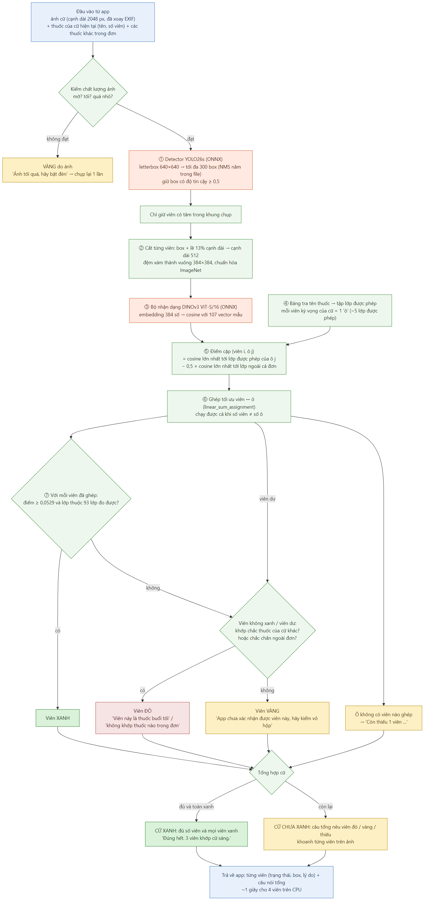

# MediCheck AI – API kiểm thuốc (dành cho nhóm app)

Máy chủ FastAPI chạy 2 mô hình ONNX trên CPU. **App không chạy mô hình**: app chỉ chụp ảnh, gửi lên và hiển thị kết quả.



## Chạy máy chủ

```bash
# từ thư mục gốc repo (cần Python 3.10+)
pip install -r backend/requirements.txt
uvicorn backend.medicheck_server.app:app --host 0.0.0.0 --port 8000
```

- Tài liệu tương tác (thử API ngay trên trình duyệt): `http://<ip-máy-chủ>:8000/docs`.
- Kiểm tra máy chủ sống: `GET /health` → `{"ok": true, "model_version": "final-2026-11-08"}`.
- Khởi động khoảng 3 giây (nạp 2 mô hình). Mỗi lần kiểm khoảng 1–2 giây cho 3–5 viên trên CPU laptop.
- Demo: điện thoại và laptop cùng mạng Wi-Fi, app gọi `http://<ip-laptop>:8000`.
- Biến môi trường (không bắt buộc):
  - `MEDICHECK_MODEL_DIR`: mặc định `out/onnx_final`;
  - `MEDICHECK_LOOKUP`: mặc định `out/onnx_final/lookup_name_classes.csv`;
  - `MEDICHECK_THREADS`: mặc định 4.

## `POST /v1/pills/verify`

Kiểm các viên thuốc của **một cữ**. Body dạng `multipart/form-data` gồm 2 phần:

| Phần | Kiểu | Nội dung |
|---|---|---|
| `image` | file JPEG | Ảnh cữ thuốc. App **xoay theo EXIF rồi thu về cạnh dài 2048 px, JPEG chất lượng 85** (~290 KB). Ảnh lớn hơn sẽ bị máy chủ thu nhỏ |
| `payload` | chuỗi JSON | Thông tin cữ (bên dưới) |

### `payload`

```json
{
  "session": "sang",
  "session_lines": [
    {"line_id": "12", "name": "cardilopin 5mg", "count": 2},
    {"line_id": "13", "name": "hoạt huyết dưỡng não 150mg+20mg", "count": 2}
  ],
  "other_lines": [
    {"line_id": "14", "name": "cosyndo b 175mg+175mg+125mcg", "sessions": ["toi"]}
  ],
  "unchecked_count": 0,
  "frame": null
}
```

| Trường | Bắt buộc | Ý nghĩa |
|---|---|---|
| `session` | có | Cữ hiện tại: `sang` / `trua` / `chieu` / `toi` |
| `session_lines` | có (≥ 1) | Các thuốc **được chấm ảnh** của cữ này. Mỗi dòng gồm:<br>• `line_id`: `drug_line.id` trong SQLite;<br>• `name`: `drug_line.matched_name`, đúng tên đã khớp từ điển khi OCR;<br>• `count`: số viên của thuốc đó trong cữ |
| `other_lines` | nên có | **Mọi dòng thuốc khác của cùng đơn**, kèm các cữ của dòng đó. Dùng để: (1) báo đỏ "Viên này là thuốc buổi tối"; (2) biết thuốc nào thuộc đơn. Thiếu trường này thì ít báo đỏ hơn, nhưng **không** làm báo xanh sai |
| `unchecked_count` | không | Số viên trong cữ **không chấm được bằng ảnh**: thuốc "chỉ nhắc lịch", liều 1/2 viên. Máy chủ sẽ không báo đỏ oan các viên này |
| `frame` | không | Khung chụp trên màn hình, dạng `[x1, y1, x2, y2]` theo tỉ lệ 0–1 của ảnh. Viên có tâm nằm ngoài khung bị bỏ qua (ví dụ vỉ thuốc trên bàn) |

**Lưu ý cho app:**
- `name` phải là tên **đã khớp với từ điển**, không phải chữ OCR thô. Bảng tra triển khai có 138 tên (`out/onnx_final/lookup_name_classes.csv`).
- Dòng có tên không nằm trong từ điển được máy chủ tự coi là "chỉ nhắc lịch".
- Thuốc "khi cần" không gửi vào `session_lines`.
- Khi **chụp lại** sau lần vàng/đỏ: bỏ các viên đã xanh ra khỏi tay, và chỉ gửi các dòng chưa xong với `count` còn lại.

### Kết quả trả về

```json
{
  "status": "not_green",
  "summary": "Có 2 viên không đúng, hãy bỏ ra.",
  "pills": [
    {"box": [0.236, 0.440, 0.431, 0.743], "detector_conf": 0.946, "status": "green", "reason": "match",
     "line_id": "12", "name": "cardilopin 5mg", "message": "Viên này khớp cardilopin 5mg."},
    {"box": [0.396, 0.699, 0.571, 0.797], "detector_conf": 0.939, "status": "red", "reason": "other_dose",
     "line_id": "14", "name": "cosyndo b 175mg+175mg+125mcg",
     "message": "Viên này là thuốc buổi tối (cosyndo b 175mg+175mg+125mcg). Đừng uống viên này trong cữ này."}
  ],
  "missing": [{"line_id": "13", "name": "hoạt huyết dưỡng não 150mg+20mg", "count": 1}],
  "n_expected": 4,
  "n_detected": 3,
  "quality": {"ok": true, "issue": null, "brightness": 136.0, "sharpness": 36.0},
  "timing_ms": {"decode": 51, "detect": 147, "recognize": 1001, "total": 1228},
  "model_version": "final-2026-11-08"
}
```

| Trường | Ý nghĩa và cách hiển thị |
|---|---|
| `status` | `green`: **đủ viên và mọi viên khớp** → "Đúng hết", hiện nút "Tôi đã uống".<br>`partial`: mọi viên chấm được đều khớp, nhưng còn viên chỉ kiểm bằng vỏ hộp.<br>`not_green`: còn viên đỏ/vàng hoặc thiếu/thừa viên |
| `summary` | **Câu đọc to trước tiên** (TTS) |
| `pills[]` | Từng viên phát hiện được:<br>• `box`: vị trí theo tỉ lệ 0–1 của ảnh đã gửi, dùng để khoanh;<br>• `status`: `green` / `red` / `yellow`;<br>• `message`: câu hiển thị/đọc khi chạm vào viên |
| `pills[].reason` | `match`: khớp.<br>`other_dose`: thuốc của cữ khác.<br>`not_in_prescription`: không thuộc đơn.<br>`uncertain`: chưa chắc.<br>`unmeasurable_class`: loại viên chưa đủ dữ liệu để báo xanh.<br>`extra`: viên dư.<br>`not_checkable`: có thể là thuốc chỉ nhắc lịch |
| `missing[]` | Thuốc còn thiếu viên → "Còn thiếu 1 viên …" |
| `quality` | `issue` = `dark` / `blurry` khi ảnh tối/mờ. **Không bao giờ làm cữ xanh thành vàng**: chỉ thêm lời khuyên chụp lại vào `summary` khi cữ chưa xanh |

Khung khoanh gợi ý: xanh = nét liền, vàng = nét đứt, đỏ = nét dày. Luôn kèm biểu tượng ✓ ? ✗, không chỉ dùng màu.

### Lỗi

| Mã | Khi nào |
|---|---|
| 422 | `payload` sai định dạng (ví dụ thiếu `session_lines`, `session` không hợp lệ) |
| 400 | Ảnh rỗng hoặc không đọc được |

### Ví dụ gọi bằng curl

```bash
curl -X POST http://localhost:8000/v1/pills/verify \
  -F "image=@cu_sang.jpg;type=image/jpeg" \
  -F 'payload={"session":"sang","session_lines":[{"line_id":"12","name":"cardilopin 5mg","count":2}],"other_lines":[]}'
```

## `POST /v1/prescriptions/parse`

Đọc đơn thuốc (OCR). **Chưa có**, trả về 501. Lịch làm: 23–29/11. Định dạng sẽ bổ sung vào file này.

## An toàn: vì sao tin được màu xanh

- Ngưỡng báo xanh được chọn sao cho khi có viên ngoài đơn hoặc viên lạ, khả năng vẫn báo xanh có **cận trên 95% ≤ 2%** (đo trên dữ liệu chưa dùng để chọn).
- Màu đỏ và lời khuyên về ảnh chỉ là hướng dẫn: chúng **không bao giờ** biến một cữ thành xanh.
- Số đo chi tiết: `MediCheck_decisions.md` mục 0 và 13.
