# Mô hình dữ liệu (ERD)

> **Trả lời câu hỏi:** app lưu gì, ở đâu, ràng buộc ra sao.
> Database **chỉ có trên điện thoại**: SQLite qua `drift`. Server không có database ([ADR-003](adr/local-first-no-accounts.md)).
> Cập nhật: 2026-11-15 · Phiên bản schema: 1 · Trạng thái: **đã chốt**

## 1. Sơ đồ

```mermaid
erDiagram
  prescription ||--o{ drug_line : "có"
  drug_line ||--o{ dose_schedule : "uống vào"
  dose_event ||--o{ verification_attempt : "được kiểm"
  verification_attempt ||--o{ verification_item : "gồm"
  drug_line |o--o{ verification_item : "khớp với"

  prescription {
    int id PK
    text source_type "image|pdf|camera|sample"
    text issued_date "YYYY-MM-DD, null"
    text diagnosis_text "chỉ hiển thị, null"
    int imported_at "epoch ms"
    int confirmed_at "epoch ms"
    text status "active|ended"
    int ended_at "epoch ms, null"
    text image_path "tương đối trong thư mục app, null"
    text image_mime "image/jpeg|image/png|application/pdf, null"
    text model_version "server lúc đọc đơn"
  }
  drug_line {
    int id PK
    int prescription_id FK
    int position "thứ tự trên đơn"
    text raw_name "chữ OCR, để hiển thị"
    text matched_name "tên danh mục, null = ngoài danh mục"
    real name_score
    int quantity "SL, null"
    text usage_text "lịch như đọc được"
    text note_text "trước/sau/trong khi ăn, null"
    text dose_type "regular|half_pill|as_needed|missing_schedule"
    text check_mode "image|reminder_only"
    text start_date "YYYY-MM-DD"
    text end_date "YYYY-MM-DD, null"
    real ocr_confidence
    bool edited_by_user
  }
  dose_schedule {
    int id PK
    int drug_line_id FK
    text session "sang|trua|chieu|toi"
    int amount_halves "2 = 1 viên, 1 = nửa viên"
  }
  dose_event {
    int id PK
    text event_date "YYYY-MM-DD"
    text session "sang|trua|chieu|toi"
    text status "pending|taken|missed"
    int taken_at "epoch ms, null"
    text confirm_type "app_verified|self_confirmed, null"
  }
  verification_attempt {
    int id PK
    int dose_event_id FK
    int attempt_no "1 hoặc 2"
    text status "green|partial|not_green|error"
    text summary
    int n_expected
    int n_detected
    int latency_ms
    text model_version
    int created_at "epoch ms"
  }
  verification_item {
    int id PK
    int attempt_id FK
    int drug_line_id FK "null = viên dư/lạ"
    text state "green|yellow|red"
    text reason "match|other_dose|not_in_prescription|uncertain|unmeasurable_class|extra|not_checkable"
    real x1
    real y1
    real x2
    real y2
    text message
  }
  setting {
    text key PK
    text value
  }
  catalog_name {
    text name PK
    text model_version
  }
```

## 2. Ràng buộc và quy tắc

| Bảng | Ràng buộc |
|---|---|
| `prescription` | **Tối đa một đơn `active`** (BR-12): `CREATE UNIQUE INDEX one_active_prescription ON prescription(status) WHERE status = 'active'`. Lưu đơn mới: trong cùng transaction, đơn cũ `status = ended`, `ended_at = bây giờ`, rồi chèn đơn mới. `ended_at` khác null khi và chỉ khi `status = ended`. Xóa đơn thì app xóa cả file `image_path` (ADR-016) |
| `drug_line` | FK `prescription_id` **ON DELETE CASCADE**. `check_mode = image` chỉ khi `matched_name IS NOT NULL` và `dose_type = regular`; mọi trường hợp khác là `reminder_only` (BR-03, BR-04) |
| `dose_schedule` | FK **ON DELETE CASCADE**. `UNIQUE(drug_line_id, session)`. `amount_halves > 0`. Dòng `as_needed` và `missing_schedule` không có bản ghi nào |
| `dose_event` | `UNIQUE(event_date, session)`: một cữ mỗi buổi mỗi ngày, theo đơn đang dùng. Tạo khi đến giờ nhắc hoặc khi người dùng mở cữ. `taken_at` và `confirm_type` khác null khi và chỉ khi `status = taken` |
| `verification_attempt` | FK **ON DELETE CASCADE**. `UNIQUE(dose_event_id, attempt_no)`, `attempt_no ∈ {1, 2}` (BR-08) |
| `verification_item` | FK `attempt_id` **ON DELETE CASCADE**; FK `drug_line_id` **ON DELETE SET NULL** (xóa đơn không xóa lịch sử cữ). Tọa độ box theo tỉ lệ 0–1 của ảnh đã gửi |
| `setting` | Khóa đã biết: `server_url`, `time_sang`, `time_trua`, `time_chieu`, `time_toi` (HH:MM), `tts_enabled` (0/1), `onboarding_done` (0/1), `schema_version` |
| `catalog_name` | Bản sao `GET /v1/catalog` để sửa tên khi mất mạng; nạp lại khi `model_version` đổi |

**Không lưu** (BR-10): ảnh thuốc; họ tên, số BHYT, địa chỉ dạng chữ. Ảnh thuốc chỉ nằm trong bộ nhớ lúc gửi; màn kết quả vẽ box lên ảnh đang giữ trong bộ nhớ, rời màn là bỏ.

**File ngoài database:** ảnh đơn gốc ở `<app documents>/prescriptions/<prescription_id>.<ext>` ([ADR-016](adr/prescription-image-on-device.md)). Ghi file trước, rồi commit transaction; transaction lỗi thì xóa file vừa ghi.

## 3. Quy tắc suy ra (dùng chung cho mọi màn)

| Giá trị | Cách tính |
|---|---|
| Dòng còn hiệu lực vào ngày D | `prescription.status = active` và `start_date ≤ D` và (`end_date IS NULL` hoặc `D ≤ end_date`) |
| `end_date` | `start_date + ⌈quantity ÷ (tổng amount_halves mỗi ngày ÷ 2)⌉ − 1` ngày; `quantity` null → null (OQ-02) |
| Các dòng của cữ (D, buổi) | Dòng còn hiệu lực vào D có `dose_schedule` của buổi đó |
| `session_lines` | Dòng của cữ có `check_mode = image`; `count = amount_halves / 2` |
| `unchecked_count` | Tổng số viên của dòng trong cữ có `check_mode = reminder_only`, nửa viên tính 1 |
| Đơn tự kết thúc | Sau ngày D, mọi dòng của đơn `active` đều có `end_date < D` → đơn `ended` (kiểm khi mở app) |
| `other_lines` | Mọi dòng còn hiệu lực khác của đơn đang dùng, `sessions` = các buổi của dòng đó; `line_id = drug_line.id` dạng chuỗi |
| Số viên của cữ (câu nhắc) | Tổng `⌈amount_halves / 2⌉` của các dòng trong cữ |
| `dose_event.status = missed` | Hết ngày `event_date` mà vẫn `pending` (tính khi mở app) |

Ánh xạ từ `ParseResponse` (server) sang bảng:

| Server | Cột |
|---|---|
| `lines[].index` | `drug_line.position` |
| `lines[].raw_name`, `name`, `name_score` | `raw_name`, `matched_name`, `name_score` |
| `lines[].quantity`, `usage_text`, `note`, `dose_type`, `ocr_confidence` | `quantity`, `usage_text`, `note_text`, `dose_type`, `ocr_confidence` |
| `lines[].schedule` (`{"sang": "1", "toi": "1/2"}`) | mỗi khóa một `dose_schedule`; `"1"` → 2, `"2"` → 4, `"1/2"` → 1 |
| `diagnosis`, `issued_date` | `prescription.diagnosis_text`, `issued_date` |

## 4. Migration

- `drift` `schemaVersion = 1` ở MVP. Mọi đổi bảng phải tăng `schemaVersion` và viết bước migration; không xóa database của người dùng.
- Bật `PRAGMA foreign_keys = ON` khi mở database (SQLite tắt mặc định).
