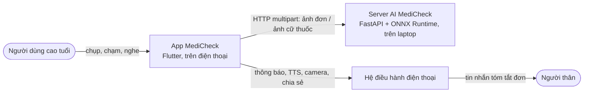
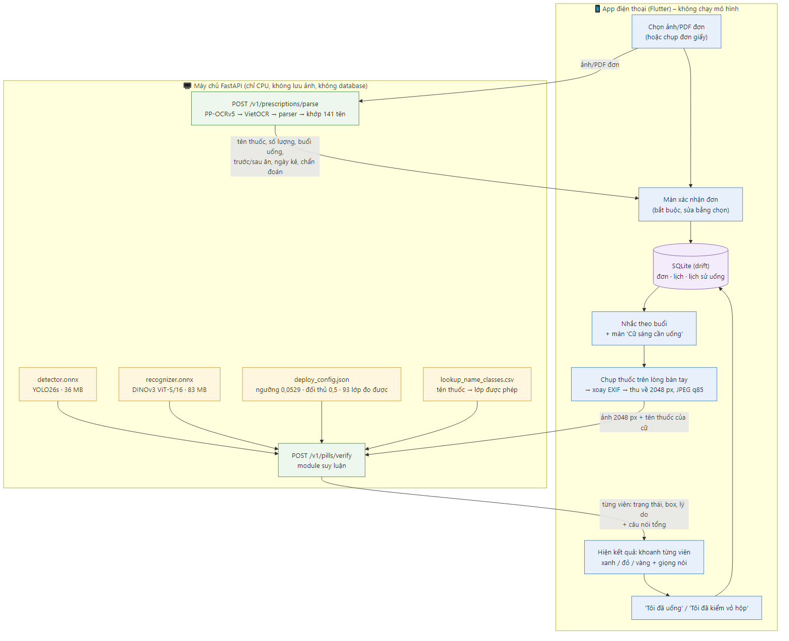
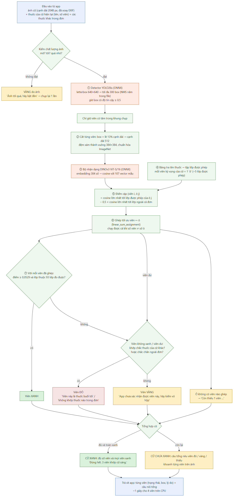

# Kiến trúc hệ thống

> **Trả lời câu hỏi:** hệ thống gồm những phần nào, chạy ở đâu, nói chuyện với nhau ra sao, code app tổ chức thế nào.
> Quyết định gốc: [adr/](adr/README.md). Hợp đồng API: [openapi.yaml](openapi.yaml) (sinh từ code) và [../../backend/API.md](../../backend/API.md) (hướng dẫn có ví dụ). Dữ liệu: [erd.md](erd.md). Chạy demo: [deployment.md](deployment.md).
> Cập nhật: 2026-11-15 · Trạng thái: **đã chốt**

## 1. Bối cảnh (C4 mức 1)



- **Không có** dịch vụ bên thứ ba nào khi chạy: không cloud, không API AI thuê ngoài, không tài khoản.
- Server **không lưu trạng thái**: không database, không ghi ảnh ra đĩa. Mọi dữ liệu người dùng ở SQLite trên điện thoại.



## 2. Các khối (C4 mức 2)

| Khối | Công nghệ | Trách nhiệm | Thư mục |
|---|---|---|---|
| App di động | Flutter (Dart), Android trước ([ADR-002](adr/flutter-android-first.md)) | Giao diện, lịch và nhắc, database cục bộ, chuẩn bị ảnh, gọi API, đọc giọng nói | `mobile/` (chưa tạo) |
| Database cục bộ | SQLite qua `drift` | Đơn, dòng thuốc, lịch, cữ, lịch sử kiểm | trong app |
| Server AI | Python 3.10–3.13, FastAPI, Uvicorn, ONNX Runtime CPU | Đọc đơn (OCR), kiểm thuốc, danh mục | `backend/medicheck_server/` |
| Module kiểm thuốc | `PillVerifier` (`infer.py`) | Detector → crop → nhận dạng → ghép → xanh/đỏ/vàng, câu nói | `backend/medicheck_server/infer.py` |
| Module đọc đơn | `PrescriptionReader` (`ocr.py`) | Tìm dòng chữ → đọc chữ → luật tách trường → khớp danh mục | `backend/medicheck_server/ocr.py` |
| File mô hình | ONNX + JSON + CSV có phiên bản | Trọng số, ngưỡng, bảng tra tên → lớp | `out/onnx_final/` |

**Server API** (chi tiết [openapi.yaml](openapi.yaml)):

| Endpoint | Việc | Thời gian (CPU laptop) |
|---|---|---|
| `POST /v1/prescriptions/parse` | Ảnh/PDF đơn → dòng thuốc, lịch, ngày kê, chẩn đoán | ~5 giây |
| `POST /v1/pills/verify` | Ảnh cữ + danh sách thuốc → trạng thái từng viên, câu nói, thiếu/thừa | ~1–2 giây cho 3–5 viên |
| `GET /v1/catalog` | 138 tên thuốc kiểm được bằng hình | tức thì |
| `GET /health` | Server sống chưa, phiên bản mô hình | tức thì |
| `GET /docs` | Trang thử API tương tác (Swagger) | – |

## 3. Bên trong server AI



- **Kiểm thuốc:** xoay EXIF → thu về 2048 px → kiểm chất lượng (tối/mờ, chỉ để khuyên) → YOLO26s 640 px, ngưỡng 0,5 → giữ viên có tâm trong `frame` → crop lề 13% → DINOv3 ViT-S/16 384 px → cosine với 107 lớp → bảng tra tên → tập lớp được phép → điểm có trừ đối thủ (hệ số 0,5) → ghép tối ưu → ngưỡng xanh 0,0529 → đỏ "cữ khác" (0,0529) / đỏ "ngoài đơn" (0,30) / vàng. Chi tiết: [../ai/model-card.md](../ai/model-card.md).
- **Đọc đơn:** PDF → ảnh trang đầu (`pypdfium2`) → chỉnh nghiêng → PP-OCRv5 mobile det (ONNX) → gom hàng → VietOCR `vgg_transformer` (ONNX, giải mã tham lam) → luật tách trường → khớp mờ với 138 tên (cutoff 0,8).
- **Cấu hình:** biến môi trường `MEDICHECK_MODEL_DIR`, `MEDICHECK_LOOKUP`, `MEDICHECK_THREADS`. Tham số mô hình nằm trong `deploy_config.json`, **không sửa tay** (BR-11).
- **Phiên bản:** mọi phản hồi kiểm thuốc có `model_version` (hiện `final-2026-11-08`); app lưu nó vào `verification_attempt`.

## 4. Kiến trúc app di động

### 4.1. Thư viện chính

| Việc | Gói | Ghi chú |
|---|---|---|
| Quản lý trạng thái + phụ thuộc | `flutter_riverpod` | [ADR-015](adr/flutter-app-stack.md) |
| Điều hướng | `go_router` | Mở đúng màn cữ khi chạm thông báo |
| Database | `drift`, `drift_flutter` (+ `drift_dev`, `build_runner`) | Có migration, truy vấn kiểu an toàn |
| HTTP | `http` | Đủ cho multipart; ví dụ Dart có sẵn trong `backend/API.md` |
| Xử lý ảnh | `image` (v4) | Xoay EXIF, thu 2048 px, JPEG q85, chạy trong isolate (`compute`) |
| Camera / chọn file | `camera`, `file_picker` | |
| Nhắc thuốc | `flutter_local_notifications`, `timezone`, `flutter_timezone` | Nhắc theo giờ, sống qua khởi động lại |
| Giọng nói | `flutter_tts` | Giọng `vi-VN` |
| Lưu ảnh đơn | `path_provider` | Thư mục riêng của app ([ADR-016](adr/prescription-image-on-device.md)) |
| Chia sẻ | `share_plus` | FR-PRES-09: ảnh đơn gốc + ảnh phiếu (vẽ bằng `RepaintBoundary`) + chữ |

### 4.2. Cấu trúc thư mục (feature-first)

```
mobile/
  lib/
    main.dart
    app/            router.dart, theme.dart (design tokens), providers.dart
    core/
      api/          medicheck_api.dart (client), dto.dart (khớp openapi.yaml)
      db/           tables.dart, database.dart (drift), daos/
      domain/       session_rules.dart, payload_builder.dart, schedule_rules.dart  ← Dart thuần, có unit test
      media/        image_prep.dart (EXIF, 2048 px, q85)
      platform/     notifications.dart, tts.dart, share.dart
      strings_vi.dart   (mọi câu chữ của app, mục 5 của ui-ux-spec)
    features/
      onboarding/  prescription_import/  prescription_confirm/  today/
      dose/  verify/  history/  settings/  demo/
  assets/demo/      đơn mẫu và ảnh thuốc mẫu (VAIPE)
  test/             unit test cho core/domain, widget test cho màn chính
```

Quy tắc phụ thuộc: `features → core`, không có chiều ngược lại; `core/domain` không import Flutter (để test nhanh và dùng lại).

## 5. Luồng dữ liệu chính

### 5.1. Nhập đơn

```mermaid
sequenceDiagram
  actor U as Người dùng
  participant A as App
  participant S as Server AI
  participant D as SQLite
  U->>A: Chọn ảnh/PDF đơn
  A->>S: POST /v1/prescriptions/parse (file)
  S-->>A: ParseResponse (lines, diagnosis, issued_date)
  A->>U: SCR-CONFIRM (bản nháp, chưa lưu)
  U->>A: Sửa dòng (chọn từ catalog) → "Đúng rồi, tạo lịch"
  A->>D: Đơn cũ (nếu có) → ended; lưu prescription + drug_line + dose_schedule (1 transaction)
  A->>A: Chép file đơn vào thư mục app (image_path)
  A->>A: Hủy nhắc đơn cũ, lên lịch nhắc đơn mới
```

### 5.2. Kiểm một cữ

```mermaid
sequenceDiagram
  actor U as Người dùng
  participant A as App
  participant D as SQLite
  participant S as Server AI
  A->>U: Thông báo "Đến giờ uống thuốc sáng, 3 viên."
  U->>A: Chạm → SCR-DOSE → "Kiểm thuốc" → chụp
  A->>D: Lấy dòng của cữ và các dòng khác của đơn đang dùng
  A->>A: Ảnh → EXIF, 2048 px, JPEG q85; dựng payload
  A->>S: POST /v1/pills/verify (image, payload)
  S-->>A: VerifyResponse (status, summary, pills[], missing[])
  A->>D: Lưu verification_attempt + verification_item (không lưu ảnh)
  A->>U: Đọc summary, khoanh viên
  U->>A: "Tôi đã uống" (chỉ khi status = green)
  A->>D: dose_event = taken, app_verified; hủy nhắc lại
```

**Dựng `payload`** (quy tắc đầy đủ ở [erd.md](erd.md) mục 3):
- `session`: buổi của cữ (`sang`/`trua`/`chieu`/`toi`).
- `session_lines`: dòng `check_mode = image` của cữ; `line_id = drug_line.id` (chuỗi), `name = matched_name` (đúng chuỗi server trả, không đổi hoa thường), `count` = số viên.
- `other_lines`: mọi dòng còn hiệu lực khác của đơn đang dùng, kèm danh sách buổi.
- `unchecked_count`: viên chỉ nhắc lịch + nửa viên của cữ.
- `frame`: khung chụp trên màn hình đổi sang tỉ lệ 0–1 của ảnh **sau khi** xoay EXIF.
- Chụp lại: chỉ các dòng còn thiếu hoặc chưa xanh, `count` = số viên còn lại.

## 6. Các mối quan tâm chung

| Chủ đề | Cách làm |
|---|---|
| An toàn | App chỉ hiện xanh khi `status = green` (BR-01). Lỗi phân tích JSON, timeout, mất mạng → coi là lỗi, không bao giờ xanh. Không cache kết quả kiểm để dùng lại |
| Riêng tư | BR-10, [ADR-016](adr/prescription-image-on-device.md): không lưu ảnh thuốc; không lưu họ tên, số BHYT dạng chữ; ảnh đơn gốc chỉ ở thư mục riêng của app, xóa cùng đơn. Server không ghi ảnh ra đĩa, không log nội dung đơn. Ảnh chỉ đi tới server người dùng cấu hình, hoặc qua bảng chia sẻ khi người dùng tự bấm |
| Mạng | Demo dùng HTTP trong mạng nội bộ (bật cleartext cho Android, `NSAllowsLocalNetworking` cho iOS); khi qua tunnel thì HTTPS. Timeout: đọc đơn 30 giây, kiểm thuốc 20 giây. Không tự gửi lại yêu cầu kiểm thuốc |
| Mã hóa ký tự | Mọi JSON là UTF-8; luôn `utf8.decode(res.bodyBytes)` |
| Khi mất mạng | Lịch, nhắc, ghi nhận, lịch sử, sửa tên (từ `catalog_name`) chạy được; chỉ đọc đơn và kiểm thuốc cần server |
| Lỗi server | 400 → câu lỗi theo ngữ cảnh; 422 → lỗi lập trình (payload sai), ghi log debug, hiện MSG-NO-SERVER |
| Hiệu năng | Ngân sách kiểm thuốc 3 giây: chuẩn bị ảnh ≤ 0,5 s, tải lên ≤ 0,5 s (~300 KB), server ≤ 2 s |
| Giấy phép | Server dùng Ultralytics (AGPL-3.0): công khai mã nguồn backend; DINOv3 License đi kèm trọng số ([../../LICENSE-DINOv3.md](../../LICENSE-DINOv3.md)) |

## 7. Hướng phát triển (không làm ở MVP)

- Chạy mô hình trên điện thoại (ONNX Runtime Mobile, ~120 MB cho 2 mô hình kiểm thuốc) để bỏ phụ thuộc laptop.
- Đưa server lên cloud bằng Docker (cần xem lại riêng tư vì ảnh đơn là dữ liệu sức khỏe).
- Làm quen thuốc mới, tương tác thuốc, chế độ người thân.
