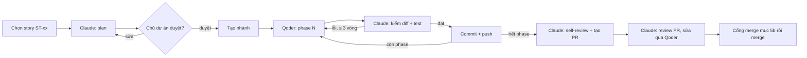

# Quy trình làm việc với AI: Claude lên plan và review, Qoder viết code

> **Trả lời câu hỏi:** một story đi từ backlog tới main như thế nào khi dùng Claude Code và Qoder CLI.
> Luật code chung cho mọi agent ở [../../AGENTS.md](../../AGENTS.md); file này chỉ nói về **luồng** và **vai trò**.
> Nhật ký vận hành (lỗi gặp, cách xử lý, đề xuất cải tiến luồng): [workflow-log.md](workflow-log.md). Mục 8 nói cách ghi.
> Cập nhật: 2026-11-15 · Trạng thái: **đã chốt**

## 1. Vai trò

| Ai | Làm | Không làm |
|---|---|---|
| **Chủ dự án** (người giao việc) | Chọn story, duyệt plan, trả lời câu hỏi, **merge PR** (hoặc cho phép Claude merge cho đúng PR đó, mục 5b) | – |
| **Claude Code** | Đọc docs, lập plan, gọi Qoder theo từng phase, kiểm diff, chạy test, commit, push, tạo PR, review PR, **ghi nhật ký vận hành** (mục 8) | Tự viết code tính năng (trừ sửa một dòng hiển nhiên khi Qoder đã thử 3 lần); merge PR (trừ khi cổng merge mục 5b đã đạt **và** chủ dự án cho phép bằng lời cho đúng PR đó); sửa docs khi chưa hỏi (trừ `tasks.csv` ở bước 9 và `workflow-log.md` ở mục 8) |
| **Qoder CLI** | Sửa đúng các file được giao trong một phase; thử chạy `flutter analyze` / `flutter test` để tự kiểm (có chạy được hay không: xem mục 3) | Mọi lệnh git ghi, `gh`, sửa file ngoài danh sách, thêm thư viện |

Chỉ Claude (hoặc người) giữ quyền ghi git, để không lọt commit sai nhánh, file cấm hay dòng tác giả AI.

## 2. Luồng một story



1. **Chọn story:** story chứa task `Todo` có `Thứ tự làm` nhỏ nhất trong [../product/tasks.csv](../product/tasks.csv) (mô tả task ở [../product/backlog.md](../product/backlog.md)). Mỗi task là một phase giao cho Qoder.
2. **Plan:** Claude đọc các FR/UC/SCR/TC mà story trỏ tới, cùng erd/openapi nếu chạm dữ liệu hoặc API, rồi viết `.ai-work/ST-xx/PLAN.md` (local, không commit):
   - mục tiêu và tiêu chí chấp nhận, chép nguyên từ PRD;
   - chia **phase** nhỏ, mỗi phase: file được sửa, việc làm, test phải có, lệnh kiểm;
   - rủi ro, chỗ chạm BR-01 / BR-10 / BR-12;
   - câu hỏi kèm đề xuất. Chỗ docs không nói → ghi `OQ-xx` mới vào PRD sau khi chủ dự án trả lời.
3. **Duyệt plan:** chỉ làm tiếp khi chủ dự án nói "duyệt".
4. **Nhánh:** `git fetch origin`, rồi `git switch -c story/ST-xx-<mo-ta-ngan> origin/main`, rồi `git push -u origin HEAD`. Luồng một story làm ở thư mục chính; 2b.1 (worktree) chỉ áp dụng khi mở nhiều story cùng lúc.
5. **Từng phase:** Claude gọi Qoder (mục 3) → kiểm (mục 4) → đạt thì commit đúng file và push. Có trục trặc thì ghi ngay vào nhật ký (mục 8).
6. **Self-review:** Claude đọc `git diff origin/main...HEAD` thật (với nhánh xếp chồng: `<nhánh-cha>...HEAD`), rà theo checklist mục 5, sửa qua Qoder. Sau self-review đạt, trước khi tạo PR: một commit riêng `chore(ST-xx): mark done` đổi trạng thái các task của story trong `tasks.csv` và, nếu có gì đáng ghi, thêm 1–3 dòng nhìn lại vào `workflow-log.md` (mục 8.3 bước 5), để hai thay đổi này được review cùng PR. Khi chạy song song (có từ 2 story mở cùng lúc, mục 2b) thì bỏ commit này và làm sau merge (bước 9, 2b.3-8).
7. **PR:** `gh pr create --base main --title "<type>(ST-xx): ..." --body-file "d:/project AI/.ai-work/ST-xx/PR_BODY.md"`. Body gồm: story, FR/SCR/TC liên quan, đã làm gì, docs đổi gì, cách test, mô tả và đường dẫn ảnh chụp emulator ở `.ai-work/ST-xx/evidence/` (ảnh không commit; chủ dự án tự đính nếu cần), giới hạn.
8. **Review PR (bắt buộc, theo mục 5b):** Claude review bản diff thật trên GitHub bằng prompt chuẩn ở mục 5b (có thể chạy song song subagent theo từng trục) và post mỗi vòng bằng `gh pr review <n> --comment`. Còn High/Medium → Qoder sửa → commit → review lại toàn bộ diff mới, tối đa 3 vòng; vòng 3 chưa đạt thì dừng và hỏi chủ dự án (mục 7). **3 là trần, không phải số vòng bắt buộc:** PR đạt cổng merge (mục 5b) ở vòng nào, kể cả vòng 1, thì được merge ngay ở vòng đó, không cần review thêm cho đủ 3 vòng.
9. **Merge:** Claude chỉ merge khi PR đã đạt **cổng merge ở mục 5b** và chủ dự án cho phép bằng lời cho đúng PR đó (lệnh merge: `gh pr merge <n> --squash`); không thì chủ dự án merge (squash) trên GitHub (chủ dự án tự merge trên GitHub là quyền của họ, ngoài luồng này). Cổng chưa đạt thì Claude không merge. Trạng thái `Done` đã đổi ở bước 6 (hoặc làm sau merge nếu chạy song song, mục 2b.3-8). Sau merge: `git switch main`, `git pull`, xác nhận `gh pr view <n> --json state` ra MERGED; squash merge làm `git branch -d` báo 'not fully merged', nên chỉ trong trường hợp này được dùng `git branch -D <nhánh story>` (ngoại lệ của 2b.3-4, chỉ khi state = MERGED và `git status` sạch); xóa nhánh remote bằng `git push origin --delete <nhánh story>`; không xóa nhánh cha khi nhánh con xếp chồng chưa `rebase --onto` (2b.4).

## 2b. Làm 2–3 story cùng lúc (worktree + nhánh xếp chồng)

Bạn vẫn làm **tuần tự theo phụ thuộc**, nhưng mở 2–3 story cùng lúc để Qoder không phải chờ. Hai loại quan hệ (xem cột `Phụ thuộc` trong [../product/tasks.csv](../product/tasks.csv)):

| Quan hệ | Gốc của nhánh mới | PR |
|---|---|---|
| **Độc lập** (không phụ thuộc story nào đang mở) | `origin/main` mới nhất | PR thường |
| **Phụ thuộc story cha của chính bạn chưa merge** | **nhánh của story cha** (xếp chồng) | PR **Draft** cho tới khi cha merge (mục 2b.5) |

Chỉ xếp chồng lên nhánh **của chính mình**. Chuỗi gợi ý: ST-06 ← ST-07 ← ST-09 (sâu 3); ST-11 ← ST-13 ← ST-14. Cặp độc lập: ST-02 ∥ ST-03 ∥ ST-04 ∥ ST-08; ST-10 ∥ ST-12; ST-17 ∥ ST-18 ∥ ST-19 ∥ ST-21; ST-05, ST-27, ST-28 với bất kỳ story nào (không đụng `mobile/`).

### 2b.1 Bố cục

```
d:\project AI\                       ← thư mục chính: chỉ fetch, quản lý worktree, đứng ở main; KHÔNG sửa code ở đây
d:\project AI_wt\ST-xx\              ← worktree của story ST-xx (nhánh story/ST-xx-…)
d:\project AI\.ai-work\ST-xx\        ← plan, log, bằng chứng (đường dẫn tuyệt đối; không commit)
d:\project AI\.ai-work\STACKS.md     ← quan hệ xếp chồng và việc "cần rebase sau phase này"
```

### 2b.2 Tạo

```powershell
cd "d:\project AI"
git fetch origin --prune
# Độc lập: gốc là main
git worktree add -b story/ST-06-import "d:\project AI_wt\ST-06" origin/main
# Xếp chồng: gốc là nhánh cha (của chính bạn, chưa merge)
git worktree add -b story/ST-07-confirm "d:\project AI_wt\ST-07" story/ST-06-import
git worktree list
cd "d:\project AI_wt\ST-07\mobile"; flutter pub get      # mỗi worktree một lần
```

Ghi quan hệ vào `.ai-work/STACKS.md` (ví dụ `ST-07 ← ST-06`). Gọi Qoder với `-w "d:\project AI_wt\ST-xx"`.

### 2b.3 Luật worktree

1. **1 worktree = 1 nhánh = 1 story.** Không làm hai story trong một worktree; không sửa code ở thư mục chính.
2. Tối đa **3 worktree** mở cùng lúc; xếp chồng sâu tối đa **3** (`main` ← A ← B ← C). Worktree chỉ để review (`review-pr<N>`) nằm ngoài giới hạn và phải dọn ngay sau review.
3. Mọi lệnh (Qoder `-w`, `flutter`, git) chạy **trong worktree của story đó**. Trước mỗi lệnh git ghi: `git rev-parse --show-toplevel` và `git branch --show-current` phải khớp story.
4. **Không xóa worktree còn thay đổi chưa commit** (`git -C <wt> status --short` phải rỗng). Không dùng `git worktree remove --force`, không `git branch -D`, trừ khi chủ dự án đồng ý, trừ ngoại lệ ở mục 2 bước 9 (nhánh story đã squash-merge, state MERGED).
5. **Flutter:** mỗi worktree có `build/` và `.dart_tool/` riêng (không copy giữa các worktree, không commit); `PUB_CACHE` và `GRADLE_USER_HOME` dùng chung nên `pub get` nhanh. **Tại một thời điểm chỉ chạy một `flutter build apk`/`flutter run`** (Gradle tranh tài nguyên và khóa nhau); `flutter analyze` và `flutter test` thì chạy song song được.
6. **Máy giả lập chỉ chạy một bản app** (cùng `applicationId`): chạy thử story nào thì cài từ worktree đó, chuyển story thì gỡ rồi cài lại. **Server Docker dùng chung** được (không có trạng thái).
7. **Chỗ dễ xung đột:** `strings_vi.dart`, `app/router.dart`, `app/providers.dart`, file drift sinh ra, `pubspec.lock`. Mỗi story chỉ **thêm khối riêng ở cuối** các file này, không sắp xếp lại, không đổi thứ tự. Thêm thư viện cần ADR mới nên không xảy ra ở giai đoạn code.
8. **`tasks.csv` không đổi trong PR story.** Sau khi PR được merge, Claude đổi trạng thái bằng một PR docs nhỏ riêng (nhánh `docs/mark-ST-xx-done`, commit `chore(ST-xx): mark done`), không push thẳng `main` (mục 6); PR nhỏ này cũng qua mục 5b.
9. **`.gitignore` kiểu danh sách cho phép** (`/*` chặn mọi thứ): thư mục hay file mới ở gốc (ví dụ `mobile/`) **bị bỏ qua im lặng** cho tới khi được mở khóa. Trước khi `git add` đường dẫn mới: `git check-ignore -v <đường dẫn>`. Mở khóa bằng commit riêng; nếu `git add` báo "paths are ignored" thì cả lệnh add bị hủy, nên luôn đọc `git diff --cached --name-only` trước khi commit.

### 2b.4 Đồng bộ nhánh xếp chồng

- **Cha có commit mới (chưa merge)** → ở worktree con: `git rebase <nhánh-cha>`, `flutter analyze` và `flutter test` lại, `git push --force-with-lease` (chỉ khi con đã push).
- **Cha đã merge vào `main`** (squash merge nên lịch sử khác): ở worktree con
  ```powershell
  git fetch origin
  git rebase --onto origin/main <nhánh-cha> <nhánh-con>
  ```
  rồi chạy `dart run build_runner build --delete-conflicting-outputs` nếu đụng drift, `flutter analyze`, `flutter test`, `push --force-with-lease`, cập nhật `STACKS.md`.
- Luôn đồng bộ **từ dưới lên** (cha trước, con sau). Conflict chỉ giải trong file của story con; conflict ở file khác → dừng, hỏi chủ dự án. Không rebase cha theo con; không cherry-pick qua lại giữa hai story.
- **Không rebase khi Qoder (hoặc `flutter`/emulator) đang chạy ở worktree đó**: rebase đổi file dưới chân Qoder và làm phase dở hỏng. Khi cha merge mà Qoder đang chạy ở con: (1) làm ngay việc không đụng worktree con (kiểm PR đã merge, đổi trạng thái task, dọn worktree cha nếu sạch); (2) ghi "cần rebase sau phase này" vào `STACKS.md`; (3) chờ Qoder xong phase → Claude kiểm → commit → `git status --short` rỗng → **mới** rebase; (4) còn thay đổi chưa commit mà cần rebase gấp thì hỏi chủ dự án, không `stash`/`reset` để lách.

### 2b.5 PR với nhánh xếp chồng

- Mỗi story một PR, base `main`.
- Con xếp chồng mà **cha chưa merge**: PR vào `main` sẽ chứa cả commit của cha. Mở dạng **Draft** (`gh pr create --draft`), dòng đầu mô tả `Stacked on #<PR cha> – review only commits after <sha cuối của cha>`; chưa chạy review PR. Cha merge → `rebase --onto` (2b.4) → bỏ dòng stacked → `gh pr ready` → review PR (mục 2 bước 8).
- **Thứ tự merge:** cha trước, con sau. Chủ dự án không merge con trước cha.

### 2b.6 `STACKS.md` (mẫu)

```
ST-07 <- ST-06    (nhánh con story/ST-07-confirm, cha story/ST-06-import)   cần rebase sau phase này: không
ST-09 <- ST-07    cần rebase sau phase này: có (ST-06 vừa merge)
```

### 2b.7 Dùng subagent để chạy Qoder hoặc review song song

Dùng khi bạn yêu cầu hoặc có ≥ 2 việc độc lập (mỗi việc một worktree, không chung file). Prompt cho subagent ghi: worktree duy nhất được làm (subagent review chỉ đọc theo mục 5b thì không cần worktree và không cần `-n`); **không** lệnh git ghi, không lệnh `gh` ghi (đọc bằng `gh pr diff`, `gh pr view`, `gh pr checks` thì được); `-n` session mới, cấm `-c` (mục 3); danh sách file được sửa; việc cần báo cáo. **Claude không tin báo cáo của subagent**: tự đọc diff thật, tự chạy `flutter analyze` và `flutter test`, rồi mới commit và push. Việc đã commit xong mà subagent còn gửi lại báo cáo cũ khi "chờ tác vụ nền" thì dừng nó (`TaskStop`).

## 3. Gọi Qoder

Giao một phase (task có màn hình thì thêm vào lời giao: `UI reference: docs/design/png/<màn>.png and docs/design/screens/<màn>.html; tokens in docs/design/design-spec.md. Match them; do not invent colors, sizes or text.`):

```powershell
qodercli -p -w "d:\project AI" -n "ST-xx-p<N>" --permission-mode accept_edits `
  --append-system-prompt "You implement code for MediCheck. Follow AGENTS.md strictly. NEVER run git write commands, never call gh, never run 'qodercli commit'. Edit ONLY the files listed. Do not add packages or edit pubspec.yaml, AndroidManifest.xml, Info.plist, docs/ or backend/ unless explicitly allowed below. All user-facing text goes in mobile/lib/core/strings_vi.dart. Never add AI attribution." `
  "Implement ONLY Phase <N> of d:\project AI\.ai-work\ST-xx\PLAN.md.
   Allowed files: <list>. Explicitly allowed extras: <none | ...>.
   Exit criteria: <from plan>.
   Try in mobile/: flutter analyze; flutter test. If you cannot run flutter here, re-read your changes for compile errors (imports, names, signatures) and say so; the orchestrator will analyze and test.
   You cannot delete or rename files: blank the old file and say so, the orchestrator removes it.
   Never use qodercli -c; you are in your own session. The orchestrator handles all git.
   If you edit a file containing Windows paths, never type a backslash before r, n, t, a, f or b (tool text mangling); prefer forward slashes and re-check the saved bytes.
   Report: files changed (full paths), commands run with results, anything not done and why."
```

Giao sửa lỗi (giữ ngữ cảnh phiên cũ):

```powershell
qodercli -p -w "d:\project AI" -r <session-id> --permission-mode accept_edits `
  "Fix ONLY: 1) <file:line> – <problem> – <expected fix> (rule <BR/FR/TC>). Raw output if from a failure: <paste verbatim>. Re-read your changes for compile errors, then report files changed."
```

**Luật khi gọi Qoder:**
- **Cấm `qodercli -c` / `--continue`**: nó nối vào session gần nhất của *bất kỳ* worktree (ở một dự án trước đã gây nhầm chéo task). Mỗi phase dùng `-n "ST-xx-p<N>"` mới; muốn tiếp tục thì chỉ `-r <session-id>` của đúng session đó ở đúng worktree đó.
- **Qoder có chạy được `flutter` hay không là việc phải đo ở lần đầu**, rồi ghi kết quả vào [workflow-log.md](workflow-log.md). Cho tới khi có ghi chép "chạy được", Claude là bên chạy `flutter analyze` và `flutter test` sau mỗi lần Qoder chạy, và không tin câu "build OK" trong báo cáo của Qoder. Không nâng quyền (`auto`, `bypass_permissions`) để lách; muốn đổi thì hỏi chủ dự án.
- Qoder không xóa hay đổi tên được file (cổng quyền): nó làm rỗng file cũ; Claude chạy `git rm -f <file>` sau khi đọc diff rồi mới commit.
- **Chuỗi có dấu gạch chéo ngược đứng trước `r`, `n`, `t`** (đường dẫn Windows kiểu "backend, gạch chéo ngược, requirements.txt") có thể bị biến thành ký tự xuống dòng khi đi qua công cụ; đã làm vỡ một dòng lệnh trong `deployment.md` (nhật ký 2026-11-15). Sau khi sửa file có chuỗi như vậy, kiểm ở mức byte (python: `chr(92)` là dấu gạch chéo ngược, `bytes([13])` là CR) và đừng tin chữ hiển thị. Prompt giao Qoder cho file có đường dẫn Windows phải nhắc điều này. Trong lệnh và tài liệu mới, ưu tiên viết đường dẫn bằng dấu `/`.
- Lỗi cú pháp thường gặp của model viết code: nhầm dấu, thiếu `return`, thiếu import, gọi API Flutter không có ở bản 3.50. Gửi lỗi nguyên văn cho Qoder, một vòng thường đủ; khi một kiểu lỗi lặp lại thì thêm câu nhắc vào prompt mẫu và ghi vào nhật ký.

## 4. Claude kiểm sau mỗi lần Qoder chạy

```bash
git status --short          # chỉ có file trong danh sách cho phép
git diff --stat
git log -1 --oneline        # không có commit lạ
git status --short --ignored mobile   # file mới bị .gitignore bỏ qua sót?
cd mobile && flutter analyze && flutter test
```

Khối này chạy bằng Git Bash; các khối khác trong tài liệu là PowerShell 5.1 (không có `&&`).

- File ngoài danh sách bị sửa → `git restore <file>`, báo Qoder.
- Có commit hoặc nhánh lạ → dừng, báo chủ dự án.
- Test mới phải **fail trước khi sửa và pass sau khi sửa** (với logic ở `core/domain`).
- Story có màn hình → chạy trên emulator, chụp màn hình vào `.ai-work/ST-xx/evidence/`. Tắt emulator khi xong; server Docker dùng chung thì để chạy (mục 4b).

### 4b. Chạy máy giả lập (Claude làm, không giao Qoder)

Qoder ở `accept_edits` không chạy được lệnh Python (đo 2026-11-15, cổng quyền chặn); `flutter` chưa đo (việc của ST-01), nên chưa biết nó có mở được emulator không; vì vậy **Claude** là bên mở máy giả lập, cài app, chụp màn hình và dọn dẹp. Prompt giao Qoder không yêu cầu mở emulator, và không nâng quyền để lách (mục 3).

| Mục | Giá trị trên máy dev (kiểm 2026-11-15) |
|---|---|
| AVD | `pixel_7_-_api_36_0` (chính), `Medium_Phone_API_37.0`; `emulator -list-avds` ra đúng hai tên này |
| Thư mục AVD | `$env:USERPROFILE/.android/avd/` |
| Android SDK | `$env:LOCALAPPDATA/Android/Sdk`; có `emulator/emulator.exe` và `platform-tools/adb.exe`; **chưa** có trong PATH, `ANDROID_HOME` chưa đặt |
| Flutter | `D:/flutter/bin/flutter.bat` |
| Camera | đặt bằng cờ `-camera-back webcam0` (config AVD `pixel_7_-_api_36_0` hiện là `virtualscene`); để chụp thuốc trên tay thật (khuyến nghị, chưa thử) |
| Server AI | Chạy bằng `docker compose up` (kiểm bằng `GET /health`, cổng 8000); app gọi `http://10.0.2.2:8000` (không thuộc phần đã kiểm) |

Quy trình (PowerShell; lệnh **chưa chạy thử** trên máy này: kiểm ở ST-01.3 và sửa mục này nếu khác):

```powershell
$sdk = "$env:LOCALAPPDATA/Android/Sdk"
Start-Process "$sdk/emulator/emulator.exe" -ArgumentList '-avd','pixel_7_-_api_36_0','-camera-back','webcam0'
& "$sdk/platform-tools/adb.exe" wait-for-device
# boot xong chưa? lặp lệnh dưới tới khi in ra 1 (chưa xong thì in rỗng hoặc 0)
& "$sdk/platform-tools/adb.exe" shell getprop sys.boot_completed      # 1 = đã khởi động xong
# chạy app từ đúng worktree hoặc thư mục chính: cd <thư mục>/mobile; cài bằng `flutter install -d <id lấy từ `adb devices`>` (hoặc `flutter run` ở cửa sổ terminal riêng: lệnh này chạy treo ở foreground, nên chụp ảnh ở cửa sổ khác)
New-Item -ItemType Directory -Force "d:/project AI/.ai-work/ST-xx/evidence" | Out-Null
& "$sdk/platform-tools/adb.exe" shell screencap -p /sdcard/s.png
& "$sdk/platform-tools/adb.exe" pull /sdcard/s.png "d:/project AI/.ai-work/ST-xx/evidence/<màn>.png"
& "$sdk/platform-tools/adb.exe" emu kill                               # tắt máy giả lập khi xong
```

- Chỉ một emulator và một bản app tại một thời điểm (2b.3-6). Chụp xong thì `emu kill`; server Docker dùng chung thì để chạy.
- Ảnh chụp chỉ ở `.ai-work/ST-xx/evidence/`, so với `docs/design/png/<màn>.png`; không commit (mục 6).
- Emulator không lên sau khoảng 3 phút, hoặc `flutter` báo lỗi giấy phép Android SDK/PATH → dừng và hỏi chủ dự án (mục 7).
- Ảnh chụp là pixel thật của máy ảo (Pixel 7: 1080×2400 px, khoảng 411×914 dp), không phải khung 390×844 của ảnh chuẩn: so bố cục theo dp và tỉ lệ, không so từng pixel. Muốn đúng 390×844 thì đặt `adb shell wm size` và `adb shell wm density`, xong thì `wm size reset` và `wm density reset` (chưa thử; kiểm ở ST-01.3).

## 5. Checklist review (mỗi PR)

- [ ] Đạt tiêu chí chấp nhận của từng FR; TC liên quan đạt.
- [ ] **BR-01:** không có đường nào hiện xanh hay "Tôi đã uống" khi `status != "green"`, kể cả lỗi/timeout.
- [ ] **BR-10 / ADR-016:** không lưu ảnh thuốc; ảnh đơn chỉ ở thư mục app; không log nội dung đơn.
- [ ] **BR-12:** không tạo được 2 đơn `active`.
- [ ] Giao diện khớp ảnh chuẩn `docs/design/png/` (so bố cục theo dp và tỉ lệ với ảnh chuẩn 390 × 844, mục 4b); dùng token, không số rời.
- [ ] Chữ hiển thị chỉ ở `strings_vi.dart`, không có từ cấm; chữ ≥ 20 sp, vùng chạm ≥ 48 dp, có `Semantics`.
- [ ] DTO khớp `openapi.yaml`; `utf8.decode(res.bodyBytes)`.
- [ ] Không thêm thư viện ngoài ADR-015; không sửa `out/onnx_final/`.
- [ ] Docs bị ảnh hưởng đã sửa trong cùng PR.

## 5b. Review PR kĩ càng và cổng merge

Mức: High / Medium / Low (cũ: BLOCKER / MAJOR / MINOR; các comment review cũ trên PR dùng tên cũ).

Review PR là bước **bắt buộc**. Người review (Claude, có thể thêm subagent chạy song song theo trục: đúng yêu cầu · quy tắc BR/ADR · riêng tư và file cấm · tài liệu nhất quán) đọc **diff thật trên GitHub**, không đọc báo cáo tự khai của người viết.

**Prompt review chuẩn** (dán cho Claude hoặc subagent; chỉ đọc, không sửa file, không git ghi, không merge):

```
CHỈ ĐỌC: không sửa file, không lệnh git ghi, chỉ dùng `gh pr diff`, `gh pr view`, `gh pr checks` (đọc); không dùng lệnh gh nào khác; chỉ trả báo cáo cho người giao.
Review PR #<n> của repo này.
1. Lấy diff thật: gh pr diff <n>; gh pr view <n> --json files,commits,body,headRefOid,reviews.
2. Đối chiếu với: tiêu chí chấp nhận của story trong docs/product/backlog.md; các FR/UC/SCR/TC story trỏ tới;
   AGENTS.md mục "Quy tắc không được phá"; checklist docs/process/ai-workflow.md mục 5.
3. Tìm lỗi THẬT, không bàn phong cách: sai yêu cầu, hồi quy, vi phạm BR-01/BR-10/BR-12/ADR, lộ dữ liệu hoặc file cấm
   (out/onnx_final/, ảnh người dùng, token, .ai-work), tài liệu mâu thuẫn hoặc liên kết hỏng, thiếu test cho logic mới,
   thay đổi ngoài phạm vi story, dòng AI đồng tác giả hay "Generated with" trong commit/PR.
4. Kiểm từng khẳng định trong body PR bằng lệnh hoặc đọc file; không tin lời tự báo cáo. Đọc file ở đầu PR bằng `git show origin/<nhánh>:<đường dẫn>`, không đọc bản trên main hay trong thư mục làm việc (PR có thể sửa chính tài liệu đang dùng để review).
Vòng ≥ 2: đọc comment các vòng trước (reviews), kiểm từng mục đã được sửa thật chưa, và tìm lỗi mới do chính bản sửa gây ra.
5. Dòng đầu báo cáo ghi headRefOid đã review. Trả về danh sách xếp theo mức, mỗi mục: file:dòng · vấn đề · cách sửa ngắn gọn.
   High = sai hoặc hại nếu làm theo, lộ dữ liệu hay file cấm, vi phạm BR-01/BR-10/BR-12/ADR (trước đây gọi BLOCKER). Medium = sai yêu cầu, thiếu việc story phải làm, hoặc mâu thuẫn mà người làm theo sẽ vấp (trước đây MAJOR). Low = nhỏ, bỏ qua cũng không làm hỏng việc (trước đây MINOR). Nếu không có gì: ghi "Không có High/Medium/Low" và liệt kê đã kiểm những gì.
```

**Vòng review:** review → post `gh pr review <n> --comment` (số High/Medium/Low và danh sách) → Qoder sửa → Claude kiểm diff và chạy lại kiểm → commit, push → vòng sau review **lại toàn bộ diff mới**. Tối đa 3 vòng; vòng 3 còn High/Medium thì dừng và hỏi chủ dự án (mục 7). **3 là trần, không phải số vòng bắt buộc:** vòng nào đạt cổng merge (không còn High/Medium và các điều khác của cổng) thì dừng review và merge, không chạy thêm vòng cho đủ 3. **Vòng cuối** = vòng đầu tiên không còn High và Medium (hoặc vòng 3). Low của các vòng trước vẫn sửa cùng lượt với Medium; ở vòng cuối thì Low ghi lý do bỏ, không sửa. Vòng 3 còn High/Medium thì chủ dự án quyết: thêm vòng (đếm lại) hoặc tự merge ngoài luồng. Vòng cuối chỉ còn Low thì ghi lý do bỏ trong comment, không sửa (sửa là thêm commit và phải review lại, điều 7). Comment của mỗi vòng bắt đầu bằng dòng `Vòng <k> · commit <headRefOid> · High <a> · Medium <b> · Low <c>`, rồi kết quả checklist mục 5 (tích hoặc n/a kèm lý do) và những gì đã kiểm.

**Kiểm theo loại PR:** app: `flutter analyze` và `flutter test`; backend: `backend/tests/test_decide.py` và `openapi.yaml` sinh lại không lệch; chỉ docs: liên kết tương đối không hỏng, mã FR/BR/ADR/ST được nhắc đều có định nghĩa, `git diff --check`.

**Cổng merge** (tất cả phải đúng; thiếu một điều thì không merge):

1. Có ít nhất một vòng review theo prompt trên, đã post lên PR, và vòng cuối khớp với commit cuối của nhánh (`headRefOid`).
2. Vòng cuối: **0 High, 0 Medium** (cổng chỉ cần vậy); Low đã sửa hoặc ghi lý do bỏ ngay trong comment review.
3. Checklist mục 5 đã tích; mục không áp dụng ghi "n/a" kèm lý do.
4. Các kiểm theo loại PR (trên) chạy lại trên commit cuối và đạt.
5. `git diff --name-only origin/main...HEAD` (với nhánh xếp chồng: `<nhánh-cha>...HEAD`) chỉ có file trong phạm vi story, hoặc phạm vi mở rộng do chủ dự án giao bằng lời và được ghi nguyên văn trong body PR (thay đổi `tasks.csv` và `workflow-log.md` của chính story được coi là trong phạm vi); commit và PR không có dòng AI đồng tác giả hay "Generated with".
6. PR không phải Draft, không còn thread chưa xử lý; CI xanh nếu đã có (ST-28).
7. Sau vòng review cuối không có commit mới (có thì quay lại một vòng review mới) (ghi nhật ký sau vòng cuối không phải commit trong PR story: dùng LOG_PENDING.md, mục 8.3).

Merge kiểu squash (lệnh merge: `gh pr merge <n> --squash`). Người merge là chủ dự án; Claude chỉ merge khi chủ dự án đã cho phép bằng lời cho **đúng PR đó**, và ghi nguyên văn câu cho phép vào comment tổng kết của PR. Cổng chưa đạt thì Claude không merge, kể cả khi được nhờ; chủ dự án tự merge trên GitHub là quyền của chủ dự án, ngoài luồng này. Comment tổng kết = một `gh pr comment <n>` đăng sau vòng review cuối, ghi nguyên văn câu cho phép merge của chủ dự án; đây không phải commit.

## 6. Git

- Nhánh: `story/ST-xx-<mo-ta>`, sửa lỗi `fix/<mo-ta>`, tài liệu `docs/<mo-ta>`. Một nhánh một story.
- Commit: `<type>(ST-xx): <tóm tắt>`; `type` ∈ `feat|fix|refactor|test|docs|chore`; tiếng Anh, mệnh lệnh, ≤ 20 từ. Một commit một thay đổi logic.
- Chỉ `git add <đường dẫn cụ thể>`; không `git add -A`, `git add .`, `git commit -a`. Trước khi commit: `git diff --cached --name-only` chỉ chứa file trong phạm vi.
- Không push thẳng `main`; không force-push `main`; `--force-with-lease` chỉ trên nhánh của chính mình.
- Không có dòng `Co-Authored-By` hay "Generated with" của AI trong commit, PR, review.
- Không commit `.ai-work/`, ảnh bằng chứng, `*.db`, token, `build/`, `.dart_tool/`.

## 7. Dừng và hỏi chủ dự án khi

- Một lỗi sửa quá 3 vòng, hoặc review PR quá 3 vòng chưa đạt.
- Chủ dự án bảo Claude merge nhưng cổng (mục 5b) chưa đạt, hoặc chưa có lời cho phép merge cho đúng PR đó: dừng, nói rõ điều nào chưa đạt, để chủ dự án quyết.
- Cần sửa docs (trừ `tasks.csv` ở bước 9 và `workflow-log.md` ở mục 8), thêm thư viện, đổi `pubspec.yaml` ngoài plan, đổi API server.
- Docs mâu thuẫn nhau, hoặc gặp `OQ-xx` chưa chốt.
- Qoder sửa ngoài phạm vi hay chạy lệnh git.
- Sự cố mức **S1** (mục 8.2): dừng, báo, ghi vào [workflow-log.md](workflow-log.md) rồi mới tiếp tục.

## 8. Nhật ký vận hành: ghi lại để luồng ngày càng an toàn và hiệu quả

Mọi trục trặc trong luồng Claude + Qoder (và cả việc chạy 2–3 story cùng lúc) được ghi vào [workflow-log.md](workflow-log.md), xử lý, rồi đưa bài học thành luật. Mục đích: cùng một lỗi không xảy ra hai lần.

### 8.1 Ghi khi nào

Ghi **ngay lúc xảy ra** (không đợi cuối ngày) khi:
- lệnh hoặc công cụ không chạy như kỳ vọng (ví dụ Qoder không chạy được `flutter`);
- Qoder làm sai luật hoặc ra ngoài phạm vi (sửa file không được giao, chạy lệnh git, thêm thư viện);
- xung đột, rebase lỗi, mất việc, commit nhầm nhánh hoặc nhầm worktree, file mới bị `.gitignore` bỏ qua;
- cùng một loại lỗi phải sửa quá một vòng;
- một bước của quy trình gây chậm hoặc rủi ro mà đáng ra tránh được;
- phát hiện một cách làm tốt đáng giữ.

### 8.2 Ghi cái gì

Một dòng trong bảng, đủ để người khác hiểu và làm lại:

| Cột | Nội dung |
|---|---|
| Ngày, story | `2026-11-20`, `ST-07` |
| Mức | **S1** suýt mất việc / lộ file cấm / commit sai nhánh (dừng và báo ngay); **S2** mất thêm ≥ 1 vòng làm lại; **S3** gợi ý cải tiến, cách làm tốt |
| Tình huống | Chuyện gì xảy ra, kèm lệnh hoặc lỗi nguyên văn ngắn |
| Nguyên nhân | Vì sao (nếu chưa biết ghi "chưa rõ") |
| Cách xử lý | Đã làm gì để qua việc |
| Luật liên quan | Mục nào của file này (hoặc "chưa có") |
| Trạng thái | `Đã xử lý` · `Đề xuất luật` · `Đã áp dụng (mục x)` · `Theo dõi` |

Không ghi token, nội dung đơn thuốc thật hay dữ liệu cá nhân.

### 8.3 Quy trình xử lý

1. Claude ghi dòng ngay, trạng thái `Đã xử lý` nếu đã qua việc trong phạm vi luật hiện có, hoặc `Theo dõi` nếu chưa chắc; nếu đã qua bước 6 của mục 2 thì ghi vào `.ai-work/ST-xx/LOG_PENDING.md` (không commit) và gom vào nhật ký ở PR docs kế tiếp, vì thêm commit sau vòng review cuối sẽ kéo thêm một vòng (mục 5b điều 7).
2. Nếu cần **đổi luật** (thêm cấm, đổi cách làm): ghi `Đề xuất luật` và **hỏi chủ dự án**; đồng ý thì sửa file này (ghi số mục) và đổi trạng thái thành `Đã áp dụng`. Không tự đổi luật cứng.
3. Lỗi **cùng loại xuất hiện lần thứ hai** mà chưa có luật: báo chủ dự án và đề xuất luật ngay.
4. **S1 → dừng việc đang làm**, báo chủ dự án trước khi tiếp tục.
5. **Cuối mỗi story:** Claude thêm 1–3 dòng nhìn lại (gì trục trặc, gì tốt, đề xuất đổi gì) vào `workflow-log.md`, trong cùng commit với đổi trạng thái `Done`: ở commit trước vòng review 1 trong PR story, hoặc trong PR docs nhỏ sau merge khi chạy song song (mục 2 bước 9).
6. **Cuối mỗi mốc** (M1, M2, …): Claude rà toàn bộ nhật ký, gom các lỗi lặp, các mục `Đề xuất luật` chưa duyệt, và đề xuất một danh sách cải tiến ngắn.

### 8.4 Dùng nhật ký

Đầu mỗi session code, Claude đọc `Theo dõi` và `Đề xuất luật` còn mở để không lặp lại sai lầm cũ.
