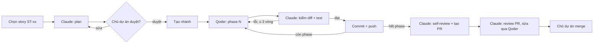

# Quy trình làm việc với AI: Claude lên plan và review, Qoder viết code

> **Trả lời câu hỏi:** một story đi từ backlog tới main như thế nào khi dùng Claude Code và Qoder CLI.
> Luật code chung cho mọi agent ở [../../AGENTS.md](../../AGENTS.md); file này chỉ nói về **luồng** và **vai trò**.
> Nhật ký vận hành (lỗi gặp, cách xử lý, đề xuất cải tiến luồng): [workflow-log.md](workflow-log.md). Mục 8 nói cách ghi.
> Cập nhật: 2026-11-15 · Trạng thái: **đã chốt**

## 1. Vai trò

| Ai | Làm | Không làm |
|---|---|---|
| **Chủ dự án** (người giao việc) | Chọn story, duyệt plan, trả lời câu hỏi, **merge PR** | – |
| **Claude Code** | Đọc docs, lập plan, gọi Qoder theo từng phase, kiểm diff, chạy test, commit, push, tạo PR, review PR, **ghi nhật ký vận hành** (mục 8) | Tự viết code tính năng (trừ sửa một dòng hiển nhiên khi Qoder đã thử 3 lần); merge PR; sửa docs khi chưa hỏi |
| **Qoder CLI** | Sửa đúng các file được giao trong một phase; thử chạy `flutter analyze` / `flutter test` để tự kiểm (có chạy được hay không: xem mục 3) | Mọi lệnh git ghi, `gh`, sửa file ngoài danh sách, thêm thư viện |

Chỉ Claude (hoặc người) giữ quyền ghi git, để không lọt commit sai nhánh, file cấm hay dòng tác giả AI.

## 2. Luồng một story



1. **Chọn story:** story chứa task `Todo` có `Thứ tự làm` nhỏ nhất trong [../product/tasks.csv](../product/tasks.csv) (mô tả task ở [../product/backlog.md](../product/backlog.md)). Mỗi task là một phase giao cho Qoder.
2. **Plan:** Claude đọc các FR/UC/SCR/TC mà story trỏ tới, cùng erd/openapi nếu chạm dữ liệu hoặc API, rồi viết `.ai-work/ST-xx/PLAN.md` (local, không commit):
   - mục tiêu và tiêu chí chấp nhận, chép nguyên từ PRD;
   - chia **phase** nhỏ, mỗi phase: file được sửa, việc làm, test phải có, lệnh kiểm;
   - rủi ro, chỗ chạm BR-01 / BR-10 / BR-12;
   - câu hỏi kèm đề xuất. Chỗ docs không nói → ghi `OQ-xx` mới vào PRD sau khi chủ dự án trả lời.
3. **Duyệt plan:** chỉ làm tiếp khi chủ dự án nói "duyệt".
4. **Nhánh:** `git switch -c story/ST-xx-<mo-ta-ngan> origin/main`, rồi `git push -u origin HEAD`.
5. **Từng phase:** Claude gọi Qoder (mục 3) → kiểm (mục 4) → đạt thì commit đúng file và push. Có trục trặc thì ghi ngay vào nhật ký (mục 8).
6. **Self-review:** Claude đọc `git diff origin/main...HEAD` thật, rà theo checklist mục 5, sửa qua Qoder.
7. **PR:** `gh pr create --base main --title "<type>(ST-xx): ..." --body-file .ai-work/ST-xx/PR_BODY.md`. Body gồm: story, FR/SCR/TC liên quan, đã làm gì, docs đổi gì, cách test, ảnh chụp màn hình emulator, giới hạn.
8. **Review PR:** Claude review lại bản trên GitHub và post bằng `gh pr review <n> --comment`. Còn lỗi → Qoder sửa → commit → review lại, tối đa 3 vòng.
9. **Merge:** chủ dự án merge (squash) trên GitHub. Claude đổi trạng thái các task của story thành `Done` trong `tasks.csv` (trong chính PR của story; khi chạy song song thì làm ở commit riêng sau merge, mục 2b), rồi xóa nhánh local.

## 2b. Làm 2–3 story cùng lúc (worktree + nhánh xếp chồng)

Bạn vẫn làm **tuần tự theo phụ thuộc**, nhưng mở 2–3 story cùng lúc để Qoder không phải chờ. Hai loại quan hệ (xem cột `Phụ thuộc` trong [../product/tasks.csv](../product/tasks.csv)):

| Quan hệ | Gốc của nhánh mới | PR |
|---|---|---|
| **Độc lập** (không phụ thuộc story nào đang mở) | `origin/main` mới nhất | PR thường |
| **Phụ thuộc story cha của chính bạn chưa merge** | **nhánh của story cha** (xếp chồng) | PR **Draft** cho tới khi cha merge (mục 2b.5) |

Chỉ xếp chồng lên nhánh **của chính mình**. Chuỗi gợi ý: ST-06 ← ST-07 ← ST-09 (sâu 3); ST-11 ← ST-13 ← ST-14. Cặp độc lập: ST-02 ∥ ST-03 ∥ ST-04 ∥ ST-08; ST-10 ∥ ST-12; ST-17 ∥ ST-18 ∥ ST-19 ∥ ST-21; ST-05, ST-27, ST-28 với bất kỳ story nào (không đụng `mobile/`).

### 2b.1 Bố cục

```
d:\project AI\                       ← thư mục chính: chỉ fetch, quản lý worktree, đứng ở main; KHÔNG sửa code ở đây
d:\project AI_wt\ST-xx\              ← worktree của story ST-xx (nhánh story/ST-xx-…)
d:\project AI\.ai-work\ST-xx\        ← plan, log, bằng chứng (đường dẫn tuyệt đối; không commit)
d:\project AI\.ai-work\STACKS.md     ← quan hệ xếp chồng và việc "cần rebase sau phase này"
```

### 2b.2 Tạo

```powershell
cd "d:\project AI"
git fetch origin --prune
# Độc lập: gốc là main
git worktree add -b story/ST-06-import "d:\project AI_wt\ST-06" origin/main
# Xếp chồng: gốc là nhánh cha (của chính bạn, chưa merge)
git worktree add -b story/ST-07-confirm "d:\project AI_wt\ST-07" story/ST-06-import
git worktree list
cd "d:\project AI_wt\ST-07\mobile"; flutter pub get      # mỗi worktree một lần
```

Ghi quan hệ vào `.ai-work/STACKS.md` (ví dụ `ST-07 ← ST-06`). Gọi Qoder với `-w "d:\project AI_wt\ST-xx"`.

### 2b.3 Luật worktree

1. **1 worktree = 1 nhánh = 1 story.** Không làm hai story trong một worktree; không sửa code ở thư mục chính.
2. Tối đa **3 worktree** mở cùng lúc; xếp chồng sâu tối đa **3** (`main` ← A ← B ← C). Worktree chỉ để review (`review-pr<N>`) nằm ngoài giới hạn và phải dọn ngay sau review.
3. Mọi lệnh (Qoder `-w`, `flutter`, git) chạy **trong worktree của story đó**. Trước mỗi lệnh git ghi: `git rev-parse --show-toplevel` và `git branch --show-current` phải khớp story.
4. **Không xóa worktree còn thay đổi chưa commit** (`git -C <wt> status --short` phải rỗng). Không dùng `git worktree remove --force`, không `git branch -D`, trừ khi chủ dự án đồng ý.
5. **Flutter:** mỗi worktree có `build/` và `.dart_tool/` riêng (không copy giữa các worktree, không commit); `PUB_CACHE` và `GRADLE_USER_HOME` dùng chung nên `pub get` nhanh. **Tại một thời điểm chỉ chạy một `flutter build apk`/`flutter run`** (Gradle tranh tài nguyên và khóa nhau); `flutter analyze` và `flutter test` thì chạy song song được.
6. **Máy giả lập chỉ chạy một bản app** (cùng `applicationId`): chạy thử story nào thì cài từ worktree đó, chuyển story thì gỡ rồi cài lại. **Server Docker dùng chung** được (không có trạng thái).
7. **Chỗ dễ xung đột:** `strings_vi.dart`, `app/router.dart`, `app/providers.dart`, file drift sinh ra, `pubspec.lock`. Mỗi story chỉ **thêm khối riêng ở cuối** các file này, không sắp xếp lại, không đổi thứ tự. Thêm thư viện cần ADR mới nên không xảy ra ở giai đoạn code.
8. **`tasks.csv` không đổi trong PR story.** Sau khi chủ dự án merge, Claude đổi trạng thái trên `main` bằng một commit riêng `chore: mark ST-xx done`.
9. **`.gitignore` kiểu danh sách cho phép** (`/*` chặn mọi thứ): thư mục hay file mới ở gốc (ví dụ `mobile/`) **bị bỏ qua im lặng** cho tới khi được mở khóa. Trước khi `git add` đường dẫn mới: `git check-ignore -v <đường dẫn>`. Mở khóa bằng commit riêng; nếu `git add` báo "paths are ignored" thì cả lệnh add bị hủy, nên luôn đọc `git diff --cached --name-only` trước khi commit.

### 2b.4 Đồng bộ nhánh xếp chồng

- **Cha có commit mới (chưa merge)** → ở worktree con: `git rebase <nhánh-cha>`, `flutter analyze` và `flutter test` lại, `git push --force-with-lease` (chỉ khi con đã push).
- **Cha đã merge vào `main`** (squash merge nên lịch sử khác): ở worktree con
  ```powershell
  git fetch origin
  git rebase --onto origin/main <nhánh-cha> <nhánh-con>
  ```
  rồi chạy `dart run build_runner build --delete-conflicting-outputs` nếu đụng drift, `flutter analyze`, `flutter test`, `push --force-with-lease`, cập nhật `STACKS.md`.
- Luôn đồng bộ **từ dưới lên** (cha trước, con sau). Conflict chỉ giải trong file của story con; conflict ở file khác → dừng, hỏi chủ dự án. Không rebase cha theo con; không cherry-pick qua lại giữa hai story.
- **Không rebase khi Qoder (hoặc `flutter`/emulator) đang chạy ở worktree đó**: rebase đổi file dưới chân Qoder và làm phase dở hỏng. Khi cha merge mà Qoder đang chạy ở con: (1) làm ngay việc không đụng worktree con (kiểm PR đã merge, đổi trạng thái task, dọn worktree cha nếu sạch); (2) ghi "cần rebase sau phase này" vào `STACKS.md`; (3) chờ Qoder xong phase → Claude kiểm → commit → `git status --short` rỗng → **mới** rebase; (4) còn thay đổi chưa commit mà cần rebase gấp thì hỏi chủ dự án, không `stash`/`reset` để lách.

### 2b.5 PR với nhánh xếp chồng

- Mỗi story một PR, base `main`.
- Con xếp chồng mà **cha chưa merge**: PR vào `main` sẽ chứa cả commit của cha. Mở dạng **Draft**, dòng đầu mô tả `Stacked on #<PR cha> – review only commits after <sha cuối của cha>`; chưa chạy review PR. Cha merge → `rebase --onto` (2b.4) → bỏ dòng stacked → `gh pr ready` → review PR (mục 2 bước 8).
- **Thứ tự merge:** cha trước, con sau. Chủ dự án không merge con trước cha.

### 2b.6 `STACKS.md` (mẫu)

```
ST-07 <- ST-06    (nhánh con story/ST-07-confirm, cha story/ST-06-import)   cần rebase sau phase này: không
ST-09 <- ST-07    cần rebase sau phase này: có (ST-06 vừa merge)
```

### 2b.7 Dùng subagent để chạy Qoder hoặc review song song

Dùng khi bạn yêu cầu hoặc có ≥ 2 việc độc lập (mỗi việc một worktree, không chung file). Prompt cho subagent ghi: worktree duy nhất được làm; **không** lệnh git ghi, không `gh` (trừ subagent review được giao đăng review); `-n` session mới, cấm `-c` (mục 3); danh sách file được sửa; việc cần báo cáo. **Claude không tin báo cáo của subagent**: tự đọc diff thật, tự chạy `flutter analyze` và `flutter test`, rồi mới commit và push. Việc đã commit xong mà subagent còn gửi lại báo cáo cũ khi "chờ tác vụ nền" thì dừng nó (`TaskStop`).

## 3. Gọi Qoder

Giao một phase (task có màn hình thì thêm vào lời giao: `UI reference: docs/design/png/<màn>.png and docs/design/screens/<màn>.html; tokens in docs/design/design-spec.md. Match them; do not invent colors, sizes or text.`):

```powershell
qodercli -p -w "d:\project AI" -n "ST-xx-p<N>" --permission-mode accept_edits `
  --append-system-prompt "You implement code for MediCheck. Follow AGENTS.md strictly. NEVER run git write commands, never call gh, never run 'qodercli commit'. Edit ONLY the files listed. Do not add packages or edit pubspec.yaml, AndroidManifest.xml, Info.plist, docs/ or backend/ unless explicitly allowed below. All user-facing text goes in mobile/lib/core/strings_vi.dart. Never add AI attribution." `
  "Implement ONLY Phase <N> of d:\project AI\.ai-work\ST-xx\PLAN.md.
   Allowed files: <list>. Explicitly allowed extras: <none | ...>.
   Exit criteria: <from plan>.
   Try in mobile/: flutter analyze; flutter test. If you cannot run flutter here, re-read your changes for compile errors (imports, names, signatures) and say so; the orchestrator will analyze and test.
   You cannot delete or rename files: blank the old file and say so, the orchestrator removes it.
   Never use qodercli -c; you are in your own session. The orchestrator handles all git.
   Report: files changed (full paths), commands run with results, anything not done and why."
```

Giao sửa lỗi (giữ ngữ cảnh phiên cũ):

```powershell
qodercli -p -w "d:\project AI" -r <session-id> --permission-mode accept_edits `
  "Fix ONLY: 1) <file:line> – <problem> – <expected fix> (rule <BR/FR/TC>). Raw output if from a failure: <paste verbatim>. Re-read your changes for compile errors, then report files changed."
```

**Luật khi gọi Qoder:**
- **Cấm `qodercli -c` / `--continue`**: nó nối vào session gần nhất của *bất kỳ* worktree (ở một dự án trước đã gây nhầm chéo task). Mỗi phase dùng `-n "ST-xx-p<N>"` mới; muốn tiếp tục thì chỉ `-r <session-id>` của đúng session đó ở đúng worktree đó.
- **Qoder có chạy được `flutter` hay không là việc phải đo ở lần đầu**, rồi ghi kết quả vào [workflow-log.md](workflow-log.md). Cho tới khi có ghi chép "chạy được", Claude là bên chạy `flutter analyze` và `flutter test` sau mỗi lần Qoder chạy, và không tin câu "build OK" trong báo cáo của Qoder. Không nâng quyền (`auto`, `bypass_permissions`) để lách; muốn đổi thì hỏi chủ dự án.
- Qoder không xóa hay đổi tên được file (cổng quyền): nó làm rỗng file cũ; Claude chạy `git rm -f <file>` sau khi đọc diff rồi mới commit.
- Lỗi cú pháp thường gặp của model viết code: nhầm dấu, thiếu `return`, thiếu import, gọi API Flutter không có ở bản 3.50. Gửi lỗi nguyên văn cho Qoder, một vòng thường đủ; khi một kiểu lỗi lặp lại thì thêm câu nhắc vào prompt mẫu và ghi vào nhật ký.

## 4. Claude kiểm sau mỗi lần Qoder chạy

```bash
git status --short          # chỉ có file trong danh sách cho phép
git diff --stat
git log -1 --oneline        # không có commit lạ
git status --short --ignored mobile   # file mới bị .gitignore bỏ qua sót?
cd mobile && flutter analyze && flutter test
```

- File ngoài danh sách bị sửa → `git restore <file>`, báo Qoder.
- Có commit hoặc nhánh lạ → dừng, báo chủ dự án.
- Test mới phải **fail trước khi sửa và pass sau khi sửa** (với logic ở `core/domain`).
- Story có màn hình → chạy trên emulator, chụp màn hình vào `.ai-work/ST-xx/evidence/`. Tắt server và emulator khi xong.

## 5. Checklist review (mỗi PR)

- [ ] Đạt tiêu chí chấp nhận của từng FR; TC liên quan đạt.
- [ ] **BR-01:** không có đường nào hiện xanh hay "Tôi đã uống" khi `status != "green"`, kể cả lỗi/timeout.
- [ ] **BR-10 / ADR-016:** không lưu ảnh thuốc; ảnh đơn chỉ ở thư mục app; không log nội dung đơn.
- [ ] **BR-12:** không tạo được 2 đơn `active`.
- [ ] Giao diện khớp ảnh chuẩn `docs/design/png/` (so ảnh chụp emulator 390 × 844); dùng token, không số rời.
- [ ] Chữ hiển thị chỉ ở `strings_vi.dart`, không có từ cấm; chữ ≥ 20 sp, vùng chạm ≥ 48 dp, có `Semantics`.
- [ ] DTO khớp `openapi.yaml`; `utf8.decode(res.bodyBytes)`.
- [ ] Không thêm thư viện ngoài ADR-015; không sửa `out/onnx_final/`.
- [ ] Docs bị ảnh hưởng đã sửa trong cùng PR.

## 6. Git

- Nhánh: `story/ST-xx-<mo-ta>`, sửa lỗi `fix/<mo-ta>`, tài liệu `docs/<mo-ta>`. Một nhánh một story.
- Commit: `<type>(ST-xx): <tóm tắt>`; `type` ∈ `feat|fix|refactor|test|docs|chore`; tiếng Anh, mệnh lệnh, ≤ 20 từ. Một commit một thay đổi logic.
- Chỉ `git add <đường dẫn cụ thể>`; không `git add -A`, `git add .`, `git commit -a`. Trước khi commit: `git diff --cached --name-only` chỉ chứa file trong phạm vi.
- Không push thẳng `main`; không force-push `main`; `--force-with-lease` chỉ trên nhánh của chính mình.
- Không có dòng `Co-Authored-By` hay "Generated with" của AI trong commit, PR, review.
- Không commit `.ai-work/`, ảnh bằng chứng, `*.db`, token, `build/`, `.dart_tool/`.

## 7. Dừng và hỏi chủ dự án khi

- Một lỗi sửa quá 3 vòng, hoặc review PR quá 3 vòng chưa đạt.
- Cần sửa docs, thêm thư viện, đổi `pubspec.yaml` ngoài plan, đổi API server.
- Docs mâu thuẫn nhau, hoặc gặp `OQ-xx` chưa chốt.
- Qoder sửa ngoài phạm vi hay chạy lệnh git.
- Sự cố mức **S1** (mục 8.2): dừng, báo, ghi vào [workflow-log.md](workflow-log.md) rồi mới tiếp tục.

## 8. Nhật ký vận hành: ghi lại để luồng ngày càng an toàn và hiệu quả

Mọi trục trặc trong luồng Claude + Qoder (và cả việc chạy 2–3 story cùng lúc) được ghi vào [workflow-log.md](workflow-log.md), xử lý, rồi đưa bài học thành luật. Mục đích: cùng một lỗi không xảy ra hai lần.

### 8.1 Ghi khi nào

Ghi **ngay lúc xảy ra** (không đợi cuối ngày) khi:
- lệnh hoặc công cụ không chạy như kỳ vọng (ví dụ Qoder không chạy được `flutter`);
- Qoder làm sai luật hoặc ra ngoài phạm vi (sửa file không được giao, chạy lệnh git, thêm thư viện);
- xung đột, rebase lỗi, mất việc, commit nhầm nhánh hoặc nhầm worktree, file mới bị `.gitignore` bỏ qua;
- cùng một loại lỗi phải sửa quá một vòng;
- một bước của quy trình gây chậm hoặc rủi ro mà đáng ra tránh được;
- phát hiện một cách làm tốt đáng giữ.

### 8.2 Ghi cái gì

Một dòng trong bảng, đủ để người khác hiểu và làm lại:

| Cột | Nội dung |
|---|---|
| Ngày, story | `2026-11-20`, `ST-07` |
| Mức | **S1** suýt mất việc / lộ file cấm / commit sai nhánh (dừng và báo ngay); **S2** mất thêm ≥ 1 vòng làm lại; **S3** gợi ý cải tiến, cách làm tốt |
| Tình huống | Chuyện gì xảy ra, kèm lệnh hoặc lỗi nguyên văn ngắn |
| Nguyên nhân | Vì sao (nếu chưa biết ghi "chưa rõ") |
| Cách xử lý | Đã làm gì để qua việc |
| Luật liên quan | Mục nào của file này (hoặc "chưa có") |
| Trạng thái | `Đã xử lý` · `Đề xuất luật` · `Đã áp dụng (mục x)` · `Theo dõi` |

Không ghi token, nội dung đơn thuốc thật hay dữ liệu cá nhân.

### 8.3 Quy trình xử lý

1. Claude ghi dòng ngay, trạng thái `Đã xử lý` nếu đã qua việc trong phạm vi luật hiện có, hoặc `Theo dõi` nếu chưa chắc.
2. Nếu cần **đổi luật** (thêm cấm, đổi cách làm): ghi `Đề xuất luật` và **hỏi chủ dự án**; đồng ý thì sửa file này (ghi số mục) và đổi trạng thái thành `Đã áp dụng`. Không tự đổi luật cứng.
3. Lỗi **cùng loại xuất hiện lần thứ hai** mà chưa có luật: báo chủ dự án và đề xuất luật ngay.
4. **S1 → dừng việc đang làm**, báo chủ dự án trước khi tiếp tục.
5. **Cuối mỗi story** (sau merge): Claude thêm 1–3 dòng nhìn lại: gì trục trặc, gì tốt, đề xuất đổi gì.
6. **Cuối mỗi mốc** (M1, M2, …): Claude rà toàn bộ nhật ký, gom các lỗi lặp, các mục `Đề xuất luật` chưa duyệt, và đề xuất một danh sách cải tiến ngắn.

### 8.4 Dùng nhật ký

Đầu mỗi session code, Claude đọc `Theo dõi` và `Đề xuất luật` còn mở để không lặp lại sai lầm cũ.
