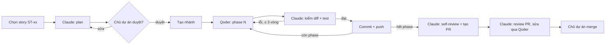

# Quy trình làm việc với AI: Claude lên plan và review, Qoder viết code

> **Trả lời câu hỏi:** một story đi từ backlog tới main như thế nào khi dùng Claude Code và Qoder CLI.
> Luật code chung cho mọi agent ở [../../AGENTS.md](../../AGENTS.md); file này chỉ nói về **luồng** và **vai trò**.
> Cập nhật: 2026-11-15 · Trạng thái: **đã chốt**

## 1. Vai trò

| Ai | Làm | Không làm |
|---|---|---|
| **Chủ dự án** (người giao việc) | Chọn story, duyệt plan, trả lời câu hỏi, **merge PR** | – |
| **Claude Code** | Đọc docs, lập plan, gọi Qoder theo từng phase, kiểm diff, chạy test, commit, push, tạo PR, review PR | Tự viết code tính năng (trừ sửa một dòng hiển nhiên khi Qoder đã thử 3 lần); merge PR; sửa docs khi chưa hỏi |
| **Qoder CLI** | Sửa đúng các file được giao trong một phase, chạy `flutter analyze` / `flutter test` để tự kiểm | Mọi lệnh git ghi, `gh`, sửa file ngoài danh sách, thêm thư viện |
| **Thành viên code tay** | Làm story được phân công theo cùng luồng nhánh + PR | Push thẳng `main` |

Chỉ Claude (hoặc người) giữ quyền ghi git, để không lọt commit sai nhánh, file cấm hay dòng tác giả AI.

## 2. Luồng một story



1. **Chọn story:** story đầu tiên chưa ✅ trong [../product/roadmap.md](../product/roadmap.md) mà các story nó phụ thuộc đã merge.
2. **Plan:** Claude đọc các FR/UC/SCR/TC mà story trỏ tới, cùng erd/openapi nếu chạm dữ liệu hoặc API, rồi viết `.ai-work/ST-xx/PLAN.md` (local, không commit):
   - mục tiêu và tiêu chí chấp nhận, chép nguyên từ PRD;
   - chia **phase** nhỏ, mỗi phase: file được sửa, việc làm, test phải có, lệnh kiểm;
   - rủi ro, chỗ chạm BR-01 / BR-10 / BR-12;
   - câu hỏi kèm đề xuất. Chỗ docs không nói → ghi `OQ-xx` mới vào PRD sau khi chủ dự án trả lời.
3. **Duyệt plan:** chỉ làm tiếp khi chủ dự án nói "duyệt".
4. **Nhánh:** `git switch -c story/ST-xx-<mo-ta-ngan> origin/main`, rồi `git push -u origin HEAD`.
5. **Từng phase:** Claude gọi Qoder (mục 3) → kiểm (mục 4) → đạt thì commit đúng file và push.
6. **Self-review:** Claude đọc `git diff origin/main...HEAD` thật, rà theo checklist mục 5, sửa qua Qoder.
7. **PR:** `gh pr create --base main --title "<type>(ST-xx): ..." --body-file .ai-work/ST-xx/PR_BODY.md`. Body gồm: story, FR/SCR/TC liên quan, đã làm gì, docs đổi gì, cách test, ảnh chụp màn hình emulator, giới hạn.
8. **Review PR:** Claude review lại bản trên GitHub và post bằng `gh pr review <n> --comment`. Còn lỗi → Qoder sửa → commit → review lại, tối đa 3 vòng.
9. **Merge:** chủ dự án merge (squash) trên GitHub. Claude đánh dấu ✅ story trong roadmap ở PR đó hoặc PR kế tiếp, rồi xóa nhánh local.

## 3. Gọi Qoder

Giao một phase:

```powershell
qodercli -p -w "d:\project AI" -n "ST-xx-p<N>" --permission-mode accept_edits `
  --append-system-prompt "You implement code for MediCheck. Follow AGENTS.md strictly. NEVER run git write commands, never call gh, never run 'qodercli commit'. Edit ONLY the files listed. Do not add packages or edit pubspec.yaml, AndroidManifest.xml, Info.plist, docs/ or backend/ unless explicitly allowed below. All user-facing text goes in mobile/lib/core/strings_vi.dart. Never add AI attribution." `
  "Implement ONLY Phase <N> of d:\project AI\.ai-work\ST-xx\PLAN.md.
   Allowed files: <list>. Explicitly allowed extras: <none | ...>.
   Exit criteria: <from plan>.
   Then run in mobile/: flutter analyze; flutter test.
   Report: files changed, commands run with results, anything not done and why."
```

Giao sửa lỗi (giữ ngữ cảnh phiên cũ):

```powershell
qodercli -p -w "d:\project AI" -r <session-id> --permission-mode accept_edits `
  "Fix ONLY: 1) <file:line> – <problem> – <expected fix> (rule <BR/FR/TC>). Then run flutter analyze; flutter test and report."
```

Ghi chú vận hành (lần đầu dùng, kết quả thực tế, lỗi gặp) vào `.ai-work/NOTES.md`.

## 4. Claude kiểm sau mỗi lần Qoder chạy

```bash
git status --short          # chỉ có file trong danh sách cho phép
git diff --stat
git log -1 --oneline        # không có commit lạ
cd mobile && flutter analyze && flutter test
```

- File ngoài danh sách bị sửa → `git restore <file>`, báo Qoder.
- Có commit hoặc nhánh lạ → dừng, báo chủ dự án.
- Test mới phải **fail trước khi sửa và pass sau khi sửa** (với logic ở `core/domain`).
- Story có màn hình → chạy trên emulator, chụp màn hình vào `.ai-work/ST-xx/evidence/`. Tắt server và emulator khi xong.

## 5. Checklist review (mỗi PR)

- [ ] Đạt tiêu chí chấp nhận của từng FR; TC liên quan đạt.
- [ ] **BR-01:** không có đường nào hiện xanh hay "Tôi đã uống" khi `status != "green"`, kể cả lỗi/timeout.
- [ ] **BR-10 / ADR-016:** không lưu ảnh thuốc; ảnh đơn chỉ ở thư mục app; không log nội dung đơn.
- [ ] **BR-12:** không tạo được 2 đơn `active`.
- [ ] Chữ hiển thị chỉ ở `strings_vi.dart`, không có từ cấm; chữ ≥ 20 sp, vùng chạm ≥ 48 dp, có `Semantics`.
- [ ] DTO khớp `openapi.yaml`; `utf8.decode(res.bodyBytes)`.
- [ ] Không thêm thư viện ngoài ADR-015; không sửa `out/onnx_final/`.
- [ ] Docs bị ảnh hưởng đã sửa trong cùng PR.

## 6. Git

- Nhánh: `story/ST-xx-<mo-ta>`, sửa lỗi `fix/<mo-ta>`, tài liệu `docs/<mo-ta>`. Một nhánh một story.
- Commit: `<type>(ST-xx): <tóm tắt>`; `type` ∈ `feat|fix|refactor|test|docs|chore`; tiếng Anh, mệnh lệnh, ≤ 20 từ. Một commit một thay đổi logic.
- Chỉ `git add <đường dẫn cụ thể>`; không `git add -A`, `git add .`, `git commit -a`.
- Không push thẳng `main`; không force-push `main`; `--force-with-lease` chỉ trên nhánh của chính mình.
- Không có dòng `Co-Authored-By` hay "Generated with" của AI trong commit, PR, review.
- Không commit `.ai-work/`, ảnh bằng chứng, `*.db`, token, `build/`, `.dart_tool/`.

## 7. Dừng và hỏi chủ dự án khi

- Một lỗi sửa quá 3 vòng, hoặc review PR quá 3 vòng chưa đạt.
- Cần sửa docs, thêm thư viện, đổi `pubspec.yaml` ngoài plan, đổi API server.
- Docs mâu thuẫn nhau, hoặc gặp `OQ-xx` chưa chốt.
- Qoder sửa ngoài phạm vi hay chạy lệnh git.
