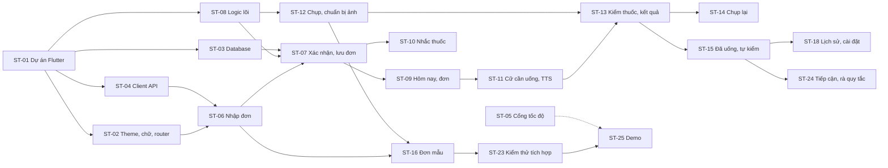

# Product backlog

> **Trả lời câu hỏi:** toàn bộ việc cần làm để có app, mô tả từng việc đủ để một người (hoặc AI agent) làm mà không phải đoán.
> Bảng theo dõi trạng thái từng task: [tasks.csv](tasks.csv) (nên nhập vào Google Sheets: File → Import → Upload; Excel tiếng Việt dùng dấu `;` làm ngăn cách nên mở thẳng có thể dồn mọi cột vào một ô, khi đó dùng Data → From Text/CSV). Mốc thời gian: [roadmap.md](roadmap.md). Luồng làm việc: [../process/ai-workflow.md](../process/ai-workflow.md).
> Cập nhật: 2026-11-15 · Trạng thái: **đã chốt**

## 1. Cách đọc

- **Story `ST-xx`** = một nhóm việc mang lại một khả năng dùng được; một story = một nhánh `story/ST-xx-…` = một PR.
- **Task `ST-xx.y`** = một lần giao việc (một "phase" cho Qoder); làm trọn trong một phiên, tối đa khoảng 8 giờ.
- **Thứ tự làm:** cột `Thứ tự làm` trong `tasks.csv` đã sắp theo mốc và phụ thuộc; làm task `Todo` có số nhỏ nhất. Không ước lượng giờ (một người làm, tự chủ động thời gian).
- **Ưu tiên:** Must (thiếu thì không demo được), Should (nên có), Could (làm nếu còn thời gian). Nếu trễ, bỏ từ Could lên, không bỏ Must.
- **`backlog.md` và `tasks.csv` là nguồn, sửa tay** (file sinh một lần ngày 15/11, không còn script; sinh lại sẽ mất chỉnh sửa). Đừng mở và lưu `tasks.csv` bằng Excel (làm hỏng dấu tiếng Việt).
- **Trạng thái** chỉ ghi ở `tasks.csv`: `Todo`, `Doing`, `Review`, `Done`, `Blocked`. File này chỉ chứa mô tả, không ghi trạng thái, để không lệch nhau.
- **Mô tả task:** `backlog.md` là nguồn; cột Mô tả của `tasks.csv` có thể cũ hơn, `tasks.csv` chỉ là nơi ghi trạng thái.
- Mỗi task đã có mã yêu cầu (FR/UC/SCR/TC/BR); đọc các mã đó ở [prd.md](prd.md), [use-cases.md](use-cases.md), [ui-ux-spec.md](ui-ux-spec.md), [../quality/test-plan.md](../quality/test-plan.md) trước khi làm.
- **Xong một task** nghĩa là: tiêu chí chấp nhận liên quan đạt, test đi kèm xanh, `flutter analyze` sạch, tài liệu bị ảnh hưởng đã sửa (xem "Định nghĩa xong" trong [../../AGENTS.md](../../AGENTS.md)).

## 2. Tổng quan

**29 story, 82 task** (đã xong 2).

| Mốc | Thời gian | Nội dung | Số task |
|---|---|---|---|
| M0 | 14–16/11 | Nền móng: tài liệu, repo, Docker, ảnh demo | 2 |
| M1 | 17–23/11 | Khung app, database, client API; cổng tốc độ 22/11 | 18 |
| M2 | 24–30/11 | Nhập đơn, xác nhận, lưu lịch, màn Hôm nay | 13 |
| M3 | 1–9/12 | Nhắc thuốc, màn Cữ cần uống, chụp, kết quả, giọng nói | 16 |
| M4 | 10–16/12 | Chụp lại, đã uống, tự kiểm, đơn mẫu, lần đầu dùng, lịch sử | 13 |
| M5 | 17–22/12 | Kiểm thử, tiếp cận, tính năng phụ, iPhone | 15 |
| M6 | 23–31/12 | Báo cáo, video dự phòng, tập demo | 5 |

| Ưu tiên | Số task |
|---|---|
| Must | 60 |
| Should | 15 |
| Could | 7 |

Số task theo mốc không đều (M2, M3 và M5 nhiều nhất). Đó là rủi ro R6 trong [business-analysis.md](business-analysis.md): nếu trễ, cắt Could rồi Should ở M4–M5 trước.

## 3. Thứ tự và phụ thuộc giữa các story

ST-05, ST-17, ST-19, ST-21, ST-22, ST-26, ST-27 và ST-28 không nằm trên đường găng; làm song song hoặc cắt khi trễ.

## 4. Các story

### ST-00 – Ảnh demo

**Mốc:** M0 · **Yêu cầu:** FR-DEMO-01

**Mục tiêu.** Có đủ ảnh để chạy kịch bản demo D1–D4 mà không phụ thuộc thư mục chờ xóa.

**Tasks**

| Mã | Thứ tự | Task | Mô tả chi tiết | Ưu tiên | Phụ thuộc |
|---|---|---|---|---|---|
| ST-00.1 | 1 | Đưa 4 ảnh demo vào repo | Thư mục `anh_demo/` gồm `don_thuoc_582.png`, `don_thuoc_979.png`, `anh_thuoc_A1_582_2.jpg`, `anh_thuoc_A2_979_3.jpg`; mở khóa trong `.gitignore`; commit và push. | Must | – |
| ST-00.2 | 2 | Chạy thử D1–D4 trên server Docker | Đọc đơn 582 và 979 qua `/v1/prescriptions/parse`, dựng payload từng cữ, gọi `/v1/pills/verify`. Kết quả 15/11: D1 xanh 3/3; D2 xanh 4/4; D3 thiếu 1 viên kavasdin; D4 thừa 1 viên; ~1 giây mỗi lần; OCR ~4,5–5 giây mỗi đơn. | Must | ST-00.1 |

**Tiêu chí chấp nhận của story**

- 4 ảnh demo nằm trong repo (`anh_demo/`) và chạy đúng D1–D4 trên server Docker.

**Kiểm thử:** Chạy D1–D4 qua `/v1/pills/verify` (đã làm 15/11).

**Lưu ý.** Không cần ảnh mẫu từng viên: ảnh viên trên màn kết quả được cắt từ chính ảnh vừa chụp (ST-29, ADR-018).

### ST-01 – Khởi tạo dự án Flutter

**Mốc:** M1 · **Yêu cầu:** NFR-08, ADR-002, ADR-015

**Mục tiêu.** Có dự án `mobile/` chạy được trên máy giả lập Android, khóa phiên bản, sẵn sàng cho mọi story sau.

**Tasks**

| Mã | Thứ tự | Task | Mô tả chi tiết | Ưu tiên | Phụ thuộc |
|---|---|---|---|---|---|
| ST-01.1 | 3 | Tạo dự án và cấu hình gói | Flutter 3.50.0 (stable, Dart 3.14.0) đã cài ở `D:\flutter` ngày 15/11; trong shell cần `D:\flutter\bin` trên PATH và `PUB_CACHE=D:\flutter_pub_cache` (ghi vào `mobile/README.md`). `flutter create --org vn.medicheck --platforms android,ios mobile`; xóa code mẫu; thêm đúng các gói ở ADR-015 (ghi phiên bản cụ thể); `analysis_options.yaml` dùng `flutter_lints`; commit `pubspec.lock`; mở `/mobile/` trong `.gitignore` (loại `build/`, `.dart_tool/`, `*.g.dart` nếu nhóm không commit file sinh ra, ghi rõ quyết định). | Must | – |
| ST-01.2 | 4 | Cấu hình Android | `minSdk 29`; `network_security_config.xml` cho phép cleartext tới `10.0.2.2` và mạng nội bộ ở bản debug; khai báo quyền `CAMERA`, `POST_NOTIFICATIONS`, `RECEIVE_BOOT_COMPLETED` và quyền báo thức chính xác theo hướng dẫn của `flutter_local_notifications`; bật core library desugaring. | Must | ST-01.1 |
| ST-01.3 | 5 | Tạo máy giả lập và kiểm kết nối | Dùng AVD có sẵn trên máy (`pixel_7_-_api_36_0`, đều có Google Play; không cần API 34), Back camera = Webcam0 khi máy có webcam; máy dev hiện không có webcam nên dùng `virtualscene` (đã chọn 2026-11-16); chạy app trống; gọi `http://10.0.2.2:8000/health` (server Docker đang chạy) và hiện kết quả; ghi lệnh đã dùng vào `deployment.md`. | Must | ST-01.2 |
| ST-01.4 | 6 | Khai báo iOS (chưa build) | `Info.plist`: `NSCameraUsageDescription`, `NSPhotoLibraryUsageDescription`, `NSLocalNetworkUsageDescription`, `NSAllowsLocalNetworking`; chỉ khai báo để giữ đường iOS mở, chưa cần Mac. | Should | ST-01.1 |

**Tiêu chí chấp nhận của story**

- `flutter analyze` sạch, `flutter test` chạy xanh.
- App trống mở được trên máy giả lập API 34 trở lên.
- `pubspec.lock` được commit; chỉ có các gói của ADR-015.
- `mobile/` được mở trong `.gitignore`, không đưa `build/` và `.dart_tool/` lên repo.

**Kiểm thử:** Chạy app trống và gọi `GET /health` thành công trên emulator..

**Lưu ý.** Đây là story đầu tiên; mọi story khác chờ nó. Khóa phiên bản Flutter SDK ghi vào `mobile/README` ngắn hoặc `.fvmrc`.

### ST-02 – Theme, câu chữ, điều hướng, widget dùng chung

**Mốc:** M1 · **Yêu cầu:** NFR-04, ui-ux-spec mục 2, 5, 7

**Mục tiêu.** Một bộ nền thống nhất (màu, chữ, nút, câu chữ, route) để mọi màn hình sau chỉ lắp ráp.

**Thiết kế:** [design-system](../design/png/design-system.png) (HTML: `docs/design/screens/<tên>.html`; token: [design-spec.md](../design/design-spec.md))

**Tasks**

| Mã | Thứ tự | Task | Mô tả chi tiết | Ưu tiên | Phụ thuộc |
|---|---|---|---|---|---|
| ST-02.1 | 7 | Theme theo design tokens | `app/theme.dart`: hằng số token (font.body 20, title 28, huge 34, touch 48, primary 64, màu bg/text/primary/status, spacing 8/16/24); `ThemeData` sáng; chặn `textScaler` ở 1,5×. | Must | ST-01.1 |
| ST-02.2 | 8 | Câu chữ và kiểm từ cấm | `core/strings_vi.dart` chứa mọi MSG-* và câu trong ui-ux-spec; test đọc file tìm từ cấm ('an toàn', 'chắc chắn đúng', 'có thể là thuốc', tên màu viên). | Must | ST-01.1 |
| ST-02.3 | 9 | Widget dùng chung | `PrimaryButton` (cao 64), `SecondaryButton` (cao 56), `ScreenScaffold` (nút Quay lại + chỗ cho 🔊), `StatusBadge` (màu + biểu tượng + kiểu nét), `BigCard`, `LoadingView`, `ErrorView` (câu + Thử lại + lối thoát); mỗi widget có Semantics tiếng Việt; widget test. | Must | ST-02.1, ST-02.2 |
| ST-02.4 | 10 | Router và provider gốc | `app/router.dart` (go_router) có route cho mọi SCR-xx (màn tạm 'Chưa làm'), route `/dose/:session` cho thông báo; chuyển hướng WELCOME khi chưa `onboarding_done`, HOME khi rồi; `app/providers.dart` (database, api, settings). | Must | ST-02.3 |

**Tiêu chí chấp nhận của story**

- Theme theo đúng design tokens; chữ không vỡ bố cục ở cỡ chữ hệ thống 1,5×.
- Mọi câu chữ nằm trong `strings_vi.dart`; test quét từ cấm đạt (TC-15).
- Mỗi SCR-xx có một route (màn tạm nếu chưa làm).
- Widget dùng chung có `Semantics` tiếng Việt và vùng chạm ≥ 48 dp.

**Kiểm thử:** TC-15; Widget test kích thước chạm của nút dùng chung.

**Lưu ý.** Không đưa chuỗi tiếng Việt vào file khác `strings_vi.dart`.

### ST-03 – Database trên điện thoại (drift)

**Mốc:** M1 · **Yêu cầu:** erd.md, BR-10, BR-12

**Mục tiêu.** Lớp lưu trữ đúng ERD, có ràng buộc do database bảo vệ, kèm test.

**Tasks**

| Mã | Thứ tự | Task | Mô tả chi tiết | Ưu tiên | Phụ thuộc |
|---|---|---|---|---|---|
| ST-03.1 | 11 | Bảng và database | `core/db/tables.dart` và `database.dart` theo `erd.md`: prescription (có `ended_at`, `image_path`, `image_mime`), drug_line, dose_schedule, dose_event, verification_attempt, verification_item, setting, catalog_name; chỉ mục duy nhất một đơn `active`; `PRAGMA foreign_keys = ON` trong `beforeOpen`. | Must | ST-01.1 |
| ST-03.2 | 12 | DAO | PrescriptionDao (lưu đơn trong transaction, lấy đơn active, kết thúc, xóa, danh sách), DoseEventDao (lấy hoặc tạo cữ theo ngày+buổi, đánh dấu uống/bỏ lỡ), VerificationDao (lưu lượt kiểm và các viên, lấy theo cữ), SettingDao (đọc/ghi và giá trị mặc định), CatalogDao (thay toàn bộ danh sách). | Must | ST-03.1 |
| ST-03.3 | 13 | Test ràng buộc | Test database trong bộ nhớ: UNIQUE(event_date, session), `attempt_no` chỉ 1 hoặc 2, cascade khi xóa đơn, `drug_line_id` thành null khi xóa đơn, chèn đơn `active` thứ hai bị từ chối. | Must | ST-03.2 |

**Tiêu chí chấp nhận của story**

- 8 bảng và ràng buộc đúng `erd.md` (khóa ngoại, cascade, SET NULL, UNIQUE).
- Database không cho tồn tại hai đơn `active` (TC-16 phần database).
- `PRAGMA foreign_keys = ON` luôn bật.
- `schemaVersion = 1`, có chỗ viết migration về sau.

**Kiểm thử:** TC-12 (phần database); TC-16 (phần database); Test ràng buộc in-memory.

**Lưu ý.** `build_runner` sinh code; ghi rõ trong README mobile có commit file sinh ra hay không.

### ST-04 – Client API, DTO và cài đặt server

**Mốc:** M1 · **Yêu cầu:** openapi.yaml, backend/API.md, FR-SET-01, NFR-09, BR-01

**Mục tiêu.** App nói chuyện đúng với server, lỗi nào cũng thành kết quả có kiểu, không bao giờ làm sập app hay báo xanh.

**Thiết kế:** [settings](../design/png/settings.png) (HTML: `docs/design/screens/<tên>.html`; token: [design-spec.md](../design/design-spec.md))

**Tasks**

| Mã | Thứ tự | Task | Mô tả chi tiết | Ưu tiên | Phụ thuộc |
|---|---|---|---|---|---|
| ST-04.1 | 14 | DTO và fixture | `core/api/dto.dart`: ParseResponse/ParsedLine, VerifyRequest/Response, PillOut, MissingOut, QualityOut, CatalogOut, HealthOut; `fromJson` an toàn (lỗi → ApiParseException); lưu JSON thật của 2 đơn demo và 4 cảnh D1–D4 vào `test/fixtures/` và viết test. | Must | ST-01.1 |
| ST-04.2 | 15 | Client HTTP | `core/api/medicheck_api.dart`: `parse(file)`, `verify(imageBytes, payload)`, `catalog()`, `health()` (multipart, `utf8.decode(bodyBytes)`); lỗi có kiểu: NoConnection, Timeout, Http400, Http422, Server5xx, BadJson; test bằng `MockClient` cho TC-02 và TC-11. | Must | ST-04.1 |
| ST-04.3 | 16 | Cài đặt server và nạp danh mục | Repository cài đặt; màn SCR-SETTINGS phần địa chỉ server và 'Kiểm tra kết nối' (hiện 'Đã kết nối (final-2026-11-08)' hoặc 'Chưa kết nối được'); nạp `catalog_name` khi `model_version` đổi; thay trang tạm `features/settings/health_check_page.dart` và bỏ hằng địa chỉ tạm trong `main.dart` (ST-01.3). | Must | ST-04.2, ST-03.2, ST-02.3 |

**Tiêu chí chấp nhận của story**

- DTO khớp `openapi.yaml`; JSON hỏng không làm sập app.
- Timeout: đọc đơn 30 giây, kiểm thuốc 20 giây, health 10 giây; không tự gửi lại yêu cầu kiểm thuốc.
- Tên thuốc có dấu gửi và nhận đúng UTF-8.
- Cài đặt server có nút 'Kiểm tra kết nối' và mặc định `http://10.0.2.2:8000`.

**Kiểm thử:** TC-02; TC-11; Test DTO với JSON thật lấy từ server Docker.

**Lưu ý.** Lấy fixture JSON bằng chính ảnh `anh_demo/` gọi vào server Docker, lưu ở `test/fixtures/`.

### ST-05 – Cổng tốc độ trên laptop trình bày

**Mốc:** M1 · **Yêu cầu:** NFR-02, ADR-017, deployment.md mục 6

**Mục tiêu.** Biết sớm (trước 22/11) laptop trình bày chạy đủ nhanh bằng Docker, còn kịp đổi phương án.

**Tasks**

| Mã | Thứ tự | Task | Mô tả chi tiết | Ưu tiên | Phụ thuộc |
|---|---|---|---|---|---|
| ST-05.1 | 17 | Chạy Docker trên laptop trình bày | Clone repo từ GitHub, cài Docker Desktop, `docker compose up --build -d`, kiểm `healthy`; ghi RAM, thời gian build, việc bật ảo hóa; nếu lỗi thì chuyển sang cách venv. | Must | – |
| ST-05.2 | 18 | Script đo tốc độ | `backend/measure_latency.py`: gọi parse (2 đơn) và verify (D1–D4) mỗi cảnh 10 lần bằng ảnh `anh_demo/`, in trung bình và p95; chạy trên laptop trình bày; ghi kết quả vào `deployment.md`. | Must | ST-05.1 |
| ST-05.3 | 19 | Quyết định sau cổng 22/11 | Không đạt → chỉnh `MEDICHECK_THREADS`, đóng ứng dụng nặng; vẫn không đạt → báo nhóm và viết ADR nới NFR-02 hoặc đổi máy trình bày. | Must | ST-05.2 |

**Tiêu chí chấp nhận của story**

- `docker compose up --build` chạy được trên chính laptop trình bày, container `healthy`.
- Đọc đơn ≤ 10 giây, kiểm cữ 4 viên ≤ 3 giây (trung bình 10 lần).
- Kết quả đo ghi vào `deployment.md`.

**Kiểm thử:** Script đo `backend/measure_latency.py`.

**Lưu ý.** Cần laptop trình bày thật và Internet cho lần build đầu. Nếu Docker không chạy được trên laptop, dùng cách venv ở `deployment.md` mục 2b và ghi lại.

### ST-06 – Nhập đơn từ file

**Mốc:** M2 · **Yêu cầu:** FR-PRES-01, FR-PRES-03, UC-01, SCR-WELCOME, SCR-IMPORT, SCR-READING

**Mục tiêu.** Người dùng chọn ảnh/PDF đơn, chờ có thông báo rõ, và nhận bản nháp để xác nhận.

**Thiết kế:** [welcome](../design/png/welcome.png), [import](../design/png/import.png), [reading](../design/png/reading.png) (HTML: `docs/design/screens/<tên>.html`; token: [design-spec.md](../design/design-spec.md))

**Tasks**

| Mã | Thứ tự | Task | Mô tả chi tiết | Ưu tiên | Phụ thuộc |
|---|---|---|---|---|---|
| ST-06.1 | 21 | SCR-WELCOME và SCR-IMPORT | UI theo spec: câu giới thiệu, cảnh báo MSG-DISCLAIMER, nút chính 'Chọn đơn thuốc', nút phụ 'Thử với đơn mẫu' (nối ở ST-16); SCR-IMPORT: 'Chọn ảnh hoặc PDF đơn' và 'Chụp đơn giấy' (nối ở ST-19); đọc to bằng giọng nói khi có TTS. | Must | ST-02.3, ST-02.4 |
| ST-06.2 | 22 | Luồng nhập đơn và màn chờ | `features/prescription_import`: `file_picker` (png/jpg/jpeg/pdf), `ImportController` (AsyncNotifier) gọi `api.parse`, tạo `DraftPrescription` thô (giữ đường dẫn và mime của file gốc); SCR-READING có MSG-READING, chặn bấm lặp, nút Hủy hủy được yêu cầu. | Must | ST-06.1, ST-04.2 |
| ST-06.3 | 23 | Lỗi khi đọc đơn | Các nhánh UC-01: 3a (quá 30 giây/mất kết nối), 4a (HTTP 400), 4b (`lines` rỗng); mỗi nhánh một câu + 'Thử lại'/'Hủy'; widget test với API giả. | Must | ST-06.2 |

**Tiêu chí chấp nhận của story**

- Chọn được PNG, JPEG, PDF; đơn 582 và 979 ra đúng các dòng thuốc như test-plan.
- Màn chờ không cho bấm lặp; quá 30 giây thì báo lỗi kèm Thử lại.
- Ba lỗi (mất kết nối/timeout, 400, không có dòng thuốc) mỗi lỗi một câu đúng spec.

**Kiểm thử:** TC-02 (phần đọc đơn); Widget test với API giả.

**Lưu ý.** Bản nháp chỉ ở bộ nhớ, chưa lưu database; nhớ giữ đường dẫn file gốc để ST-07.4 chép vào thư mục app.

### ST-07 – Màn xác nhận, sửa dòng và lưu đơn

**Mốc:** M2 · **Yêu cầu:** FR-PRES-04…06, FR-PRES-11, FR-SCH-01, UC-03, SCR-CONFIRM, SCR-EDIT-LINE, BR-02…06, BR-12

**Mục tiêu.** Không có đường nào tạo lịch mà bỏ qua xác nhận; sửa bằng chọn; lưu đơn mới thay đơn cũ an toàn.

**Thiết kế:** [confirm](../design/png/confirm.png), [confirm-cards](../design/png/confirm-cards.png), [edit-line](../design/png/edit-line.png) (HTML: `docs/design/screens/<tên>.html`; token: [design-spec.md](../design/design-spec.md))

**Tasks**

| Mã | Thứ tự | Task | Mô tả chi tiết | Ưu tiên | Phụ thuộc |
|---|---|---|---|---|---|
| ST-07.1 | 25 | Mô hình bản nháp và ánh xạ | `DraftPrescription`/`DraftLine` bằng Dart thuần; ánh xạ từ ParseResponse theo `erd.md` mục 3 (`'1'`→2, `'2'`→4, `'1/2'`→1 `amount_halves`); suy `check_mode` theo BR-03/04; cờ khóa của `missing_schedule`; test. | Must | ST-04.1, ST-08.1 |
| ST-07.2 | 26 | SCR-CONFIRM | Đầu màn, thẻ từng dòng với 5 nhãn (needs_review, missing_schedule, half_pill, as_needed, name null), nút chính khóa khi còn dòng thiếu lịch, bản đọc to tóm tắt (hàm dựng câu trong domain, có test), nút phụ Hủy. | Must | ST-07.1, ST-02.3 |
| ST-07.3 | 27 | SCR-EDIT-LINE | Chọn tên từ `catalog_name` có ô tìm (gợi ý đầu là tên OCR gần nhất); 4 hàng buổi với nút −/+ và lựa chọn '½'; 'Chọn lịch'/'Để sau'; nút 'Xong'; tên ngoài danh mục giữ nguyên nhưng `reminder_only`. | Must | ST-07.1, ST-04.3 |
| ST-07.4 | 28 | Lưu đơn | `SavePrescription`: một transaction (đơn active cũ → `ended` + `ended_at`; chèn prescription, drug_line, dose_schedule; `start_date` hôm nay, `end_date` tính từ số lượng); ghi file ảnh đơn vào `<documents>/prescriptions/<id>.<ext>` trước khi commit, lỗi thì xóa file; MSG-REPLACE-PRES khi đã có đơn active; Hủy giữ nguyên đơn cũ; gọi hook lên lịch nhắc. | Must | ST-07.2, ST-07.3, ST-03.2, ST-08.1 |

**Tiêu chí chấp nhận của story**

- Dòng thiếu lịch bị khóa đến khi chọn lịch hoặc 'Để sau' (BR-05).
- Tên ngoài danh mục thành 'chỉ nhắc lịch'; nửa viên và 'khi cần' không chấm ảnh (BR-03, BR-04).
- Không có ô gõ số viên.
- Lưu đơn mới: đơn cũ thành `ended` trong cùng transaction; lỗi giữa chừng không để lại file mồ côi.

**Kiểm thử:** TC-03; TC-04; TC-05; TC-06; TC-16; TC-17.

**Lưu ý.** Task 4 cần `schedule_rules` của ST-08.1 (tính `end_date`), nên làm ST-08.1 trước.

### ST-08 – Logic nghiệp vụ lõi (Dart thuần)

**Mốc:** M2 · **Yêu cầu:** erd.md mục 3, system-architecture mục 5.2, FR-SCH-02, FR-SCH-03, FR-DOSE-03, FR-VER-03, FR-VER-04

**Mục tiêu.** Mọi quy tắc suy ra (ngày kết thúc, cữ hiện tại, payload) nằm ở một chỗ, có test, không phụ thuộc Flutter.

**Tasks**

| Mã | Thứ tự | Task | Mô tả chi tiết | Ưu tiên | Phụ thuộc |
|---|---|---|---|---|---|
| ST-08.1 | 24 | schedule_rules | `core/domain/schedule_rules.dart`: đổi lịch chữ sang `amount_halves`; `endDate(start, quantity, halvesPerDay)`; `activeLinesOn(date, prescription)`; `prescriptionShouldEnd(date, lines)`; test cho số lượng lẻ, null, nửa viên. | Must | ST-01.1 |
| ST-08.2 | 29 | session_rules | `core/domain/session_rules.dart`: cữ hiện tại (cữ chưa uống gần nhất đã đến giờ; 9:30 sáng chưa uống → sáng), cữ tiếp theo, tổng số viên của cữ (⌈halves/2⌉ cộng lại), `missed` khi hết ngày, giờ mặc định 7:00/11:30/17:00/20:00; test. | Must | ST-08.1 |
| ST-08.3 | 30 | payload_builder | `core/domain/payload_builder.dart`: dựng `session_lines`, `other_lines`, `unchecked_count` theo `erd.md` mục 3; `line_id` là `drug_line.id` dạng chuỗi; `count = amount_halves/2`; trả 'không chấm được' khi không có dòng chấm ảnh; hỗ trợ payload chụp lại; test cho TC-04, TC-05, TC-07, TC-09. | Must | ST-08.1, ST-08.2 |

**Tiêu chí chấp nhận của story**

- `core/domain` không import Flutter.
- Công thức `end_date` và các quy tắc ở `erd.md` mục 3 được test ở các trường hợp biên.
- `payload_builder` không bao giờ tạo `session_lines` rỗng, và `name` luôn là `matched_name` nguyên chuỗi.

**Kiểm thử:** TC-04; TC-05; TC-07; TC-09; Unit test cho từng hàm.

**Lưu ý.** ST-07.1 và ST-07.4 phụ thuộc task 1; làm sớm nhất trong M2.

### ST-09 – Màn Hôm nay, danh sách đơn, kết thúc và xóa đơn

**Mốc:** M2 · **Yêu cầu:** FR-PRES-08, FR-PRES-10, FR-PRES-12, UC-13, UC-14, SCR-HOME, SCR-PRES-DETAIL

**Mục tiêu.** Người dùng thấy ngay cữ tiếp theo, xem lại đơn, kết thúc hoặc xóa đơn mà không để lại nhắc hay file thừa.

**Thiết kế:** [home](../design/png/home.png), [home-empty](../design/png/home-empty.png), [pres-list](../design/png/pres-list.png), [pres-detail](../design/png/pres-detail.png) (HTML: `docs/design/screens/<tên>.html`; token: [design-spec.md](../design/design-spec.md))

**Tasks**

| Mã | Thứ tự | Task | Mô tả chi tiết | Ưu tiên | Phụ thuộc |
|---|---|---|---|---|---|
| ST-09.1 | 31 | SCR-HOME | Thẻ cữ tiếp theo + 'Uống cữ này'; 4 cữ với ✓/⏰/—/!; nhắc '{n} thuốc chưa có lịch'; liên kết Đơn thuốc/Lịch sử/Cài đặt; trạng thái rỗng 'Chưa có đơn nào'; khi mở app: đánh dấu cữ `missed`, tự kết thúc đơn hết hạn. | Must | ST-08.2, ST-03.2, ST-07.4 |
| ST-09.2 | 32 | Danh sách đơn và SCR-PRES-DETAIL | Danh sách (đơn đang dùng trên cùng); chi tiết: nhãn Đang dùng/Đã kết thúc, ngày kê, 'Bệnh: …' (chỉ hiển thị), dòng như SCR-CONFIRM (đơn active sửa được bằng SCR-EDIT-LINE và lên lịch nhắc lại). | Must | ST-09.1, ST-07.3 |
| ST-09.3 | 33 | Kết thúc đơn và xóa đơn | Xác nhận 2 bước; kết thúc → `ended` + hủy nhắc (hook ST-10); xóa → xóa dòng, lịch, nhắc và file ảnh, giữ lịch sử cữ (`drug_line_id` = null). | Must | ST-09.2 |

**Tiêu chí chấp nhận của story**

- SCR-HOME hiện đúng cữ tiếp theo và 4 cữ trong ngày với đúng trạng thái.
- Xóa đơn: không còn thông báo nào của đơn, file ảnh đơn bị xóa, lịch sử cữ còn.
- Kết thúc đơn vẫn xem lại được; đơn hết hạn tự chuyển `ended` khi mở app.

**Kiểm thử:** TC-12; Widget test SCR-HOME.

**Lưu ý.** Nút 'Gửi người thân' ở chi tiết đơn chỉ hiện sau ST-21.

### ST-10 – Nhắc thuốc cục bộ

**Mốc:** M3 · **Yêu cầu:** FR-REM-01…03, UC-04, TC-13, TC-14

**Mục tiêu.** Đến giờ thì máy nhắc, kể cả khi tắt mạng hoặc khởi động lại; chạm thông báo mở đúng cữ.

**Tasks**

| Mã | Thứ tự | Task | Mô tả chi tiết | Ưu tiên | Phụ thuộc |
|---|---|---|---|---|---|
| ST-10.1 | 34 | Dịch vụ thông báo | `core/platform/notifications.dart`: khởi tạo `flutter_local_notifications`, `timezone`, `flutter_timezone`, kênh thông báo; giao diện trừu tượng + bản giả cho test; xin quyền Android 13+ với câu giải thích và nút 'Mở cài đặt' khi bị từ chối. | Must | ST-01.2 |
| ST-10.2 | 35 | Lên lịch nhắc | `ReminderScheduler.rescheduleAll()`: đọc đơn active và giờ từ cài đặt; mỗi buổi có thuốc một thông báo lặp hằng ngày với MSG-REMIND (số viên); gọi lại khi lưu/kết thúc/xóa đơn và khi đổi giờ; sống qua khởi động lại; không nhắc sau `end_date`. | Must | ST-10.1, ST-08.2, ST-07.4 |
| ST-10.3 | 36 | Nhắc lại | Chưa 'Tôi đã uống' thì nhắc lại sau 15 phút, tối đa 2 lần; hủy các lần nhắc lại khi đã uống. | Should | ST-10.2 |
| ST-10.4 | 37 | Chạm thông báo mở đúng cữ | Payload thông báo mang `session`; go_router mở `/dose/:session` cả khi app tắt hẳn hoặc đang chạy nền; thử thủ công khởi động lại emulator (TC-13). | Must | ST-10.2, ST-02.4 |

**Tiêu chí chấp nhận của story**

- Nhắc đúng giờ mặc định, chỉ các buổi có thuốc, nội dung đúng số viên.
- Nhắc vẫn chạy khi tắt mạng và sau khi khởi động lại máy.
- Chưa uống thì nhắc lại sau 15 phút, tối đa 2 lần; bấm 'Tôi đã uống' thì hủy.
- Chạm thông báo mở đúng SCR-DOSE, kể cả khi app đã tắt hẳn.

**Kiểm thử:** TC-13; TC-14; Unit test chọn buổi cần nhắc (với dịch vụ giả).

**Lưu ý.** Android 13+ cần xin quyền thông báo lúc dùng, không xin lúc cài. Bản thử cuối cùng phải làm thủ công trên máy giả lập.

### ST-11 – Màn Cữ cần uống và giọng nói

**Mốc:** M3 · **Yêu cầu:** FR-DOSE-01, FR-LOG-03, NFR-05, UC-04, SCR-DOSE

**Mục tiêu.** Trước khi chụp, người dùng thấy rõ phải uống thuốc gì, mấy viên, và nghe được bằng tiếng Việt.

**Thiết kế:** [dose](../design/png/dose.png), [dose-switch](../design/png/dose-switch.png), [dose-taken](../design/png/dose-taken.png) (HTML: `docs/design/screens/<tên>.html`; token: [design-spec.md](../design/design-spec.md))

**Tasks**

| Mã | Thứ tự | Task | Mô tả chi tiết | Ưu tiên | Phụ thuộc |
|---|---|---|---|---|---|
| ST-11.1 | 38 | Dịch vụ giọng nói | `core/platform/tts.dart` bằng `flutter_tts` (`vi-VN`), `speak/stop`, tôn trọng `tts_enabled`; nối nút 🔊 vào `ScreenScaffold`; thông báo hướng dẫn cài giọng khi máy thiếu giọng tiếng Việt. | Must | ST-02.3 |
| ST-11.2 | 39 | SCR-DOSE | Tiêu đề 'Cữ sáng · 3 viên' (`font.huge`); mỗi thuốc: tên to, '× 2 viên' (nửa viên đọc là 'nửa viên'), ghi chú ăn, nhãn 'Tự kiểm theo vỏ hộp'; nút chính 'Kiểm thuốc' hoặc 'Tôi đã kiểm vỏ hộp' (FR-VER-04); nút phụ 'Đổi cữ' (4 nút lớn). | Must | ST-11.1, ST-08.2, ST-08.3 |
| ST-11.3 | 40 | Cữ đã uống và tự đọc | Cữ đã uống hiện MSG-TAKEN-ALREADY thay toàn bộ nội dung; mở từ thông báo thì tự đọc to nội dung cữ. | Must | ST-11.2 |

**Tiêu chí chấp nhận của story**

- Mở được từ thông báo và từ SCR-HOME.
- Cữ đã uống hiện MSG-TAKEN-ALREADY, không cho kiểm lại (TC-10).
- Giọng nói bật/tắt theo cài đặt; máy thiếu giọng tiếng Việt thì có hướng dẫn cài.

**Kiểm thử:** TC-10; TC-07 (nút khi cữ không chấm được); Widget test SCR-DOSE.

**Lưu ý.** Nút nghe lại 🔊 là thành phần của `ScreenScaffold` (ST-02.3).

### ST-12 – Chụp thuốc và chuẩn bị ảnh

**Mốc:** M3 · **Yêu cầu:** FR-VER-01, FR-VER-02, FR-VER-10, ADR-014, SCR-CAPTURE

**Mục tiêu.** Chụp (hoặc chọn) ảnh thuốc, chuẩn bị đúng 2048 px JPEG q85 và khung chụp đúng tỉ lệ để gửi.

**Thiết kế:** [capture](../design/png/capture.png), [capture-retake](../design/png/capture-retake.png), [camera-denied](../design/png/camera-denied.png) (HTML: `docs/design/screens/<tên>.html`; token: [design-spec.md](../design/design-spec.md))

**Tasks**

| Mã | Thứ tự | Task | Mô tả chi tiết | Ưu tiên | Phụ thuộc |
|---|---|---|---|---|---|
| ST-12.1 | 41 | SCR-CAPTURE với camera | Gói `camera`: xem trước toàn màn; khung ngắm chữ nhật đứng 342 × 380 dp với bốn góc chữ L và dấu + ở giữa, vùng ngoài tối 45% (đúng `capture.html`); câu hướng dẫn; thanh dưới ba nút: "Ảnh có sẵn" (trái), nút chụp tròn 88 dp (giữa), "Hướng dẫn" (phải, mở lại hướng dẫn lần đầu); xin quyền camera và màn bị từ chối (`camera-denied.html`); trả về ảnh và khung theo toạ độ màn hình. Kiểm Webcam0 thật (`-camera-back webcam0`) khi có webcam thật (hoặc camera ảo kiểu webcam, ví dụ OBS Virtual Camera); `virtualscene` không thay được Webcam0. | Must | ST-02.3, ST-01.2 |
| ST-12.2 | 42 | image_prep | `core/media/image_prep.dart` (gói `image` v4, trong isolate): xoay EXIF, thu cạnh dài 2048, JPEG q85; đổi khung màn hình sang tỉ lệ 0–1 sau khi xoay; test với 2 ảnh demo (kích thước, dung lượng, khung). | Must | ST-01.1 |
| ST-12.3 | 43 | Chọn ảnh có sẵn | Nút phụ 'Chọn ảnh có sẵn' dùng `file_picker` (ảnh); qua `image_prep`, gửi `frame = null`; thử trên emulator bằng cách kéo thả ảnh vào cửa sổ máy ảo (TC-19). | Should | ST-12.1, ST-12.2 |

**Tiêu chí chấp nhận của story**

- Ảnh gửi đi ≤ 2048 px cạnh dài, ~300 KB.
- `frame` đổi sang tỉ lệ 0–1 của ảnh SAU khi xoay EXIF, kể cả khi xem trước bị cắt.
- Chọn được ảnh có sẵn từ thư viện của máy ảo (TC-19), gửi với `frame = null`.
- Quyền camera bị từ chối thì có câu giải thích và nút 'Mở cài đặt'.

**Kiểm thử:** TC-19; Unit test image_prep bằng 2 ảnh `anh_demo/`.

**Lưu ý.** Xử lý ảnh chạy trong isolate (`compute`) để giao diện không đứng.

### ST-13 – Gửi kiểm thuốc và màn kết quả

**Mốc:** M3 · **Yêu cầu:** FR-VER-03…06, FR-VER-08, FR-VER-09, UC-05, SCR-RESULT, BR-01, ADR-009

**Mục tiêu.** Hiện đúng kết quả server trả, tuân thủ BR-01 ở đúng một chỗ trong mã.

**Thiết kế:** [checking](../design/png/checking.png), [result-green](../design/png/result-green.png), [result-retake](../design/png/result-retake.png), [result-final](../design/png/result-final.png), [result-error](../design/png/result-error.png) (HTML: `docs/design/screens/<tên>.html`; token: [design-spec.md](../design/design-spec.md))

**Tasks**

| Mã | Thứ tự | Task | Mô tả chi tiết | Ưu tiên | Phụ thuộc |
|---|---|---|---|---|---|
| ST-13.1 | 44 | VerifyDose và cổng BR-01 | Use case: lấy cữ từ database, `payload_builder`, gọi API, ánh xạ sang `DoseResult`; hàm `isGreen` là **nơi duy nhất** quyết định xanh (`status == 'green'`); mọi exception → `ResultError`; lưu `verification_attempt` + `verification_item`; test TC-01, TC-02. | Must | ST-04.2, ST-08.3, ST-03.2, ST-12.2 |
| ST-13.2 | 45 | Màn chờ và SCR-RESULT | Màn chờ 'Đang kiểm thuốc' (20 giây); SCR-RESULT: biểu tượng + `summary` đọc ngay, ảnh với `PillBoxesPainter` (box 0–1; nét liền 4 dp / đứt 4 dp / dày 6 dp), chạm viên → đọc `message`, danh sách `missing`. | Must | ST-13.1, ST-11.1, ST-02.3 |
| ST-13.3 | 46 | Ma trận nút theo trạng thái | Nút chính và phụ theo bảng 5 trường hợp (green, partial, not_green còn lượt, not_green hết lượt, lỗi kết nối); widget test đủ 5; test tĩnh quét `lib/` để chỉ có một nơi dựng nút 'Tôi đã uống'. | Must | ST-13.2 |

**Tiêu chí chấp nhận của story**

- Xanh chỉ khi `status = green` từ server; mọi lỗi, timeout, JSON hỏng → không xanh, có lối tự kiểm.
- Xanh nét liền ✓, vàng nét đứt ?, đỏ nét dày ✗; chạm viên thì đọc `message`.
- Nút đúng theo 5 trường hợp của bảng trong SCR-RESULT.
- Lưu `verification_attempt` và `verification_item`, không lưu ảnh.

**Kiểm thử:** TC-01; TC-02; Widget test đủ 5 trường hợp nút; Test tĩnh: chỉ một nơi tạo nút 'Tôi đã uống'.

**Lưu ý.** Review mọi chỗ chạm BR-01 bằng tay. `n_detected = 0` đọc `summary`, cho chụp lại và không tính là lượt chụp lại.

### ST-29 – Danh sách thuốc theo kết quả (ảnh cắt trong bộ nhớ)

**Mốc:** M3 · **Yêu cầu:** FR-VER-11, BR-13, BR-10, BR-01, ADR-018

**Mục tiêu.** Sau khi kiểm, người dùng thấy từng thuốc kèm ảnh viên của chính họ, số viên và trạng thái; không lưu gì.

**Thiết kế:** [result-green](../design/png/result-green.png), [result-retake](../design/png/result-retake.png), [result-final](../design/png/result-final.png), [result-missing](../design/png/result-missing.png) (HTML: `docs/design/screens/<tên>.html`; token: [design-spec.md](../design/design-spec.md))

**Tasks**

| Mã | Thứ tự | Task | Mô tả chi tiết | Ưu tiên | Phụ thuộc |
|---|---|---|---|---|---|
| ST-29.1 | 47 | Cắt viên theo box | `core/media/pill_crop.dart`: từ bytes JPEG đã gửi và `box` (0–1) cắt ô vuông có cạnh = max(rộng, cao) × 1,25 quanh tâm viên, kẹp trong ảnh, thu về 160 px, trả `Uint8List`; chạy trong isolate; test bằng ảnh `anh_demo/` (D1, D4). | Must | ST-12.2, ST-04.1 |
| ST-29.2 | 48 | Gom viên theo thuốc | `core/domain/result_groups.dart`: nhóm `pills` theo `line_id` thành hàng (tên, số viên, trạng thái nặng nhất trong nhóm theo thứ tự đỏ > vàng > xanh, viên đại diện); thêm hàng từ `missing[]`; nhóm `line_id = null` thành 'Viên chưa xác nhận'; sắp theo thứ tự trên đơn, hàng cần chú ý lên đầu; test TC-21. | Must | ST-13.1 |
| ST-29.3 | 49 | Danh sách trên màn kết quả | Mục 'Thuốc theo kết quả' dưới ảnh khoanh ở SCR-RESULT theo `result-green`, `result-retake`, `result-final`, `result-missing`; ảnh cắt trong provider `autoDispose` (không ghi đĩa); chạm hàng ↔ chọn viên; không có ô sửa; test TC-20, TC-22. | Must | ST-29.1, ST-29.2, ST-13.2 |

**Tiêu chí chấp nhận của story**

- Mỗi thuốc có một ảnh duy nhất (số viên đã có ở chữ), viền theo trạng thái: liền 4 dp xanh, đứt 4 dp vàng, liền 6 dp đỏ.
- Thuốc còn thiếu hiện hàng không có ảnh ('Còn thiếu n viên'); viên không thuộc thuốc nào hiện ở hàng 'Viên chưa xác nhận'.
- Chạm một hàng thì viên tương ứng trên ảnh khoanh được nhấn mạnh và ngược lại.
- Ảnh cắt chỉ ở bộ nhớ: không ghi file, không vào database, bỏ khi rời kết quả hoặc xong cữ.
- Không có ô sửa tên hay số viên trong danh sách.

**Kiểm thử:** TC-20; TC-21; TC-22; Unit test pill_crop và result_groups.

**Lưu ý.** Cắt từ ảnh 2048 px đã gửi, theo `pills[].box`; không cần sửa server. Ảnh nhỏ ~160 px, dùng `Image.memory`.

### ST-14 – Chụp lại một lần

**Mốc:** M4 · **Yêu cầu:** FR-VER-07, UC-06, BR-08

**Mục tiêu.** Khi chưa xanh, cho thêm đúng một lần chụp với hướng dẫn rõ, giữ viên đã xanh.

**Thiết kế:** [capture-retake](../design/png/capture-retake.png) (HTML: `docs/design/screens/<tên>.html`; token: [design-spec.md](../design/design-spec.md))

**Tasks**

| Mã | Thứ tự | Task | Mô tả chi tiết | Ưu tiên | Phụ thuộc |
|---|---|---|---|---|---|
| ST-14.1 | 50 | Gộp kết quả và payload chụp lại | `core/domain/result_merge.dart`: `retakePayload(...)`, `mergeAttempts(a1, a2)`, `canRetake(attempts)`; kết quả lượt 1 và ảnh cắt viên (ST-29) được giữ trong bộ nhớ đến khi xong cữ rồi bỏ; test TC-08, TC-09. | Must | ST-08.3, ST-13.1 |
| ST-14.2 | 51 | Giao diện chụp lại | SCR-RESULT lượt 1: 'Bỏ viên này ra' cho viên đỏ, 'Viên này đúng, để riêng ra' cho viên xanh; SCR-CAPTURE lần chụp lại hiện 'Chỉ để các viên còn thiếu trên tay: …'; lượt 2 lưu `attempt_no = 2`. | Must | ST-14.1, ST-13.2 |

**Tiêu chí chấp nhận của story**

- Lần 2 chỉ gửi các dòng còn thiếu/chưa xanh với `count` là số viên còn lại.
- Viên đã xanh lần 1 giữ xanh; lần 2 vẫn chưa xanh thì chỉ còn 'Tôi đã kiểm vỏ hộp'.
- `attempt_no` = 2 được lưu đúng.

**Kiểm thử:** TC-08; TC-09.

### ST-15 – Ghi nhận đã uống, tự kiểm vỏ hộp, chống uống lặp

**Mốc:** M4 · **Yêu cầu:** FR-LOG-01…03, UC-07, UC-08, SCR-DONE

**Mục tiêu.** Mỗi cữ kết thúc có ghi nhận rõ ràng (app xác nhận hay tự kiểm) và không uống lặp.

**Thiết kế:** [self-check](../design/png/self-check.png), [done](../design/png/done.png), [dose-taken](../design/png/dose-taken.png) (HTML: `docs/design/screens/<tên>.html`; token: [design-spec.md](../design/design-spec.md))

**Tasks**

| Mã | Thứ tự | Task | Mô tả chi tiết | Ưu tiên | Phụ thuộc |
|---|---|---|---|---|---|
| ST-15.1 | 52 | Tôi đã uống và SCR-DONE | Ghi `dose_event` taken, `confirm_type = app_verified`, `taken_at`; hủy nhắc lại; MSG-TAKEN-OK; SCR-DONE tự về SCR-HOME sau 5 giây. | Must | ST-13.3, ST-10.3, ST-03.2 |
| ST-15.2 | 53 | Tự kiểm vỏ hộp | Màn hiện MSG-BOX-CHECK và danh sách thuốc của cữ chữ to; nút 'Tôi đã kiểm vỏ hộp' ghi `self_confirmed`; vào từ partial, not_green, lỗi kết nối và cữ không chấm được. | Must | ST-15.1 |
| ST-15.3 | 54 | Chống uống lặp | Cữ đã `taken` mở lại chỉ hiện MSG-TAKEN-ALREADY; cữ hết ngày vẫn `pending` thì đánh dấu `missed` khi mở app; test TC-07, TC-10. | Must | ST-15.1, ST-11.3 |

**Tiêu chí chấp nhận của story**

- 'Tôi đã uống' ghi `taken` + `app_verified` + giờ, hủy nhắc lại.
- 'Tôi đã kiểm vỏ hộp' ghi `self_confirmed`; lịch sử phân biệt được hai kiểu.
- Mở lại cữ đã uống không cho kiểm lại như cữ mới (TC-10).

**Kiểm thử:** TC-07; TC-10.

**Lưu ý.** Nút 'Tôi đã uống' chỉ do `ST-13.3` tạo; không thêm nơi khác.

### ST-16 – Đơn mẫu và ảnh thuốc mẫu

**Mốc:** M4 · **Yêu cầu:** FR-ONB-01, FR-DEMO-01, UC-11

**Mục tiêu.** Chạy trọn kịch bản demo trên máy giả lập mà không cần camera hay đơn thật.

**Thiết kế:** [welcome](../design/png/welcome.png), [capture](../design/png/capture.png) (HTML: `docs/design/screens/<tên>.html`; token: [design-spec.md](../design/design-spec.md))

**Tasks**

| Mã | Thứ tự | Task | Mô tả chi tiết | Ưu tiên | Phụ thuộc |
|---|---|---|---|---|---|
| ST-16.1 | 55 | Đưa ảnh demo vào assets | Chép `anh_demo/*` vào `mobile/assets/demo/`, khai báo trong `pubspec.yaml`. | Must | ST-01.1 |
| ST-16.2 | 56 | Thử với đơn mẫu | Màn chọn 1 trong 2 đơn mẫu; gửi lên server như UC-01 rồi vào SCR-CONFIRM; `source_type = sample`; ảnh đơn gốc là ảnh mẫu. | Must | ST-16.1, ST-06.2 |
| ST-16.3 | 57 | Dùng ảnh thuốc mẫu | Khi đơn có `source_type = sample`, SCR-CAPTURE thêm nút 'Dùng ảnh thuốc mẫu' (chọn A1/A2); chạy D1–D4 thủ công và ghi kết quả. | Must | ST-16.2, ST-12.1 |

**Tiêu chí chấp nhận của story**

- 'Thử với đơn mẫu' nạp được đơn 582 hoặc 979 và đi tới màn xác nhận.
- Ở màn chụp có 'Dùng ảnh thuốc mẫu' để chọn ảnh mẫu thay vì chụp.
- Bốn kịch bản D1–D4 cho đúng kết quả ở test-plan mục 5.

**Kiểm thử:** D1–D4 trên máy giả lập.

**Lưu ý.** Ảnh mẫu lấy nguyên từ `anh_demo/`, không chỉnh sửa. Đơn mẫu vẫn đi qua server (OCR thật).

### ST-17 – Lần đầu dùng và cảnh báo

**Mốc:** M4 · **Yêu cầu:** FR-ONB-02, FR-SET-03, MSG-DISCLAIMER

**Mục tiêu.** Người mới được hướng dẫn bằng giọng nói ở lần đầu chụp đơn và chụp thuốc; cảnh báo không thay dược sĩ luôn hiện.

**Thiết kế:** [guide-first-time](../design/png/guide-first-time.png), [settings](../design/png/settings.png) (HTML: `docs/design/screens/<tên>.html`; token: [design-spec.md](../design/design-spec.md))

**Tasks**

| Mã | Thứ tự | Task | Mô tả chi tiết | Ưu tiên | Phụ thuộc |
|---|---|---|---|---|---|
| ST-17.1 | 58 | Hướng dẫn lần đầu | Lớp phủ hướng dẫn cho chụp đơn (SCR-PRES-CAMERA) và chụp thuốc (SCR-CAPTURE): giọng nói + hình minh họa + hai nút; lưu cờ đã xem trong `setting`. Nút "Hướng dẫn" ở màn chụp mở lại lớp phủ này bất cứ lúc nào. | Should | ST-11.1, ST-12.1 |
| ST-17.2 | 59 | Cảnh báo cố định | Hiện MSG-DISCLAIMER ở Cài đặt và rà màn chào; đặt `onboarding_done` sau lần xác nhận đơn đầu tiên. | Must | ST-02.4 |

**Tiêu chí chấp nhận của story**

- Hướng dẫn lần đầu có giọng nói, hình minh họa, 'Tôi hiểu rồi'/'Bỏ qua'; lần thứ hai vào thẳng màn chụp.
- Cảnh báo có ở màn chào và Cài đặt.

**Kiểm thử:** Widget test cờ đã xem hướng dẫn.

**Lưu ý.** Hình minh họa vẽ bằng biểu tượng/hình vector trong app, không cần ảnh thật.

### ST-18 – Lịch sử và cài đặt

**Mốc:** M4 · **Yêu cầu:** FR-LOG-04, FR-REM-04, FR-SET-02, UC-09, UC-12, SCR-HISTORY, SCR-SETTINGS

**Mục tiêu.** Xem lại 7 ngày gần nhất và chỉnh giờ nhắc, giọng nói.

**Thiết kế:** [history](../design/png/history.png), [settings](../design/png/settings.png) (HTML: `docs/design/screens/<tên>.html`; token: [design-spec.md](../design/design-spec.md))

**Tasks**

| Mã | Thứ tự | Task | Mô tả chi tiết | Ưu tiên | Phụ thuộc |
|---|---|---|---|---|---|
| ST-18.1 | 60 | SCR-HISTORY | Lưới 7 ngày × 4 cữ đọc từ `dose_event`, biểu tượng theo `confirm_type`; chạm xem chi tiết lượt kiểm. | Should | ST-15.1, ST-03.2 |
| ST-18.2 | 61 | Cài đặt: giờ, giọng nói, phiên bản | Chọn giờ từng buổi bằng bộ chọn giờ cỡ lớn (gọi `rescheduleAll`), bật/tắt giọng nói, hiện `model_version`. | Should | ST-04.3, ST-10.2 |

**Tiêu chí chấp nhận của story**

- Lịch sử 7 ngày, mỗi ngày 4 ô; phân biệt ✓ app xác nhận, ☑ tự kiểm, ! chưa uống.
- Đổi giờ một buổi thì lên lịch lại mọi nhắc; bật/tắt giọng nói có hiệu lực ngay.

**Kiểm thử:** Widget test SCR-HISTORY; Test đổi giờ → gọi `rescheduleAll`.

### ST-19 – Chụp đơn giấy

**Mốc:** M4 · **Yêu cầu:** FR-PRES-02, UC-02, SCR-PRES-CAMERA

**Mục tiêu.** Chụp đơn giấy bằng camera làm đường phụ của việc nhập đơn.

**Thiết kế:** [pres-camera](../design/png/pres-camera.png) (HTML: `docs/design/screens/<tên>.html`; token: [design-spec.md](../design/design-spec.md))

**Tasks**

| Mã | Thứ tự | Task | Mô tả chi tiết | Ưu tiên | Phụ thuộc |
|---|---|---|---|---|---|
| ST-19.1 | 62 | SCR-PRES-CAMERA | Camera chụp đơn, hướng dẫn lần đầu, dùng `image_prep` (giữ 2048 px), gửi như UC-01 và lưu file làm ảnh đơn gốc. | Should | ST-06.2, ST-12.2 |

**Tiêu chí chấp nhận của story**

- Ảnh chụp được gửi và xử lý giống nhập từ file.
- Lần đầu có hướng dẫn đặt đơn lên bàn.

**Kiểm thử:** Chạy thủ công với webcam (D5).

**Lưu ý.** Mức Should; bỏ đầu tiên nếu trễ (cùng ST-22).

### ST-21 – Gửi người thân kiểm tra

**Mốc:** M5 · **Yêu cầu:** FR-PRES-09, UC-10, SCR-SHARE, ADR-016, TC-18

**Mục tiêu.** Chia sẻ ảnh đơn gốc, ảnh phiếu bảng chữ to và bản chữ để người thân đối chiếu.

**Thiết kế:** [share-warn](../design/png/share-warn.png), [share-phieu](../design/png/share-phieu.png) (HTML: `docs/design/screens/<tên>.html`; token: [design-spec.md](../design/design-spec.md))

**Tasks**

| Mã | Thứ tự | Task | Mô tả chi tiết | Ưu tiên | Phụ thuộc |
|---|---|---|---|---|---|
| ST-21.1 | 63 | Bản chữ | Hàm dựng bản chữ mỗi thuốc một dòng ('1. Panactol 500mg – SL 10 – Sáng 1, Tối 1 – Sau ăn') trong domain; test với đơn 582 và 979. | Could | ST-07.1 |
| ST-21.2 | 64 | Ảnh phiếu đơn | Widget phiếu theo bố cục SCR-SHARE (tiêu đề, dòng ngày/bệnh, bảng 8 cột, ★ chỉ nhắc lịch, ⚠ chưa có lịch, chú thích, câu MSG-DISCLAIMER), vẽ ra PNG rộng 1080 px; golden test. | Could | ST-21.1, ST-02.1 |
| ST-21.3 | 65 | Luồng chia sẻ | Hộp xác nhận MSG-SHARE-WARN; `share_plus` gửi file ảnh đơn/PDF + ảnh phiếu + chữ; thiếu file ảnh thì chỉ gửi phiếu và chữ kèm thông báo; vào từ SCR-CONFIRM (bản nháp) và SCR-PRES-DETAIL. | Could | ST-21.2, ST-09.2 |

**Tiêu chí chấp nhận của story**

- Luôn hiện MSG-SHARE-WARN trước khi gửi.
- Bảng chia sẻ có đủ ba thứ: ảnh đơn gốc (hoặc PDF), ảnh phiếu, bản chữ.
- Phiếu đủ cột STT · Tên thuốc · SL · Sáng · Trưa · Chiều · Tối · Ghi chú, có chú thích, chữ ≥ 32 px trên ảnh 1080 px, tên dài xuống dòng.
- Không có họ tên, số BHYT trong phiếu và bản chữ.

**Kiểm thử:** TC-18; Golden test ảnh phiếu.

**Lưu ý.** Vẽ phiếu bằng `RepaintBoundary`, không thêm gói PDF.

### ST-22 – Thử cài lên iPhone

**Mốc:** M5 · **Yêu cầu:** ADR-002

**Mục tiêu.** Kiểm xem có chạy được trên iPhone không, để báo cáo trung thực dù kết quả ra sao.

**Tasks**

| Mã | Thứ tự | Task | Mô tả chi tiết | Ưu tiên | Phụ thuộc |
|---|---|---|---|---|---|
| ST-22.1 | 66 | Rà cấu hình iOS | Kiểm `Info.plist`, `Podfile` (iOS 15.0 của dự án; `file_picker` cần iOS 14 trở lên), cài đặt iOS của `flutter_local_notifications`, quyền camera/ảnh, mạng nội bộ HTTP. | Could | ST-01.4 |
| ST-22.2 | 67 | Build và cài trên Mac | Mượn Mac: `flutter build ios`, ký bằng Apple ID miễn phí trong Xcode, cài lên iPhone, chạy luồng chính, ghi vấn đề. | Could | ST-22.1 |
| ST-22.3 | 68 | Sửa khác biệt hoặc ghi kết luận | Sửa khác biệt nền tảng nếu có; hoặc ghi 'không làm được' và lý do vào phần Hệ quả của ADR-002. | Could | ST-22.2 |

**Tiêu chí chấp nhận của story**

- Có kết luận bằng chữ: chạy được hoặc không, và lý do.
- Nếu chạy được: luồng chính chạy trên iPhone thật.

**Kiểm thử:** Chạy thủ công luồng chính.

**Lưu ý.** Cần mượn một máy Mac và Apple ID miễn phí (app hết hạn sau 7 ngày). Không làm được thì không ảnh hưởng MVP.

### ST-23 – Kiểm thử tích hợp với server thật

**Mốc:** M5 · **Yêu cầu:** test-plan mục 1, 5, TC-02, TC-14

**Mục tiêu.** Tự động chạy trọn luồng từ nhập đơn tới ghi nhận đã uống với server Docker thật.

**Tasks**

| Mã | Thứ tự | Task | Mô tả chi tiết | Ưu tiên | Phụ thuộc |
|---|---|---|---|---|---|
| ST-23.1 | 69 | Khung integration_test | Cấu hình `integration_test`, hàm đặt lại database, khởi động với server Docker thật ở `10.0.2.2:8000`. | Should | ST-16.3 |
| ST-23.2 | 70 | Kịch bản D1–D4 | Nhập đơn 582 → xác nhận → lưu → cữ sáng → chọn ảnh mẫu A1 → xanh → 'Tôi đã uống'; D2, D3, D4 tương tự; D3/D4 kết thúc bằng tự kiểm vỏ hộp. | Should | ST-23.1, ST-15.2 |
| ST-23.3 | 71 | Mất mạng và dừng server | Dừng container giữa chừng → MSG-NO-SERVER, không xanh; chế độ máy bay → lịch, nhắc, ghi nhận, lịch sử vẫn chạy. | Should | ST-23.2 |

**Tiêu chí chấp nhận của story**

- Kịch bản D1–D4 chạy trọn bằng `flutter test integration_test`.
- Tắt server giữa chừng thì không có kết quả xanh.

**Kiểm thử:** D1–D4; TC-02; TC-14.

**Lưu ý.** Chạy trên máy giả lập; chạy trước mỗi mốc.

### ST-24 – Tiếp cận, trạng thái chung và rà quy tắc

**Mốc:** M5 · **Yêu cầu:** NFR-04, NFR-05, ui-ux-spec mục 6, 7, BR-01, BR-10, BR-12

**Mục tiêu.** Mỗi màn đạt checklist tiếp cận; các trạng thái lỗi/rỗng/từ chối quyền đều xử lý; mã tuân thủ BR-01, BR-10, BR-12.

**Tasks**

| Mã | Thứ tự | Task | Mô tả chi tiết | Ưu tiên | Phụ thuộc |
|---|---|---|---|---|---|
| ST-24.1 | 72 | Rà tiếp cận từng màn | Cỡ chữ hệ thống 1,5×, vùng chạm, tương phản, `Semantics`, nút 🔊, chỉ một nút chính; sửa lỗi tìm thấy. | Must | ST-13.3, ST-15.3, ST-18.2 |
| ST-24.2 | 73 | TalkBack | Đi trọn luồng cữ bằng TalkBack trên máy giả lập; sửa nhãn và thứ tự đọc. | Should | ST-24.1 |
| ST-24.3 | 74 | Trạng thái chung | Quyền camera/thông báo bị từ chối, danh sách rỗng, mất mạng ở mọi màn cần server; thử TC-13 và TC-14 thủ công. | Must | ST-24.1 |
| ST-24.4 | 75 | Rà BR-01, BR-10, BR-12 trong mã | Tìm tĩnh nơi tạo nút 'Tôi đã uống' và `isGreen`; không có `print`/log nội dung đơn; không ghi ảnh thuốc ra đĩa; không thể có hai đơn `active`; lập checklist dùng cho mọi PR. | Must | ST-13.3, ST-07.4 |

**Tiêu chí chấp nhận của story**

- Mọi SCR-xx đạt 7 mục checklist tiếp cận.
- TalkBack đi trọn luồng kiểm một cữ.
- Không có đường nào tạo xanh ngoài server; không log nội dung đơn; không lưu ảnh thuốc.

**Kiểm thử:** Checklist ui-ux-spec mục 7; TC-13; TC-14; TC-15.

### ST-25 – Chuẩn bị trình bày và demo

**Mốc:** M6 · **Yêu cầu:** deployment.md mục 6, test-plan mục 5, R2, R3, R4

**Mục tiêu.** Buổi trình bày chạy được cả khi có sự cố: có kịch bản, bản quay dự phòng, đã tập trên đúng laptop.

**Tasks**

| Mã | Thứ tự | Task | Mô tả chi tiết | Ưu tiên | Phụ thuộc |
|---|---|---|---|---|---|
| ST-25.1 | 78 | Kịch bản demo | `docs/quality/demo-script.md`: kịch bản theo phút (lời thoại, thao tác, cảnh D1–D5), cách xử lý khi lỗi (mất kết nối, OCR sai, webcam đen). | Must | ST-16.3 |
| ST-25.2 | 79 | Video dự phòng | Quay màn hình máy giả lập chạy trọn kịch bản, có giọng nói; lưu ngoài repo (không đưa video lên GitHub). | Must | ST-25.1 |
| ST-25.3 | 80 | Tập demo trên laptop trình bày | Docker + máy giả lập + webcam; bấm giờ; quy trình đặt lại (xóa dữ liệu app, bật lại server); thử hotspot và `cloudflared` dự phòng. | Must | ST-25.1, ST-23.2 |

**Tiêu chí chấp nhận của story**

- Có kịch bản demo theo phút với lời thoại và việc cần làm khi lỗi.
- Có video quay màn hình dự phòng.
- Đã tập ít nhất 2 lần trên laptop trình bày với Docker + máy giả lập + webcam, có quy trình đặt lại dữ liệu.

**Kiểm thử:** Checklist `deployment.md` mục 6.

### ST-26 – Báo cáo và số liệu từ app

**Mốc:** M6 · **Yêu cầu:** work-log.md, báo cáo v6

**Mục tiêu.** Có số liệu và ảnh chụp thật từ app để đưa vào báo cáo.

**Tasks**

| Mã | Thứ tự | Task | Mô tả chi tiết | Ưu tiên | Phụ thuộc |
|---|---|---|---|---|---|
| ST-26.1 | 81 | Chụp màn hình và số đo | Chụp ảnh các màn chính trên máy giả lập (theo kịch bản demo), tổng hợp số đo tốc độ từ ST-05.2 và kết quả D1–D4. | Should | ST-25.3 |
| ST-26.2 | 82 | Cập nhật báo cáo | Khi chủ dự án yêu cầu: thêm phần app vào báo cáo, giữ ≤ 60 trang, Word gốc. | Should | ST-26.1 |

**Tiêu chí chấp nhận của story**

- Có ảnh chụp từng màn chính và số đo tốc độ thật.
- Báo cáo chỉ cập nhật khi chủ dự án yêu cầu; giữ ≤ 60 trang, Word gốc.

**Lưu ý.** Báo cáo v6 hiện không nhắc phần app; chủ dự án quyết định có thêm chương app không.

### ST-27 – Giấy phép và hồ sơ nộp

**Mốc:** M5 · **Yêu cầu:** model-card.md mục giấy phép, README

**Mục tiêu.** Hồ sơ nộp không thiếu giấy phép và nhất quán về tên nhóm.

**Tasks**

| Mã | Thứ tự | Task | Mô tả chi tiết | Ưu tiên | Phụ thuộc |
|---|---|---|---|---|---|
| ST-27.1 | 76 | Kiểm giấy phép | Kiểm giấy phép PP-OCRv5, VietOCR và các gói trong ADR-015; ghi vào `model-card.md`, README; nếu cần thì thêm file giấy phép đi kèm. | Should | – |
| ST-27.2 | 77 | Chốt tên nhóm | Bìa báo cáo ghi GROUP 05, tên file ghi GROUP_01: chủ dự án chọn một, sửa cho thống nhất. | Should | – |

**Tiêu chí chấp nhận của story**

- PP-OCRv5, VietOCR và các gói Flutter chính có giấy phép được kiểm và ghi lại.
- Tên nhóm trên bìa và tên file báo cáo thống nhất.

### ST-28 – Kiểm tra tự động trên GitHub (CI)

**Mốc:** M1 · **Yêu cầu:** test-plan mục 1

**Mục tiêu.** Mỗi PR tự chạy test, tránh lỗi lọt vào `main`.

**Tasks**

| Mã | Thứ tự | Task | Mô tả chi tiết | Ưu tiên | Phụ thuộc |
|---|---|---|---|---|---|
| ST-28.1 | 20 | Workflow CI | `.github/workflows/ci.yml`: job backend (cài `requirements.txt`, `test_decide.py`, `export_openapi` rồi `git diff --exit-code`) và job mobile (`flutter analyze`, `flutter test`). | Could | ST-01.1 |

**Tiêu chí chấp nhận của story**

- PR chạy `flutter analyze`, `flutter test`, `test_decide.py` và kiểm `openapi.yaml` không lệch.

**Kiểm thử:** Workflow chạy xanh trên một PR thử.

**Lưu ý.** Thêm `.github/workflows/` cần mở trong `.gitignore`; mức Could, làm sau ST-01.

## 5. Việc không nằm trong backlog (ngoài MVP)

Theo [prd.md](prd.md) mục 4: tài khoản, đồng bộ đám mây, chế độ người thân theo dõi, chạy mô hình trên máy, tương tác thuốc, kiểm hàm lượng, nhiều người dùng trên một máy, đa ngôn ngữ, chế độ tối. Muốn thêm thì viết yêu cầu mới trong PRD rồi thêm story vào đây.

## 6. Việc đã bỏ

| Mã | Việc | Lý do |
|---|---|---|
| ST-20, ST-00.3 | Ảnh mẫu từng thuốc lấy từ VAIPE (FR-DOSE-02) | Thay bằng ảnh viên cắt từ ảnh vừa chụp, chỉ trong bộ nhớ (ST-29, [ADR-018](../architecture/adr/pill-crops-in-memory.md)); 15/11/2026 |

## 7. Việc đang chờ quyết định

| Việc | Chờ ai | Ảnh hưởng |
|---|---|---|
| ST-27.2: tên nhóm trên bìa báo cáo (GROUP 05 hay GROUP_01) | Chủ dự án | Hồ sơ nộp |
| ST-26.2: có thêm phần app vào báo cáo không | Chủ dự án | Giới hạn 60 trang |

