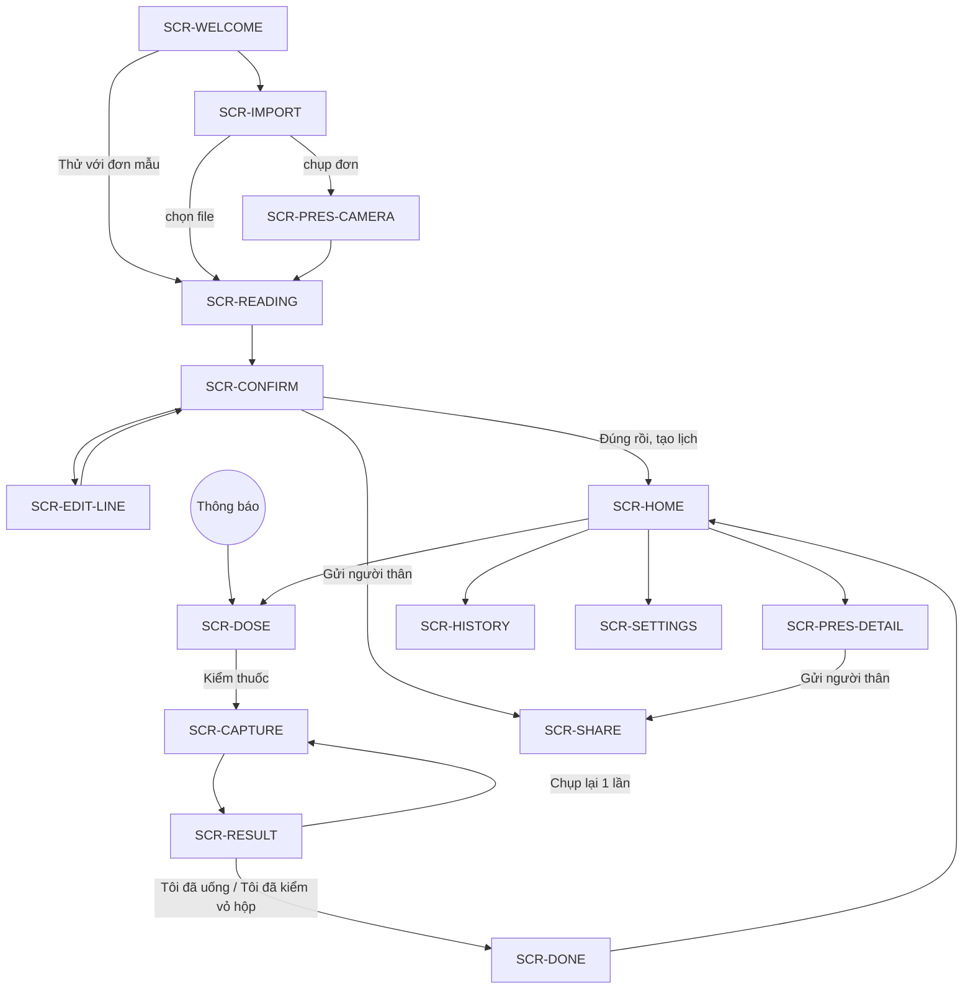

# Đặc tả UI/UX

> **Trả lời câu hỏi:** mỗi màn hình có gì, nói câu gì, trông thế nào, xử lý trạng thái nào.
> Yêu cầu gốc: [prd.md](prd.md). Luồng: [use-cases.md](use-cases.md). Sơ đồ luồng người dùng: [../diagrams/07_luong_nguoi_dung.png](../diagrams/07_luong_nguoi_dung.png).
> Cập nhật: 2026-11-15 · Trạng thái: **đã chốt** (chưa có bản vẽ Figma; wireframe dạng chữ ở mục 4)

## 1. Persona và nguyên tắc

**Bác Lan, 68 tuổi:** tăng huyết áp, đục thủy tinh thể nhẹ, tay hơi run. Dùng được Zalo và gọi video, nhưng không rành cài đặt. Mỗi ngày 2 cữ, mỗi cữ 2–4 viên. Sợ "bấm nhầm làm hỏng máy".

| # | Nguyên tắc | Cách kiểm |
|---|---|---|
| P1 | Một màn hình – một việc – **một nút chính** | Mỗi màn chỉ có 1 nút kiểu `primary` |
| P2 | Kết quả nói trước bằng **một câu**, chi tiết để sau | Câu `summary` hiện trên cùng và được đọc ngay |
| P3 | Không dựa vào màu đơn thuần: **màu + biểu tượng + kiểu nét + giọng nói** | Ảnh chụp màn hình đen trắng vẫn phân biệt được trạng thái |
| P4 | Không chắc thì nói thẳng và đưa lối thoát ("hãy kiểm vỏ hộp") | Mọi trạng thái lỗi có ít nhất 1 lối đi tiếp |
| P5 | Không bắt gõ phím: sửa bằng **chọn** | Không có ô nhập chữ ngoài ô tìm tên thuốc và địa chỉ server |
| P6 | Phòng ngừa trước, kiểm tra sau | Màn "Cữ cần uống" có trước màn chụp |
| P7 | "Khớp với đơn", không bao giờ "an toàn để uống" | Rà toàn bộ chuỗi chữ |
| P8 | Báo xanh nhầm là lỗi nguy hiểm nhất; vàng là an toàn | Không có đường nào tạo xanh ngoài `status = green` từ server (BR-01) |

## 2. Hệ thống thiết kế (design tokens)

| Token | Giá trị | Ghi chú |
|---|---|---|
| `font.body` | 20 sp, đậm vừa | Tối thiểu cho mọi chữ người dùng phải đọc |
| `font.title` | 28 sp, đậm | Tiêu đề màn, câu kết quả |
| `font.huge` | 34 sp, đậm | Số viên, tên cữ trên màn Cữ cần uống |
| `touch.min` | 48 × 48 dp | Mọi vùng chạm |
| `button.primary` | cao 64 dp, rộng toàn màn trừ lề 16 dp, chữ 22 sp | 1 nút mỗi màn |
| `button.secondary` | cao 56 dp, viền | |
| `color.bg` / `color.text` | `#FFFFFF` / `#111111` | Tương phản ~18 : 1 |
| `color.primary` | `#0B57D0` | Chữ trắng trên nền này ≥ 4,5 : 1 |
| `status.green` | `#1B7F3B` + ✓ + nét liền 4 dp | |
| `status.yellow` | `#B26A00` + ? + nét đứt 4 dp | Chữ đậm trên nền vàng nhạt `#FFF4D6` |
| `status.red` | `#B3261E` + ✗ + nét dày 6 dp | |
| `spacing` | 8 / 16 / 24 dp | Lề màn hình 16 dp |

- Theme sáng là mặc định. Chế độ tối để giai đoạn 2.
- Tôn trọng cỡ chữ hệ thống (`textScaler`) đến 1,5 lần mà không vỡ bố cục.
- Không dùng animation quan trọng; mọi thông tin có cả chữ.

## 3. Bản đồ màn hình



Điều hướng: không có thanh tab. SCR-HOME là gốc; mỗi màn có nút "Quay lại" chữ to ở góc trên trái, và nút 🔊 "Nghe lại" ở góc trên phải.

## 4. Đặc tả từng màn

### SCR-WELCOME – Lần đầu mở app
- **Nội dung:** tên app, câu "Kiểm thuốc của bác có khớp với đơn không", cảnh báo "App hỗ trợ đối chiếu với đơn, không thay thế dược sĩ" (FR-SET-03).
- **Nút chính:** "Chọn đơn thuốc" → SCR-IMPORT. **Nút phụ:** "Thử với đơn mẫu" (UC-11).
- **Giọng nói:** đọc câu giới thiệu và tên hai nút.

### SCR-IMPORT – Chọn nguồn đơn
- **Nút chính:** "Chọn ảnh hoặc PDF đơn" (mở bộ chọn file). **Nút phụ:** "Chụp đơn giấy".

### SCR-PRES-CAMERA – Chụp đơn giấy
- Lần đầu: "Đặt đơn lên mặt bàn, giữ máy ngang phía trên đơn. Bấm nút tròn lớn khi đơn nằm gọn trong khung." + ảnh minh họa + "Tôi hiểu rồi".
- Nút chụp tròn 88 dp ở giữa dưới.

### SCR-READING – Đang đọc đơn
- Vòng chờ + "Đang đọc đơn, xin chờ khoảng 10 giây" (đọc to một lần). Không có nút nào ngoài "Hủy".
- **Lỗi:** xem UC-01 luồng lỗi; mỗi lỗi một câu + "Thử lại" (chính) + "Hủy".

### SCR-CONFIRM – Xác nhận đơn (bắt buộc)
- **Đầu màn:** "Đây là lịch app đọc được. Bác xem lại giúp." + ngày kê + "Bệnh: …" (nếu có).
- **Mỗi dòng một thẻ:**
  ```
  ┌─────────────────────────────────┐
  │ Panactol 500mg          SL: 10  │
  │ Sáng 1 viên · Tối 1 viên        │
  │ Uống sau khi ăn                 │
  │ [Sửa]                           │
  └─────────────────────────────────┘
  ```
  - `needs_review` → nền vàng nhạt, biểu tượng ?, câu "App chưa chắc dòng này, bác kiểm lại giúp".
  - `missing_schedule` → "Chưa có lịch" + nút "Chọn lịch" + "Để sau"; câu "Nhập theo lời dặn của bác sĩ hoặc dược sĩ".
  - `half_pill` → nhãn "Nửa viên – tự kiểm theo vỏ hộp".
  - `as_needed` → nhãn "Khi cần – không nhắc giờ".
  - `name = null` → nhãn "Chỉ nhắc lịch – app không kiểm được thuốc này bằng hình".
- **Đã có đơn đang dùng** (FR-PRES-11): khung vàng trên nút chính "Đơn cũ (kê ngày 03/11) sẽ kết thúc khi bác tạo lịch cho đơn này."
- **Nút chính:** "Đúng rồi, tạo lịch" (khóa khi còn dòng thiếu lịch chưa chọn "Để sau"). **Nút phụ:** "Hủy", "Gửi người thân" (Could) → SCR-SHARE.
- **Đọc to:** "Đơn có 3 thuốc. Panactol 500mg, sáng 1 viên, tối 1 viên, uống sau khi ăn. …"

### SCR-EDIT-LINE – Sửa một dòng
- Tên thuốc: danh sách chọn từ `catalog_name` có ô tìm; gợi ý đầu là tên OCR khớp gần nhất.
- Mỗi buổi (Sáng/Trưa/Chiều/Tối) một hàng: nút `−` số viên `+` (bước 1 viên; "½" là lựa chọn riêng), nút cao 56 dp.
- **Nút chính:** "Xong".

### SCR-HOME – Hôm nay
- Thẻ lớn **cữ tiếp theo**: "Cữ trưa · 11:30 · 2 viên" + nút chính "Uống cữ này".
- Danh sách 4 cữ trong ngày với trạng thái: ✓ đã uống 7:05 · ⏰ sắp tới · — không có thuốc · ! chưa uống.
- Nhắc "1 thuốc chưa có lịch" (nếu có) → SCR-PRES-DETAIL.
- Liên kết nhỏ: "Đơn thuốc", "Lịch sử", "Cài đặt".

### SCR-DOSE – Cữ sáng cần uống
- Tiêu đề `font.huge`: "Cữ sáng · 3 viên".
- Mỗi thuốc: ảnh mẫu (nếu có, ghi "ảnh minh họa"), tên chữ to, "× 2 viên", ghi chú ăn.
- Thuốc chỉ nhắc lịch / nửa viên: nhãn "Tự kiểm theo vỏ hộp".
- **Nút chính:** "Kiểm thuốc" (hoặc "Tôi đã kiểm vỏ hộp" nếu cữ không có thuốc chấm ảnh, FR-VER-04).
- Cữ đã uống: thay toàn bộ bằng "Cữ sáng đã uống lúc 7:05." (FR-LOG-03).
- Nút phụ "Đổi cữ" → 4 nút lớn Sáng/Trưa/Chiều/Tối.

### SCR-CAPTURE – Chụp thuốc
- Xem trước camera toàn màn, **khung chụp** vuông ~70% chiều rộng ở giữa, viền trắng dày.
- Câu trên cùng: "Xòe bàn tay ra, đặt thuốc lên lòng bàn tay, các viên rời nhau, rồi chụp."
- Lần chụp lại: "Chỉ để các viên còn thiếu trên tay: hoạt huyết dưỡng não × 1."
- Nút chụp tròn 88 dp. Nút phụ "Chọn ảnh có sẵn" (FR-VER-10): mở bộ chọn ảnh của hệ điều hành, gửi cả ảnh (không có khung). Chế độ đơn mẫu: thêm "Dùng ảnh thuốc mẫu".
- Lần đầu: hướng dẫn giọng nói + ảnh minh họa + "Bỏ qua".
- Sau khi chụp: màn chờ "Đang kiểm thuốc" (tối đa 20 giây).

### SCR-RESULT – Kết quả
- Trên cùng: biểu tượng lớn + câu `summary` (`font.title`), đọc ngay.
- Giữa: ảnh vừa chụp, khoanh từng viên theo `pills[].box`; chạm vào viên → đọc `message`.
- Dưới: danh sách `missing[]` ("Còn thiếu 1 viên …").
- Nút theo `status`:

| `status` | Nút chính | Nút phụ |
|---|---|---|
| `green` | "Tôi đã uống" | – |
| `partial` | "Tôi đã kiểm vỏ hộp" | – |
| `not_green`, còn lượt | "Chụp lại" | "Tôi đã kiểm vỏ hộp" |
| `not_green`, hết lượt | "Tôi đã kiểm vỏ hộp" | – |
| lỗi kết nối | "Thử lại" | "Tôi đã kiểm vỏ hộp" |

### SCR-DONE – Đã ghi nhận
- "Đã ghi nhận cữ sáng lúc 7:05." + nút "Về màn chính". Tự về SCR-HOME sau 5 giây.

### SCR-SHARE – Gửi người thân (FR-PRES-09)
- **Bước 1, hộp xác nhận:** "Ảnh đơn có họ tên và số BHYT của bác. Chỉ gửi cho người thân tin cậy." Nút chính "Gửi", nút phụ "Hủy".
- **Bước 2:** app vẽ **ảnh phiếu đơn** (PNG, rộng 1080 px, nền trắng, chữ đen) bằng `RepaintBoundary`, rồi mở bảng chia sẻ với: ảnh đơn gốc (hoặc file PDF), ảnh phiếu, và bản chữ.
- **Bố cục ảnh phiếu:**
  ```
  ┌──────────────────────────────────────────────────────────┐
  │ PHIẾU ĐƠN APP ĐỌC ĐƯỢC                (chữ 44 px, đậm)   │
  │ Đơn kê ngày 03/11/2026 · Bệnh: Tăng huyết áp             │
  │ Nhờ người nhà so với ẢNH ĐƠN GỐC gửi kèm.                │
  ├────┬────────────────────┬────┬─────┬─────┬──────┬─────┬──────────────┤
  │ STT│ Tên thuốc          │ SL │ Sáng│ Trưa│ Chiều│ Tối │ Ghi chú      │
  ├────┼────────────────────┼────┼─────┼─────┼──────┼─────┼──────────────┤
  │ 1  │ Panactol 500mg     │ 10 │  1  │  –  │  –   │  1  │ Sau ăn       │
  │ 2  │ Amlodipin 5mg  ★   │ 14 │ 1/2 │  –  │  –   │  –  │ Nửa viên     │
  │ 3  │ Vitamin C      ⚠   │ 20 │  ?  │  ?  │  ?   │  ?  │ Chưa có lịch │
  └────┴────────────────────┴────┴─────┴─────┴──────┴─────┴──────────────┘
  │ Chú thích: số = số viên mỗi lần · ½ = nửa viên · – = không uống
  │ ★ app chỉ nhắc, không kiểm bằng hình · ⚠ chưa có lịch, cần hỏi bác sĩ
  │ App hỗ trợ đối chiếu với đơn, không thay thế dược sĩ. · MediCheck
  └──────────────────────────────────────────────────────────┘
  ```
  - Chữ trong bảng ≥ 32 px trên ảnh 1080 px (đọc được trên điện thoại người nhận); hàng xen kẽ nền xám rất nhạt; tên thuốc dài thì xuống dòng, không cắt.
  - Tên thuốc: `matched_name` nếu có, nếu không dùng `raw_name`; dòng `edited_by_user` thêm "(bác đã sửa)".
  - Không in họ tên, số BHYT (app không có các trường này).
- **Bản chữ** (cùng nội dung, mỗi thuốc một dòng): "1. Panactol 500mg – SL 10 – Sáng 1, Tối 1 – Sau ăn".

### SCR-PRES-DETAIL, SCR-HISTORY, SCR-SETTINGS
- **Chi tiết đơn:** nhãn "Đang dùng" hoặc "Đã kết thúc", ngày kê, "Bệnh: …", danh sách dòng như SCR-CONFIRM (đơn đang dùng sửa được, đơn đã kết thúc chỉ xem). Nút "Gửi người thân" → SCR-SHARE; "Kết thúc đơn" (FR-PRES-12) và "Xóa đơn", cả hai xác nhận 2 bước. Danh sách "Đơn thuốc" từ SCR-HOME: đơn đang dùng trên cùng, đơn đã kết thúc bên dưới.
- **Lịch sử:** 7 ngày, mỗi ngày 4 ô cữ; ✓ app xác nhận · ☑ tự kiểm vỏ hộp · ! chưa uống.
- **Cài đặt:** giờ 4 buổi, giọng nói bật/tắt, địa chỉ server + "Kiểm tra kết nối", cảnh báo không thay thế dược sĩ, phiên bản mô hình.

## 5. Câu chữ chuẩn

Câu kiểm thuốc lấy nguyên từ server (`summary`, `message`; OQ-05). Các câu do app sở hữu:

| Mã | Khi nào | Câu |
|---|---|---|
| MSG-REMIND | Thông báo nhắc | "Đến giờ uống thuốc {buổi}, {n} viên." |
| MSG-TAKEN-ALREADY | Mở cữ đã uống | "Cữ {buổi} đã uống lúc {giờ}." |
| MSG-TAKEN-OK | Sau "Tôi đã uống" | "Đã ghi nhận cữ {buổi} lúc {giờ}." |
| MSG-READING | Đang đọc đơn | "Đang đọc đơn, xin chờ khoảng 10 giây." |
| MSG-CHECKING | Đang kiểm thuốc | "Đang kiểm thuốc." |
| MSG-NO-SERVER | Lỗi mạng/timeout | "Chưa kết nối được máy kiểm thuốc. Bác thử lại, hoặc tự kiểm theo vỏ hộp." |
| MSG-BOX-CHECK | Vào bước tự kiểm | "Hãy đối chiếu tên trên vỏ hộp với đơn." |
| MSG-NOT-CHECKABLE | Cữ không có thuốc chấm ảnh | "Thuốc của cữ này app chưa kiểm được bằng hình, hãy kiểm theo vỏ hộp." |
| MSG-DISCLAIMER | Chào mừng, cài đặt, phiếu đơn | "App hỗ trợ đối chiếu với đơn, không thay thế dược sĩ." |
| MSG-REPLACE-PRES | Lưu đơn mới khi có đơn đang dùng | "Đơn cũ (kê ngày {ngày}) sẽ kết thúc khi bác tạo lịch cho đơn này." |
| MSG-SHARE-WARN | Trước khi gửi người thân | "Ảnh đơn có họ tên và số BHYT của bác. Chỉ gửi cho người thân tin cậy." |

Từ cấm: "an toàn", "chắc chắn đúng", "có thể là thuốc …", tên màu của viên ("viên màu trắng").

## 6. Trạng thái chung

| Trạng thái | Cách hiện |
|---|---|
| Đang tải | Vòng chờ + câu nói; chặn bấm lặp |
| Mất mạng khi cần server | MSG-NO-SERVER + "Thử lại" + lối thoát tự kiểm |
| Danh sách rỗng | Một câu + nút hành động (ví dụ "Chưa có đơn nào" + "Chọn đơn thuốc") |
| Quyền camera/thông báo bị từ chối | Câu giải thích lý do + nút "Mở cài đặt" |

## 7. Checklist tiếp cận (mỗi màn phải đạt)

- [ ] Chữ ≥ 20 sp; ở cỡ chữ hệ thống 1,5× không bị cắt.
- [ ] Vùng chạm ≥ 48 dp; nút chính ≥ 64 dp cao.
- [ ] Tương phản chữ ≥ 4,5 : 1.
- [ ] Trạng thái phân biệt được khi không nhìn màu (biểu tượng + nét + chữ).
- [ ] Có nút 🔊 nghe lại; câu quan trọng được đọc tự động khi bật giọng nói.
- [ ] Mỗi widget tương tác có `Semantics` label tiếng Việt (TalkBack đọc được).
- [ ] Chỉ có 1 nút chính.
