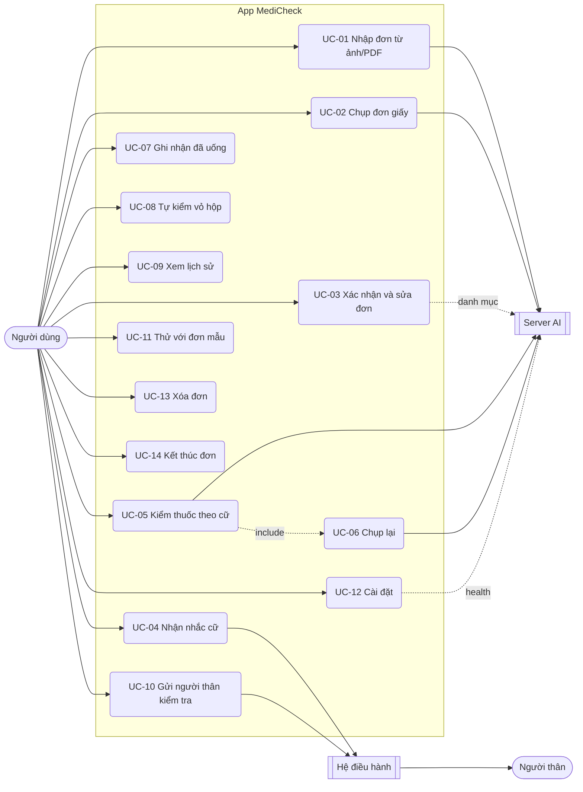

# Use case

> **Trả lời câu hỏi:** ai làm gì với hệ thống, theo trình tự nào, khi lỗi thì sao.
> Mỗi use case trỏ về yêu cầu trong [prd.md](prd.md) và màn hình trong [ui-ux-spec.md](ui-ux-spec.md).
> Cập nhật: 2026-11-15 · Trạng thái: **đã chốt**

## 1. Tác nhân

| Tác nhân | Mô tả |
|---|---|
| Người dùng | Người cao tuổi tự dùng app (persona bác Lan) |
| Người thân | Nhận bản tóm tắt đơn qua chia sẻ; không dùng app |
| Server AI | FastAPI trên laptop: đọc đơn, kiểm thuốc, trả danh mục |
| Hệ điều hành | Thông báo theo giờ, camera, bảng chia sẻ, giọng nói (TTS) |

## 2. Sơ đồ tổng quát

## 3. Danh sách

| Mã | Tên | Ưu tiên | Yêu cầu | Màn hình |
|---|---|---|---|---|
| UC-01 | Nhập đơn từ ảnh/PDF | Must | FR-PRES-01, 03 | SCR-IMPORT, SCR-READING |
| UC-02 | Chụp đơn giấy | Should | FR-PRES-02 | SCR-IMPORT, SCR-PRES-CAMERA |
| UC-03 | Xác nhận và sửa đơn | Must | FR-PRES-04 … 08, 11, FR-SCH-01 … 03 | SCR-CONFIRM, SCR-EDIT-LINE |
| UC-04 | Nhận nhắc cữ | Must | FR-REM-01 … 03, FR-DOSE-01 | Thông báo, SCR-DOSE |
| UC-05 | Kiểm thuốc theo cữ | Must | FR-DOSE-03, FR-VER-01 … 09, 11 | SCR-DOSE, SCR-CAPTURE, SCR-RESULT |
| UC-06 | Chụp lại | Must | FR-VER-07 | SCR-RESULT, SCR-CAPTURE |
| UC-07 | Ghi nhận đã uống | Must | FR-LOG-01, 03 | SCR-RESULT, SCR-DOSE |
| UC-08 | Tự kiểm vỏ hộp | Must | FR-LOG-02, FR-VER-04, 08 | SCR-RESULT, SCR-DOSE |
| UC-09 | Xem lịch sử | Should | FR-LOG-04 | SCR-HISTORY |
| UC-10 | Gửi người thân kiểm tra | Could | FR-PRES-09 | SCR-CONFIRM, SCR-PRES-DETAIL, SCR-SHARE |
| UC-11 | Thử với đơn mẫu | Must | FR-ONB-01, FR-DEMO-01 | SCR-WELCOME |
| UC-12 | Cài đặt | Must | FR-SET-01 … 03, FR-REM-04 | SCR-SETTINGS |
| UC-13 | Xóa đơn | Must | FR-PRES-10 | SCR-PRES-DETAIL |
| UC-14 | Kết thúc đơn | Should | FR-PRES-12 | SCR-PRES-DETAIL |

## 4. Đặc tả chi tiết

### UC-01 Nhập đơn từ ảnh/PDF

- **Tiền điều kiện:** app đã cấu hình địa chỉ server.
- **Kích hoạt:** người dùng bấm "Chọn đơn thuốc".
- **Luồng chính:**
  1. App mở bộ chọn file (ảnh PNG/JPEG hoặc PDF).
  2. Người dùng chọn file.
  3. App hiện SCR-READING, đọc "Đang đọc đơn, xin chờ khoảng 10 giây", gửi `POST /v1/prescriptions/parse`.
  4. Server trả `ParseResponse`.
  5. App chuyển sang UC-03 với kết quả (chưa lưu gì vào database).
- **Luồng lỗi:**
  - 3a. Quá 30 giây hoặc mất kết nối → "Chưa đọc được đơn. Kiểm tra kết nối rồi thử lại", nút "Thử lại", "Hủy".
  - 4a. Server trả 400 → "File này không đọc được. Hãy chọn ảnh đơn khác".
  - 4b. `lines` rỗng → "Không tìm thấy dòng thuốc nào trong ảnh. Hãy chọn đúng ảnh đơn thuốc".
- **Hậu điều kiện:** có bản nháp đơn trong bộ nhớ, chờ xác nhận.

### UC-03 Xác nhận và sửa đơn

- **Tiền điều kiện:** có bản nháp từ UC-01, UC-02 hoặc UC-11.
- **Luồng chính:**
  1. App hiện mỗi dòng thuốc một thẻ chữ to; dòng `needs_review` hoặc `missing_schedule` tô nổi.
  2. App đọc to tóm tắt lịch (nếu bật giọng nói).
  3. Người dùng bấm vào dòng tô nổi → SCR-EDIT-LINE → chọn tên từ danh mục, chọn buổi và số viên → "Xong".
  4. Khi không còn dòng bị khóa, người dùng bấm "Đúng rồi, tạo lịch".
  5. App chép file đơn vào thư mục riêng của app (ADR-016); trong một transaction: chuyển đơn đang dùng cũ (nếu có) sang `ended`, lưu `prescription`, `drug_line`, `dose_schedule`; rồi hủy nhắc của đơn cũ và lên lịch nhắc mới (BR-12).
  6. App đọc "Đã tạo lịch. Cữ tiếp theo: tối, 2 viên."
- **Luồng phụ:**
  - 3a. Dòng thiếu lịch, người dùng chọn "Để sau" → dòng lưu với `dose_type = missing_schedule`, không có nhắc; Màn Hôm nay hiện nhắc "1 thuốc chưa có lịch".
  - 3b. Người dùng chọn tên không có trong danh mục → dòng thành "chỉ nhắc lịch" (`check_mode = reminder_only`).
  - 4a. Người dùng bấm "Hủy" → bỏ bản nháp, không lưu gì; đơn đang dùng cũ giữ nguyên.
  - 4b. Đã có đơn đang dùng → trước bước 4 app hiện và đọc MSG-REPLACE-PRES.
- **Quy tắc:** BR-02, BR-03, BR-04, BR-05, BR-06, BR-09, BR-12.

### UC-04 Nhận nhắc cữ

- **Kích hoạt:** đến giờ của một buổi có thuốc.
- **Luồng chính:**
  1. Hệ điều hành hiện thông báo "Đến giờ uống thuốc sáng, 3 viên.".
  2. Người dùng chạm thông báo → app mở SCR-DOSE của cữ đó và đọc to.
- **Luồng phụ:**
  - 1a. 15 phút sau chưa có "Tôi đã uống" → nhắc lại, tối đa 2 lần.
  - 2a. Cữ đã uống → app đọc "Cữ sáng đã uống lúc 7:05." (FR-LOG-03).

### UC-05 Kiểm thuốc theo cữ

- **Tiền điều kiện:** cữ hiện tại có ít nhất một dòng chấm ảnh; cữ chưa được ghi nhận đã uống.
- **Luồng chính:**
  1. Từ SCR-DOSE, người dùng bấm "Kiểm thuốc".
  2. SCR-CAPTURE hiện khung chụp và câu hướng dẫn; người dùng chụp.
  3. App chuẩn bị ảnh (EXIF, 2048 px, JPEG q85), dựng `payload` (FR-VER-03), gửi `POST /v1/pills/verify`.
  4. App hiện SCR-RESULT: đọc `summary`, khoanh từng viên, và danh sách "Thuốc theo kết quả" với ảnh viên cắt từ ảnh vừa chụp (FR-VER-11; chỉ ở bộ nhớ).
  5. Nếu `status = green` → nút "Tôi đã uống" (UC-07).
- **Luồng phụ:**
  - 2a. Người dùng bấm "Chọn ảnh có sẵn" thay vì chụp → chọn ảnh trong thư viện, đi tiếp từ bước 3 với `frame = null` (FR-VER-10).
  - 1a. Cữ không có dòng chấm ảnh → bỏ bước 2–4, đi thẳng UC-08 (FR-VER-04).
  - 4a. `status = partial` → hiện "Tôi đã kiểm vỏ hộp" cho phần chưa chấm được (UC-08).
  - 4b. `status = not_green` và còn lượt chụp lại → UC-06.
  - 4c. `n_detected = 0` → đọc `summary` ("Không thấy viên thuốc nào…"), cho chụp lại, không tính là lượt chụp lại.
- **Luồng lỗi:** 3a. Mất kết nối/timeout/lỗi server → FR-VER-08; không bao giờ báo xanh.
- **Hậu điều kiện:** lưu `verification_attempt` và các `verification_item` (không lưu ảnh).

### UC-06 Chụp lại

- **Tiền điều kiện:** lần kiểm đầu tiên của cữ trả `not_green`.
- **Luồng chính:**
  1. App khoanh trên ảnh vừa chụp: viên đỏ "Bỏ viên này ra", viên xanh "Viên này đúng, để riêng ra".
  2. App chỉ yêu cầu các viên của dòng còn thiếu hoặc chưa xanh; người dùng chụp lại.
  3. App gửi `session_lines` = các dòng chưa đủ, `count` = số viên còn lại.
  4. Gộp kết quả: viên đã xanh ở lần 1 giữ xanh; nếu lần 2 xanh cho mọi viên còn lại thì cữ xanh.
- **Luồng phụ:** 4a. Lần 2 vẫn chưa xanh → chỉ còn "Tôi đã kiểm vỏ hộp" (BR-08).

### UC-07 Ghi nhận đã uống

- **Kích hoạt:** người dùng bấm "Tôi đã uống" sau khi cữ xanh.
- **Luồng chính:** app ghi `dose_event.status = taken`, `confirm_type = app_verified`, `taken_at = bây giờ`; hủy các nhắc lại; đọc "Đã ghi nhận cữ sáng lúc 7:05".

### UC-08 Tự kiểm vỏ hộp

- **Kích hoạt:** cữ không xanh sau tối đa 1 lần chụp lại, cữ không chấm được, hoặc lỗi kết nối.
- **Luồng chính:** app nói "Hãy đối chiếu tên trên vỏ hộp với đơn", hiện danh sách thuốc của cữ chữ to; người dùng bấm "Tôi đã kiểm vỏ hộp" → ghi `taken`, `confirm_type = self_confirmed`.

### UC-11 Thử với đơn mẫu

- **Luồng chính:**
  1. Từ SCR-WELCOME, người dùng chọn "Thử với đơn mẫu".
  2. App gửi ảnh đơn mẫu đóng gói sẵn tới server như UC-01, rồi vào UC-03.
  3. Ở SCR-CAPTURE, app có thêm nút "Dùng ảnh thuốc mẫu" để chọn ảnh mẫu thay vì chụp.
- **Ghi chú:** đơn mẫu là đơn đang hoạt động bình thường; xóa được như mọi đơn.

### UC-12 Cài đặt

- Đổi địa chỉ server, bấm "Kiểm tra kết nối" → `GET /health` → "Đã kết nối (final-2026-11-08)" hoặc "Chưa kết nối được".
- Đổi giờ từng buổi → lên lịch lại mọi nhắc. Bật/tắt giọng nói.

### UC-13 Xóa đơn

- Từ chi tiết đơn, bấm "Xóa đơn" → hộp xác nhận chữ to "Xóa đơn này và mọi lịch nhắc của nó?" → xóa đơn, dòng thuốc, lịch, file ảnh đơn; hủy nhắc. Lịch sử các cữ đã uống được giữ nhưng không còn tên thuốc của đơn đã xóa ([../architecture/erd.md](../architecture/erd.md) mục 2).

### UC-10 Gửi người thân kiểm tra

- **Kích hoạt:** "Gửi người thân" ở SCR-CONFIRM (bản nháp) hoặc SCR-PRES-DETAIL (đơn đã lưu).
- **Luồng chính:**
  1. App hiện và đọc MSG-SHARE-WARN; người dùng bấm "Gửi".
  2. App vẽ ảnh phiếu đơn theo SCR-SHARE từ các dòng hiện có (kể cả dòng vừa sửa trên bản nháp).
  3. App mở bảng chia sẻ với ảnh đơn gốc (file tạm của bản nháp, hoặc `image_path` của đơn đã lưu), ảnh phiếu và bản chữ.
- **Luồng phụ:** 3a. Đơn mẫu → ảnh đơn gốc là ảnh mẫu trong app. 3b. File ảnh đơn bị mất → chỉ gửi ảnh phiếu và bản chữ, báo "Không tìm thấy ảnh đơn gốc".
- **Hậu điều kiện:** không lưu ảnh phiếu (vẽ lại mỗi lần gửi).

UC-02, UC-09 làm theo cùng khuôn: UC-02 như UC-01 nhưng lấy ảnh từ camera; UC-09 chỉ đọc database.

### UC-14 Kết thúc đơn

- Từ chi tiết đơn đang dùng, bấm "Kết thúc đơn" → "Ngừng nhắc mọi thuốc của đơn này?" → đơn `ended`, hủy nhắc; đơn vẫn xem được và gửi người thân được. Đơn cũng tự kết thúc khi mọi dòng hết ngày (erd mục 3) hoặc khi lưu đơn mới (BR-12).
